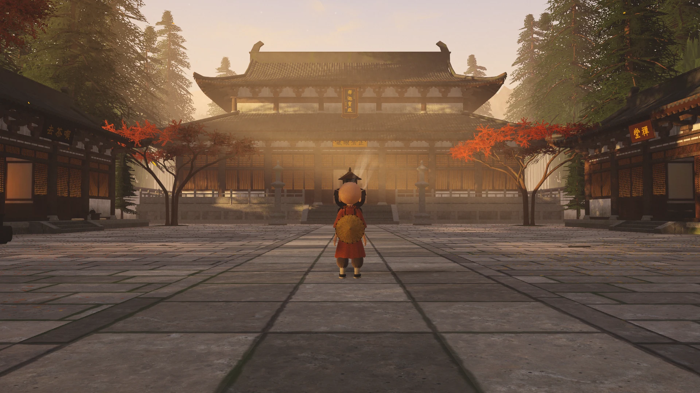
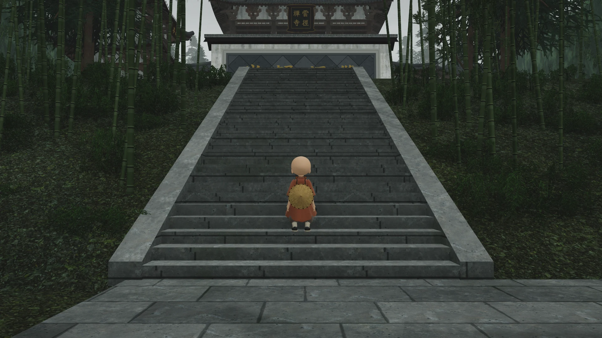
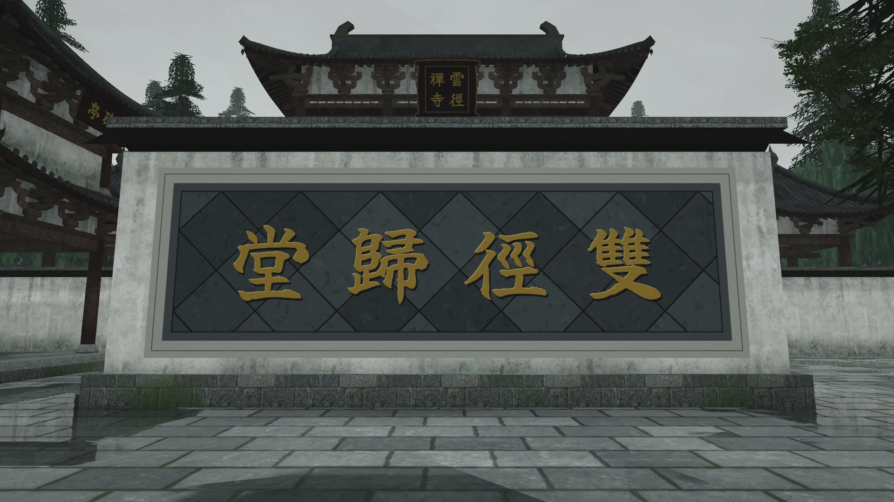
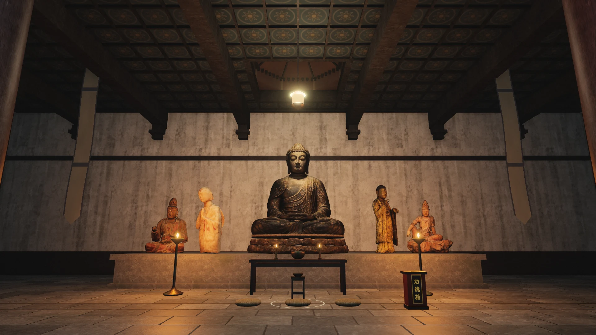
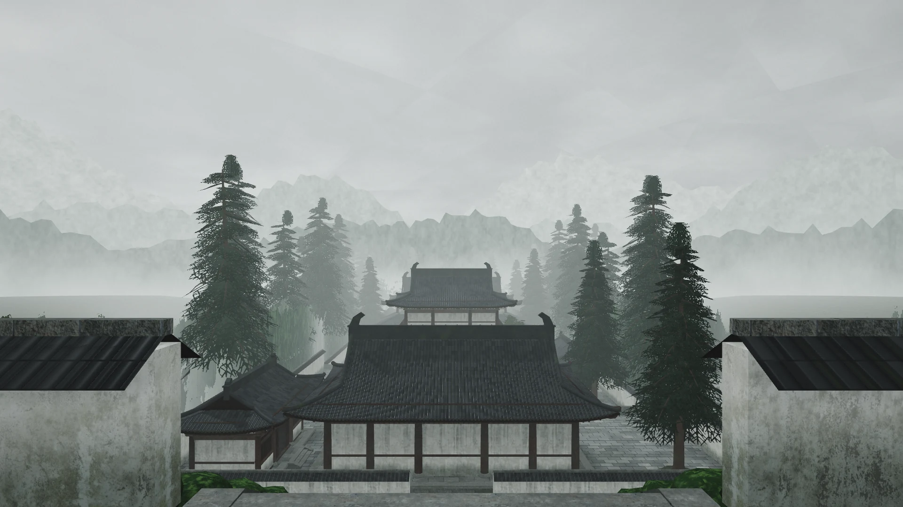
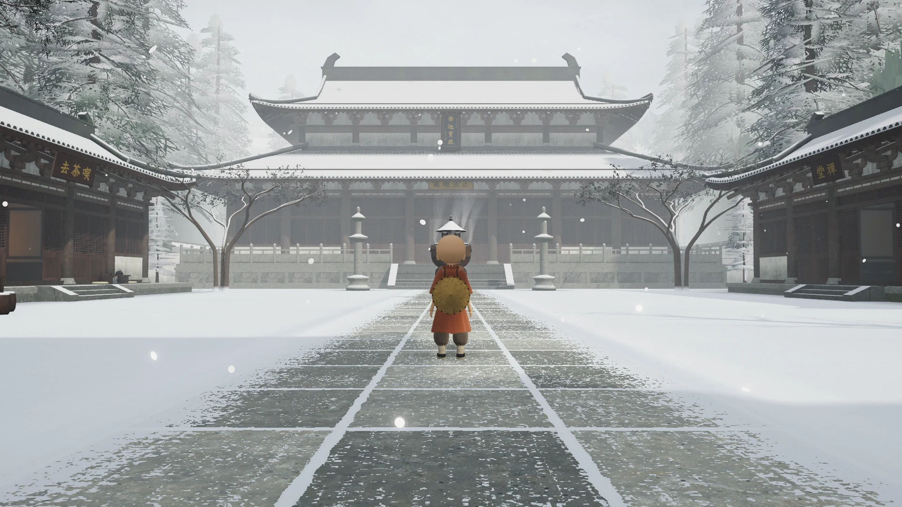

# 山门之外（temple-walk）

**一城一寺，一段值得慢下来的路。**



<sub>游戏里的真实画面（Tesla T4、高画质、1920×1080 截图），机位见下文「实机截图」。</sub>

《山门之外》是一款在浏览器中行走、停留与观看的寺院探索游戏。我们从真实寺院的文化背景、艺术与空间出发，创作有地方气质的数字寺院：让玩家穿过一段竹径、发现转角后的塔、听见院落里的声响，也在轻互动中理解一处地方。

选题优先寻找小众、有特色、值得细看的寺院；地域分布帮助拓宽视野，空间辨识度和文化内容决定是否入选。少量知名寺院也可以因容易被忽略的艺术细节进入研究名单。每一关保留一条可完成的路线和几个值得停留的瞬间，逐步连接不同地方的建筑、艺术与生活。

调研档案区分可核实的事实、仍待核证的说法与原创取舍。场景使用虚构名称，并重新设计具体布局和表达；真实原型作为研究依据，素材仍逐项核对来源与使用权。更名本身不代表取得授权。

当前开发场景是 **T00「云径禅寺」**，取意于杭州径山寺，以原创意境呈现。**《山门之外》是游戏名，`temple-walk` 是仓库标识，「云径禅寺」是T00场景名**；T00由现有开发工作继续推进，其余关卡处于调研与概念阶段。

仓库现已公开，用于协作开发。**公开可见不等于所有代码与素材已获得统一开源或再分发许可**；许可状态见下文。

- [体验原型（正式站）](https://temple.rushiwowen.co/)
- [T00 研究、进度与独立验收](https://temple-atlas-research.floralpage64.chatgpt.site/#temple/T00)
- [T01 宝通寺研究与开发准备](docs/T01-BAOTONG.md)：案头补证、白盒与观察玩法提案、资产顺序、现场采集清单；当前尚无 T01 游戏实现。
- [T01 开工前的引擎评估](docs/T01-ENGINE.md)：对照 T00 提交记录和 three.js、Godot、Unity 的公开文档。结论仍是不换；包体和帧耗未经本项目实测。
- [Claude / Fable 读取入口 llms.txt](https://temple-atlas-research.floralpage64.chatgpt.site/llms.txt)
- [开发交接与验收包](https://temple-atlas-research.floralpage64.chatgpt.site/handoff/T00-handoff-v001.zip)
- [开发方按交接包提交的 T00 交付物](docs/t00/README.md)：启动说明、基线、机位、评审记录、已知问题、验收自报与证据

## 实机截图

全部是 Tesla T4 真显卡上用 `tools/gpu-render.sh` 出的游戏画面（高画质，1920×1080），不是生成图，也没有后期修饰。T4 运行 `20261120-002113`，构建自提交 `c38edbe`。想重出，用 `tools/shots.js` 的机位名（殿内一张见表）；季节和时辰写在 `@` 后。

| 画面 | 机位 | 重出 |
|---|---|---|
|  | 竹径石阶，夏·昼，第三人称 | `node tools/shots.js stair@summer-day@third` |
|  | 照壁「雙徑歸堂」，夏·昼，交接包固定机位 cam03 | `node tools/shots.js cam03@summer-day` |
|  | 大殿内佛像，夏·昼，第一人称 | `node tools/inside.cjs tools/out/hall-views --views t00`（`main-altar`） |
|  | 山顶回望，夏·昼 | `node tools/shots.js lookback@summer-day` |
|  | 首院，冬·昼，第三人称 | `node tools/shots.js court@winter-day@third` |

首屏一张是 `court@autumn-dusk@third`。`tools/shots.js` 在本机用软件渲染，画面内容相同，细节和帧率以 T4 或真机为准。

## 当前实现

`app/` 已有一座可行走的山寺：从竹林出发，经照壁、山门、院落与多级台地，到达山顶。代码中的路线长度约 250 米，是场景设计尺度，不是实地测绘结果。调研依据与创作取舍见 [docs/JINGSHAN.md](docs/JINGSHAN.md)。

1. **竹径**：望江亭、三段折线石阶、洗砚池与半山亭。
2. **照壁和山门**：「双径归堂」照壁、重阁山门、两侧钟鼓空间、柳杉与碑亭。
3. **主院**：禅堂、茶寮、茶桌、铁香炉与大雄宝殿。
4. **台地**：藏经楼、药师殿、龙井、观音殿与大慧院。
5. **茶垄与山顶**：茶园石阶、凌霄阁和回望机位。

已有的游戏功能：

- 小沙弥第一／第三视角切换；第一视角眼高为 **1.3 米**，是儿童视角设计。
- WASD、鼠标环顾、点地行走与移动端虚拟摇杆。
- 靠近无栏矮台前沿并面向外侧时，按Space或点「下台阶」完成一次受限下跳；落差最多1.5米，保留栏杆和高处边界。
- 八座可进入的 3D 殿堂；室内画框的剧情内容仍待补充。
- 撞钟、上香、吃茶、请一句话、观水、燃灯、静坐七处轻互动及朱印帐。
- 四季 × 晨昼暮夜，共 16 种预设，包含植被、天气氛围和灯火变化。
- 拍照画幅、焦段、对焦、沙弥入画／合掌及分享卡片。
- 按情境出现并淡出的提示；按 `H` 查看键位，鼠标移动时恢复侧边控件。
- 材质、阴影、局部倒影、画质分档与自动降级。

建筑、植被、人物、部分器物和声音主要由代码生成；扫描贴图、字体及佛像模型另有来源，不能将整个项目视为纯原创资产。声音需首次用户交互后启用。

## 运行

页面是 ES 模块，由 Vite 开发和构建（2026-11-15 起）；Three.js r186 是 pnpm 依赖，不放在 Git 里。需要 Node.js 22+ 和 pnpm 10，先在仓库根目录执行一次

```sh
pnpm install   # 装依赖，并运行 tools/setup.mjs：把 Basis 转码器拷进 app/vendor/basis/，并校验 app/shared/models/ 里的佛像文件
```

之后从仓库根目录运行：

```sh
pnpm dev         # Vite 开发服务器，改代码即时生效
pnpm build       # 构建到 dist/，即发布到 GitHub Pages 的站点；测试和出图工具打开的也是它
pnpm preview     # 在本机看构建结果
pnpm typecheck   # TypeScript（checkJs）检查 app/ 下全部模块，three.js 用 @types/three 的类型
```

打开 `http://127.0.0.1:8000/`。默认只绑定本机；不要把开发工具服务器暴露到公网或不可信网络。

桌面常用操作：

| 按键／输入 | 操作 |
|---|---|
| WASD／方向键 | 行走 |
| Shift | 快步 |
| 按住鼠标拖动 | 环顾；单击地面走到那里，单击钟或鼓敲响 |
| Space | 跳；在无栏矮台前沿面向外侧时下台阶 |
| Esc | 关闭最上层的面板；没有面板时打开歇脚菜单 |
| E | 执行当前提示的互动 |
| V | 切换第一／第三视角 |
| B | 朱印帐 |
| P | 拍照模式 |
| T | 季节与时辰 |
| H | 查看键位 |

触屏：左下拇指摇杆行走，右下的圆环跳跃（台沿前读作「下台阶」或「上台」），拖动环顾，双指拉近拉远，点地面走到那里。「锁定鼠标」在歇脚菜单里，默认关闭。具体可用操作以游戏提示为准。

## 测试与截图

测试与截图工具需要 **Node.js 22+、pnpm、Playwright 和 Chromium**。Playwright 已是开发依赖，`pnpm install` 之后只需再取一次浏览器：

```sh
pnpm exec playwright install chromium
# Linux CI 如缺系统库，可使用：pnpm exec playwright install --with-deps chromium
```

```sh
pnpm run check       # 脚本解析及着色器片段检查
pnpm test            # 单元测试：平面、建筑、路线、季节和朱印逻辑
pnpm run e2e:quick    # 启动档：页面、渲染、字体及基本控件
pnpm run e2e:smoke    # 更广的场景与控件检查
pnpm run e2e         # 完整端到端场景
pnpm run verify      # check + 单元测试 + smoke
node tools/shots.js court@autumn-dusk@third
```

截图与测试报告写入 `tools/out/`；运行时长受软件／硬件图形环境影响，不保证固定分钟数。默认无头测试使用软件渲染，其帧率不能代表 Mac 或手机性能。

调试参数：

- `?show=机位名`：使用 `app/src/site.js` 的命名机位。
- `?cam=x,z,朝向,俯仰`：指定取景位置与角度。
- `?season=summer&time=day&view=first`：固定季节、时辰和视角。
- `?q=low|medium|high`：锁定画质；不指定时自动选择并可降级。
- `?shot=1`：冻结时间、隐藏界面，用于截图。
- `?fast=1`：加速自动行走测试；不能据此宣称正常速度手动验收通过。
- `?in=<殿名>&cam=<房间坐标>`：直接开在殿内某个机位；`node tools/inside.cjs tools/out/hall-views --views [关卡]` 一次出该关卡登记的全部殿内机位（不写关卡时是 `t00`：八座殿各两张，陈设与屋顶），机位表在 `app/levels/<关卡>/hall-views.js`；写了没有机位表的关卡会直接报错并列出有表的关卡。
- `?devpose`：只在 `pnpm dev` 下生效。走动时把当前位置、朝向、视角、季节时辰和所在殿写回地址栏（替换，不增加历史），改代码整页刷新后回到原处；按 C 复制当前机位链接。发布包不含这段代码。
- `?debug`：只在 `pnpm dev` 下生效。右上角一块调试面板（lil-gui）：位置与命名机位、殿内机位、季节时辰、视角、锁定画质（重新载入）、帧率与面数、`__cost()`、`__census()`，关卡完成状态（朱印、下一处、这一趟），以及按部件和倒影、泛光、阴影的开关。按反引号键（`` ` ``）收起或展开。发布包不含这段代码。

真实 GPU 渲染工具见 `tools/gpu-render.sh`。运行 Hugging Face Jobs 需要自己的账号、权限与预算，可能产生费用；不是启动游戏的必要条件。

## 进度与验收边界

以下是 **2026-11-14 的固定版本记录**，不是对未来提交的自动认证：

| 证据版本 | 已验证内容 | 仍不能据此认定 |
|---|---|---|
| `035efc0` | 独立复跑 27 项解析、31 项单元测试及 quick 启动回归通过；quick 在软件图形环境耗时约 86 秒 | 完整路线 E2E、全部美术机位或目标设备性能通过 |
| `c5f69f4` | 9 张独立运行截图；加速自动路点去程与返程通过，附约 325 秒连续录像 | 新版已经全套通过，或正常速度手动真机验收通过 |

独立验收目前**尚未通过完整交付标准**：植被自然度、材料变化与雾中层次仍需改进；Mac／手机的目标设备长采样与 p95 帧耗时尚待提交。历史 T4 测量见开发记录，不能直接换算为手机表现。

[独立验收 JSON](https://temple-atlas-research.floralpage64.chatgpt.site/t00-audit.json) 包含截图、录像、版本及逐项结论。生成概念图、历史运行截图、源码实现与目标设备测试是不同证据；不要互相替代。

## 协作方式

欢迎通过 Issue 讨论问题，通过分支或 fork 提交 PR。公开仓库不自动给予所有人写权限；需要直接写权限的协作者由维护者单独邀请。

开始前阅读：

- [docs/HANDOFF.md](docs/HANDOFF.md)：开发交接与历史记录。
- [docs/ART-SPEC.md](docs/ART-SPEC.md)：美术规范与实现对照。
- [docs/JINGSHAN.md](docs/JINGSHAN.md)：原型调研及取舍。
- [docs/VISION-AND-RESEARCH.md](docs/VISION-AND-RESEARCH.md)：项目定位。
- [T00 Goal、参考图与验收文件索引](https://temple-atlas-research.floralpage64.chatgpt.site/llms.txt)：交给 Claude／Fable 时，按读取顺序实际打开图片，并核对仓库 HEAD。

提交改动时，请说明问题、修改范围和验证结果。画面改动附相同机位、季节、时辰、画质、尺寸和视角的运行截图；性能改动附设备、运行时、原始数据和测量方式。记录截图对应的提交，不把参考效果图当作实机结果。

PR 有构建预览和自动检查，合并统一用 squash，规则见 [CONTRIBUTING.md](CONTRIBUTING.md) 与 [AGENTS.md](AGENTS.md)。分支保护等仓库设置以 GitHub 仓库设置页为准，这里不替它作证。

## 自动部署与发布

推送到 `main` 触发 [Pages 工作流](.github/workflows/pages.yml)：解析、类型检查、单元测试（旧、新两种 walker）、建站与 `boot`，以及走路与镜头的快检（`stairs`、`drop`）都通过后，只部署到 **canary 内测地址** <https://temple-walk-canary.bole-chen.workers.dev>（不被搜索引擎收录，不统计）。只改文档（`docs/`、`*.md`、`skills/`）的推送只跑文档相关检查，不构建、不部署。

**[正式站](https://temple.rushiwowen.co/)只从版本标签部署**：Release Please 发版时自动调用 [`deploy-tag.yml`](.github/workflows/deploy-tag.yml)。出了问题回滚，就在 Actions 里手动运行 `deploy-tag.yml`，选一个旧标签。每一步的细节以 [docs/RELEASING.md](docs/RELEASING.md) 为准。

较慢的场景（`edges` 等）在 [e2e 工作流](.github/workflows/e2e.yml) 里并行跑，每晚还跑一遍全部场景；实际结果以 [Actions](https://github.com/bolechen/temple-walk/actions) 中对应提交的记录为准，配置存在不等于每个提交都已跑过完整套件。

## 隐私与同修留痕

走过的人会在钟楼前看到一句淡淡的「当日已有 N 人在此敲钟」，大殿香炉的灰里也多几根别人留下的香梗（#340）。这是**匿名的计数**，没有实时同步，没有聊天，看不到任何人：服务器只存「日期 × 地点 × 次数」，不存 IP、设备、语言、账号或任何标识；每处每次访问只报一次；浏览器开着 Do Not Track 或 Global Privacy Control 时只读不报；离线或接口出错时页面什么都不显示。统计页面访问用的 Umami 是另一回事，见 [docs/t00/ANALYTICS.md](docs/t00/ANALYTICS.md)。

## 安全与素材许可

2026-11-14 对基线 `035efc0` 的完整可达历史 33 个提交及当前目录运行 Gitleaks v8.30.1，未检出规则命中的常见密钥。这是限定范围的扫描结果，不代表所有外部服务与依赖都已完成安全审计。不要提交 `.env`、账号令牌、私钥、云服务凭据或包含这些内容的日志。

测试／截图／GPU 作业工具的临时静态服务器曾有目录边界检查不足、无效 URL 编码异常及未限定监听地址的问题，已修复：路径在 `app/` 内解析并校验、无效编码返回 404、只监听 `127.0.0.1`；`tests/unit/serve.test.mjs` 对越界路径和坏编码有回归测试，`npm run serve` 也只绑定本机。影响只在开发工具服务器，与 GitHub Pages 静态托管无关。

许可须按资产分别处理：

- **项目代码**：暂不开源，保留所有权利（所有者 2026-11-15 决定）。仓库公开只为协作与查看，不构成使用、修改或再分发的许可。
- **佛像模型**：`app/shared/models/`，约 3.9 MB，是如是我闻 `/zen` 场景 CDN 上发布的原始文件（`tools/setup.mjs` 里记着地址和校验和）。它们仍留在 Git 里，因为那个 CDN 拒绝 GitHub 的构建机（403），发布不能依赖现取。所有者 2026-11-15 确认：模型归其所有，可随本项目分发；这不等于向第三方授予再使用的许可。
- **扫描贴图**：来源与生成方式见 [tools/textures.py](tools/textures.py)，当前记录为 Poly Haven CC0。
- **字体**：本地子集、来源及相关许可见 [tools/fonts.py](tools/fonts.py) 和 [app/shared/fonts/OFL.txt](app/shared/fonts/OFL.txt)。
- **Three.js 与扩展**：由 pnpm 管理（`three@0.186.0`，MIT），由 Vite 打进站点；只有 Basis 转码器在安装时拷到 `app/vendor/basis/`（Git 忽略），其 LICENSE 一并拷入。
- **参考图片与其他素材**：保留来源、作者、版本和用途记录；不能笼统由项目代码许可覆盖。
- **能否商用**：2026-11-16 按收费上架的口径逐件核对过，见 [docs/t00/LICENSING-AUDIT.md](docs/t00/LICENSING-AUDIT.md)（开发方对公开条款的整理，不是法律意见）；每件的结论在 `docs/t00/asset-register.csv` 的 `commercial_use` 一栏，`app/` 下新加的素材文件不登记，单元测试会失败。

删除当前文件不等于移除 Git 历史中的内容。若发现真实凭据，先撤销或轮换，再按影响范围处理历史；如发现安全漏洞，请避免在公开 Issue 中贴出凭据、个人数据或真实敏感文件内容。

## 代码结构

| 文件／目录 | 内容 |
|---|---|
| `app/index.html`、`app/yard.js` | 界面、场景组装、行走、相机、画质与转场 |
| `app/src/building.js`、`site.js`、`geo.js` | 参数化建筑、总平面、台阶、台地和碰撞 |
| `app/src/interior.js` | 八座可进入的 3D 房间及待补剧情画框 |
| `app/src/framing.js` | 殿内的柱网、梁架和天花：柱位取自殿外开间，平棊与藻井、平闇或彻上明造 |
| `app/src/materials.js`、`textures.js`、`ground.js` | 材质、扫描细节、铺地与局部倒影 |
| `app/src/bamboo.js`、`trees.js`、`backdrop.js` | 近景植被和远景环境 |
| `app/src/sky.js`、`mood.js`、`props.js`、`post.js`、`drift.js` | 天光、季节时辰、器物、后期和飘落物 |
| `app/src/monk.js`、`journey.js`、`game.js`、`hints.js` | 沙弥、朱印、交互与情境提示 |
| `app/src/card.js`、`goshuin.js`、`plaque.js`、`audio.js` | 分享卡片、印章、匾额与合成声音 |
| `app/levels/t00/` | 序章这一关自己的资源：`gallery/` 殿内真迹图片、`boards/` 匾额取字 |
| `app/shared/` | 各关共用的资源：`fonts/` 字体子集、`textures/` 扫描贴图、`models/` 佛像与莲座 |
| `app/vendor/basis/` | Basis 转码器（不入库，由 pnpm 安装后拷入） |
| `vite.config.mjs`、`tsconfig.json`、`dist/` | 构建与类型检查的设置；`dist/` 是构建结果，不入库 |
| `package.json`、`pnpm-lock.yaml`、`tools/setup.mjs` | 依赖与安装后的准备步骤 |
| `tools/`、`tests/` | 截图、GPU 渲染及测试工具 |
| `refs/`、`docs/` | 视觉参考、研究与开发记录；参考图不是测绘或验收证明 |

单位为米，北向为 `-Z`。具体相机和建筑参数以当前源码为准。

## 已知缺口与下一步

- 没有人用键鼠以正常速度走完一整趟并录像；目标设备（Mac、手机）的长采样与 p95 帧耗时尚未取得，T4 的数不能换算成手机：见 [docs/t00/KNOWN-ISSUES.md](docs/t00/KNOWN-ISSUES.md) 与 [验收自报](docs/t00/README.md)。
- 走路已全部改为走从绘制网格烘出来的地面（`?walker=old` 仍可回到旧的手写碰撞，观察期满后才删），进度和删除条件见 [docs/t00/refactor/collision-spike.md](docs/t00/refactor/collision-spike.md)。
- 日、英、韩译文是开发方初稿，未经母语者审读。
- 植被的重复感、近景材质和雾的层次仍在改，设想见 [docs/ART-SPEC.md](docs/ART-SPEC.md)。
- 其余待办在 [open issues](https://github.com/bolechen/temple-walk/issues) 里，当前交接见 [docs/HANDOFF.md](docs/HANDOFF.md)。

其他实现差距与参考见 [Saltline 对照](docs/SALTLINE-TEARDOWN.md) 和 [水彩表现对照](docs/WATERCOLOUR-TEARDOWN.md)。

## 设计参考

早期的美术方向用过一张生成的概念图：


<sub>这是生成的概念参考，不是游戏画面；游戏实际的样子以上面的实机截图为准。</sub>

## 可复用的独立评审 Skill

[评审流程与采用说明](docs/REVIEW-PROCESS.md) · [Skill规范](skills/temple-review/SKILL.md) · [自审与最佳实践依据](skills/temple-review/references/protocol.md)

```sh
python3 tools/install-review-skill.py --client both
```

Claude Code调用 `/temple-review`，Codex调用 `$temple-review`。其他项目可复制Skill或指定`--root`，并填写自己的仓库、授权范围和验收配置。安装器会保留有差异的本地版本，除非显式使用`--replace`。

评审锁定提交，按改动选检查，串行运行图形验证，区分实际用户操作与诊断hook；功能、视觉、性能与发布分别形成带证据的结论。历史截图保留原提交，修复后复测才能关闭问题。结构校验通过不代表美术或游戏整体通过。

图形验证确有需要时可以使用商业Hugging Face Jobs；创建前核对费率、额度与预算，限制时长和作业数量。PRO不是无限免费GPU，T4结果也不代替Mac或手机测试。纯文档更新无需启动GPU。

## 提交与合并规范

后续 PR 统一 **Squash and merge**；新提交、PR 标题及最终 squash 提交标题使用 **Conventional Commits**。示例：`feat(loading): 增加首屏加载进度`。详见 [CONTRIBUTING.md](CONTRIBUTING.md) 与 [代理协作规则](AGENTS.md)。

## 版本与发版

使用 [Release Please](.github/workflows/release-please.yml) 根据 Conventional Commits 维护版本PR、`CHANGELOG.md`、标签与GitHub Release，以 **0.1.0** 接入。当前版本见 [package.json](package.json)，操作与权限说明见 [发版流程](docs/RELEASING.md)。版本PR仍使用 squash 合并；试玩站由 `pages.yml` 验证后发布到 Cloudflare Worker，独立于版本发布。

### 开发交付与研究站联动

Claude 等开发者随 PR 更新交付记录；合并后 GitHub Actions 自动生成状态，研究 Site 读取最新交付、测试、部署和独立评审。测试通过不等于美术验收通过。详见[联动流程](docs/SITE-SYNC.md)。
