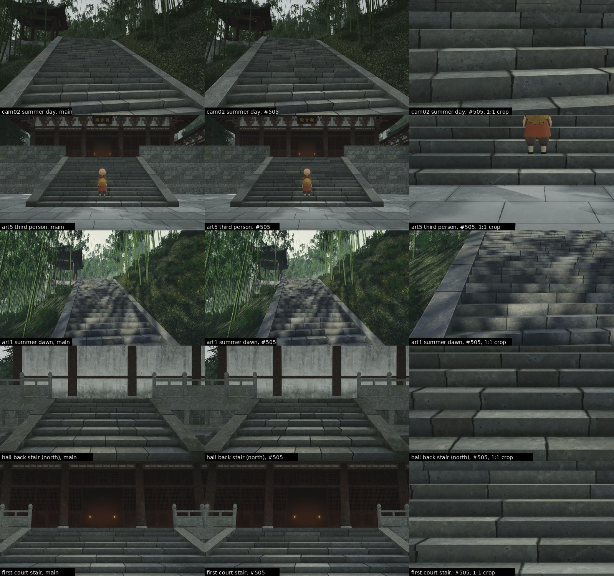

# #505 石阶的缝、棱和石块明暗：改前改后

Refs #505（接 #460）。

每行三格：改前（main `4588948`）｜改后｜改后的 1:1 裁图。T4 原图在下面的地址里。

## 怎么拍的

- **机器**：Hugging Face Job，Tesla T4（ANGLE，Vulkan），高档，1920×1080（`art*` 用 1920×804），一人称（带 `@third` 的是第三人称），`?shot=1`，夏昼。运行号 `20261121-180340`。
- **改后的代码**：`c75ec6d`（干净，没有 `+dirty`）；改前是 main `4588948` 的构建，用 `BASE_SITE` 放在同一个 Job、同一个浏览器里，改前改后交替。
- 重出：`BASE_SITE=<main 的 dist> tools/gpu-render.sh t4-small "$(cat t4-spec.json)"`（规格见 PR 说明里的机位表；机位和季节时辰都写在文件名里）。

## 验收逐条

| # | 要求 | 结果 |
|---|---|---|
| 1 缝 | 缝色与两侧石面亮度比 0.4–0.7；同一段缝宽度起伏 ≥ ±30% | cam02 夏昼，中间几级（行 0.55–0.75）：**比 0.677**（改前 0.650），p10–p90 0.39–0.85（改前 0.54–0.84）；**宽度起伏 0.353**（改前 0.341）。整个区域（行 0.55–0.99）：比 0.775（改前 0.776），起伏 0.401（改前 0.381）。量法见下 |
| 2 棱 | 踏面前沿 1–2 cm 磨圆高光；第三人称近看读不出刀切的直棱 | 踏面前沿一道 1.8 cm 内的亮边，边上高度往外下落 4 mm（屏上读作圆角）；垂带顶两条边同理（1.4 cm）。看 `sheets/third-person-1to1-main-vs-505.jpg`（第三人称，1:1）和拼图第三列。**待审图二判** |
| 3 石块深浅 | 相邻石块平均亮度差的中位数 ≥ 8% | cam02 夏昼，中间几级：**0.114**（改前 0.078）；整个区域 0.107（改前 0.078） |
| 4 十六种时辰 | cam02 拼图一张，没有一处变差；雪照旧 | `sheets/cam02-16-moods.jpg`，无花屏无破绽；冬昼同机位改前改后见 `sheets/winter-cam02-main-vs-505-crop.jpg`，积雪不变（盖雪那段 `procMat` 没碰） |
| 5 三角面、绘制数、帧耗 | 不变；T4 帧耗差 ≤ 0.2 ms | 三角面和绘制数逐行相同（art5 692,873 / 118，cam02 528,527 / 88）；`__cost` 交替量：art5 6 次 11.80 → 11.53（−0.27 ms），cam02 4 次 11.88 → 11.86（−0.02 ms） |
| 6 T05 | 共用这套参数就附对照交美术总监 | 共用同一个着色器；`sheets/t05-main-vs-505.jpg`（b、a-tall、台阶近景改前｜改后）。T05 的 `STAIR_STYLE`（竹叶关、苔关）没动，石块尺度没动 |
| 7 审图二 | 「美术通过」 | 等 |

## 量法（`measure.py`，在本目录）

脚本读一张 PNG：缝 = 比两侧 5–10 px 外的石面暗（< 0.88）、宽不过 10 px、在一列上连续 8 行以上的一段；缝色比 = 每行缝里最暗的一个像素除以缝两侧 6–14 px 外石面的平均，取中位数；宽度起伏 = 一条缝每行「等效宽」（把缝里各像素比石面暗的部分加起来）的 (p90 − p10) / (2 × 中位数)；石块 = 同一行里两条缝之间（各缩进 5 px，至少 30 px 宽）的平均亮度，相邻两块的 |a − b| / 平均，取中位数。结果 JSON 在 `measure_cam02_*`。

**为什么取行 0.55–0.75 作官方区域**（`skills/art-gate` 第 14 条：先看量的地方真有东西）：cam02 的画面下四分之一只有最近的四级，缝很少（改后 20 条），又宽又被阴影边、台阶前沿的亮边打乱，参照像素会落进缝里，比值不可靠；上面一截的缝在屏上只有一两个像素，被着色器按「看得清才画」淡掉（`seen`），中位数被它们拉高。中间几级（行 0.55–0.75，约 45 条缝、每条 2–4 px）两头都没有这些问题；整个区域的数一并列出，不藏。这几个数是代理，图和数冲突时看图：改前的缝在这个量法下并不黑（比 0.65），审图二说的「等宽纯黑」是看得见的那几条近缝，改后它们宽窄、深浅沿长度变化（宽 0.35–1.65 倍，吃掉石面颜色的 54%–78% 之间浮动），缝边多一道磨亮的棱。

## 原图

地址钉在数据集提交 `15a7e8322dee`，清单见 `MANIFEST.json`；`node tools/evidence.mjs pull docs/t00/evidence/stair-seams-505` 取到 `tools/out/evidence/`。

- T4 命名机位（改后 / 改前）：
  - [`cam02_summer-day.png`](https://huggingface.co/datasets/bolechen/temple-walk-evidence/resolve/15a7e8322deee27a728c4384f4fb33cc882dabce/t00/stair-seams-505/t4/cam02_summer-day.png) / [`cam02_summer-day_base.png`](https://huggingface.co/datasets/bolechen/temple-walk-evidence/resolve/15a7e8322deee27a728c4384f4fb33cc882dabce/t00/stair-seams-505/t4/cam02_summer-day_base.png)
  - [`cam01_summer-day.png`](https://huggingface.co/datasets/bolechen/temple-walk-evidence/resolve/15a7e8322deee27a728c4384f4fb33cc882dabce/t00/stair-seams-505/t4/cam01_summer-day.png) / [`cam01_summer-day_base.png`](https://huggingface.co/datasets/bolechen/temple-walk-evidence/resolve/15a7e8322deee27a728c4384f4fb33cc882dabce/t00/stair-seams-505/t4/cam01_summer-day_base.png)
  - [`art5_summer-day.png`](https://huggingface.co/datasets/bolechen/temple-walk-evidence/resolve/15a7e8322deee27a728c4384f4fb33cc882dabce/t00/stair-seams-505/t4/art5_summer-day.png) / [`art5_summer-day_base.png`](https://huggingface.co/datasets/bolechen/temple-walk-evidence/resolve/15a7e8322deee27a728c4384f4fb33cc882dabce/t00/stair-seams-505/t4/art5_summer-day_base.png)
  - [`cam02_winter-day.png`](https://huggingface.co/datasets/bolechen/temple-walk-evidence/resolve/15a7e8322deee27a728c4384f4fb33cc882dabce/t00/stair-seams-505/t4/cam02_winter-day.png) / [`cam02_winter-day_base.png`](https://huggingface.co/datasets/bolechen/temple-walk-evidence/resolve/15a7e8322deee27a728c4384f4fb33cc882dabce/t00/stair-seams-505/t4/cam02_winter-day_base.png)
  - [`art5_summer-day_third.png`](https://huggingface.co/datasets/bolechen/temple-walk-evidence/resolve/15a7e8322deee27a728c4384f4fb33cc882dabce/t00/stair-seams-505/t4/art5_summer-day_third.png) / [`art5_summer-day_third_base.png`](https://huggingface.co/datasets/bolechen/temple-walk-evidence/resolve/15a7e8322deee27a728c4384f4fb33cc882dabce/t00/stair-seams-505/t4/art5_summer-day_third_base.png)
  - [`cam02_summer-day_third.png`](https://huggingface.co/datasets/bolechen/temple-walk-evidence/resolve/15a7e8322deee27a728c4384f4fb33cc882dabce/t00/stair-seams-505/t4/cam02_summer-day_third.png) / [`cam02_summer-day_third_base.png`](https://huggingface.co/datasets/bolechen/temple-walk-evidence/resolve/15a7e8322deee27a728c4384f4fb33cc882dabce/t00/stair-seams-505/t4/cam02_summer-day_third_base.png)
  - [`art1_summer-dawn.png`](https://huggingface.co/datasets/bolechen/temple-walk-evidence/resolve/15a7e8322deee27a728c4384f4fb33cc882dabce/t00/stair-seams-505/t4/art1_summer-dawn.png) / [`art1_summer-dawn_base.png`](https://huggingface.co/datasets/bolechen/temple-walk-evidence/resolve/15a7e8322deee27a728c4384f4fb33cc882dabce/t00/stair-seams-505/t4/art1_summer-dawn_base.png)
  - [`art5_summer-dusk.png`](https://huggingface.co/datasets/bolechen/temple-walk-evidence/resolve/15a7e8322deee27a728c4384f4fb33cc882dabce/t00/stair-seams-505/t4/art5_summer-dusk.png) / [`art5_summer-dusk_base.png`](https://huggingface.co/datasets/bolechen/temple-walk-evidence/resolve/15a7e8322deee27a728c4384f4fb33cc882dabce/t00/stair-seams-505/t4/art5_summer-dusk_base.png)
- T4 `?cam=` 机位和手机、T05（改后 `_505` / 改前 `_main`；手机的是 `phone-low_cam02_505` / `_main`）：
  - 首院踏道：[`firstcourt-stair_summer-day_505.png`](https://huggingface.co/datasets/bolechen/temple-walk-evidence/resolve/15a7e8322deee27a728c4384f4fb33cc882dabce/t00/stair-seams-505/t4/firstcourt-stair_summer-day_505.png) / [`firstcourt-stair_summer-day_main.png`](https://huggingface.co/datasets/bolechen/temple-walk-evidence/resolve/15a7e8322deee27a728c4384f4fb33cc882dabce/t00/stair-seams-505/t4/firstcourt-stair_summer-day_main.png)
  - 大殿后阶（朝北）：[`hall-back-stair_summer-day_505.png`](https://huggingface.co/datasets/bolechen/temple-walk-evidence/resolve/15a7e8322deee27a728c4384f4fb33cc882dabce/t00/stair-seams-505/t4/hall-back-stair_summer-day_505.png) / [`hall-back-stair_summer-day_main.png`](https://huggingface.co/datasets/bolechen/temple-walk-evidence/resolve/15a7e8322deee27a728c4384f4fb33cc882dabce/t00/stair-seams-505/t4/hall-back-stair_summer-day_main.png)
  - 手机低档 cam02：[`phone-low_cam02_505.png`](https://huggingface.co/datasets/bolechen/temple-walk-evidence/resolve/15a7e8322deee27a728c4384f4fb33cc882dabce/t00/stair-seams-505/t4/phone-low_cam02_505.png) / [`phone-low_cam02_main.png`](https://huggingface.co/datasets/bolechen/temple-walk-evidence/resolve/15a7e8322deee27a728c4384f4fb33cc882dabce/t00/stair-seams-505/t4/phone-low_cam02_main.png)
  - T05 b：[`t05_b_505.png`](https://huggingface.co/datasets/bolechen/temple-walk-evidence/resolve/15a7e8322deee27a728c4384f4fb33cc882dabce/t00/stair-seams-505/t4/t05_b_505.png) / [`t05_b_main.png`](https://huggingface.co/datasets/bolechen/temple-walk-evidence/resolve/15a7e8322deee27a728c4384f4fb33cc882dabce/t00/stair-seams-505/t4/t05_b_main.png)
  - T05 a-tall：[`t05_a-tall_505.png`](https://huggingface.co/datasets/bolechen/temple-walk-evidence/resolve/15a7e8322deee27a728c4384f4fb33cc882dabce/t00/stair-seams-505/t4/t05_a-tall_505.png) / [`t05_a-tall_main.png`](https://huggingface.co/datasets/bolechen/temple-walk-evidence/resolve/15a7e8322deee27a728c4384f4fb33cc882dabce/t00/stair-seams-505/t4/t05_a-tall_main.png)
  - T05 台阶近景：[`t05_flight-close_505.png`](https://huggingface.co/datasets/bolechen/temple-walk-evidence/resolve/15a7e8322deee27a728c4384f4fb33cc882dabce/t00/stair-seams-505/t4/t05_flight-close_505.png) / [`t05_flight-close_main.png`](https://huggingface.co/datasets/bolechen/temple-walk-evidence/resolve/15a7e8322deee27a728c4384f4fb33cc882dabce/t00/stair-seams-505/t4/t05_flight-close_main.png)
- 十六种时辰（改后）：`t4/mood_cam02_<季>-<时>.png`，拼图 [`sheets/cam02-16-moods.jpg`](https://huggingface.co/datasets/bolechen/temple-walk-evidence/resolve/15a7e8322deee27a728c4384f4fb33cc882dabce/t00/stair-seams-505/sheets/cam02-16-moods.jpg)。
- 其他拼图：[手机](https://huggingface.co/datasets/bolechen/temple-walk-evidence/resolve/15a7e8322deee27a728c4384f4fb33cc882dabce/t00/stair-seams-505/sheets/phone-low-cam02-main-vs-505.jpg)、[T05](https://huggingface.co/datasets/bolechen/temple-walk-evidence/resolve/15a7e8322deee27a728c4384f4fb33cc882dabce/t00/stair-seams-505/sheets/t05-main-vs-505.jpg)、[冬景](https://huggingface.co/datasets/bolechen/temple-walk-evidence/resolve/15a7e8322deee27a728c4384f4fb33cc882dabce/t00/stair-seams-505/sheets/winter-cam02-main-vs-505-crop.jpg)、[第三人称 1:1](https://huggingface.co/datasets/bolechen/temple-walk-evidence/resolve/15a7e8322deee27a728c4384f4fb33cc882dabce/t00/stair-seams-505/sheets/third-person-1to1-main-vs-505.jpg)。

## 没验的

夜景的近景（十六种时辰的夜景只在 cam02 上看过）、拍照模式成片、其余七座殿的台阶近看。黄昏和夜里台阶一片黑是原来就有的，记在 B1，这一单没动。
