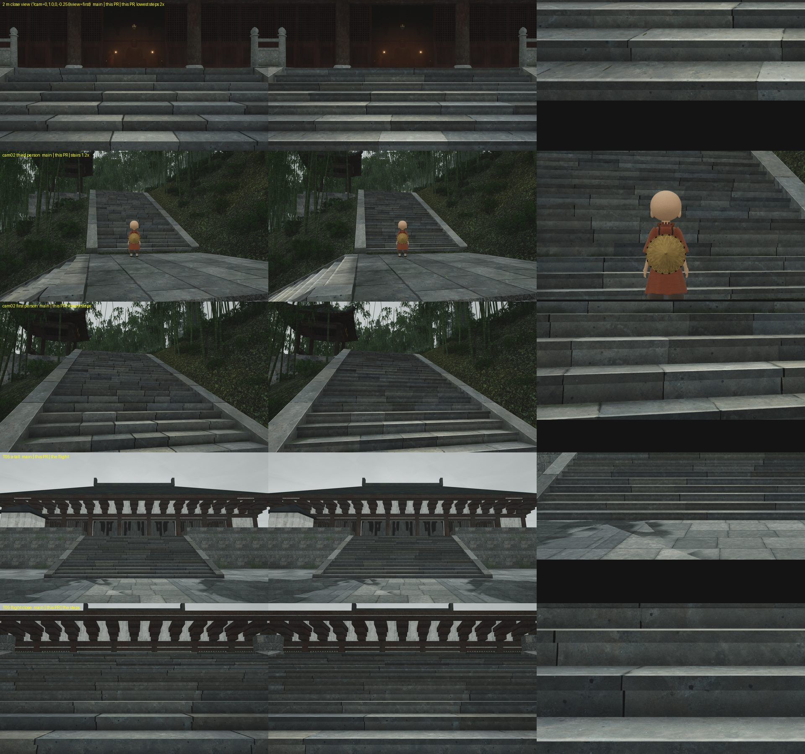

# #505 石阶的缝和棱（第 1、2 条）：改前改后

Refs #505（接 #544，那一个 PR 只过了第 3 条石块深浅）。审图二的评语和判法：[PR #544 评论 7068051281](https://github.com/bolechen/temple-walk/pull/544#issuecomment-7068051281)。

每行三格：改前（main `3842470`）｜改后｜改后的局部放大。T4 原图在下面的地址里。

## 怎么拍的

- **机器**：Hugging Face Job，Tesla T4（ANGLE，Vulkan），高档，`?shot=1`，夏昼。拍图一轮 `20261121-222809`，帧耗一轮 `20261121-222811`（两轮都是同一份站点，`sha256 a439882d…`）。
- **改后的代码**：着色器是 `e6b2962`（`1c9f26c` 在它之上只加了文档和脚本）；改前是 main `3842470` 的构建，用 `BASE_SITE` 放在同一个 Job、同一个浏览器里，交替。
- 两米近景就是审图二的地址：`?cam=0,1.0,0,-0.25&view=first`（1280×720，一人称）。
- 十六种时辰在 cam02 上，一人称，1280×720，只有改后（改前的十六种在 #544 的证据里）。雪天和秋暮的改前改后是**软件渲染**（SwiftShader，不是 T4）：`software/`。

## 做了什么（只改 `steps` 材质，不加三角面）

- **缝**：沿长度一段开着、一段填平，背阴的台阶和高处的踏步填得更多。开着的缝宽约 1–4 像素（两米处）；踏面上的缝浅，踢面上的缝深（不吃环境光）。填平的缝接近石面颜色。
- **棱**：踏面前沿磨成 4–6 厘米宽的圆带，中间三分之一最宽，两头收窄，每块石头的宽度和亮度不一样；比紧邻踏面亮约三成，下沿压一道暗线，鼻下的石唇（6 厘米高的一圈立面）更暗。二十米外圆带自己淡掉（宽度小于约 1.5 像素就不画）。
- **崩口**：缝与棱相交处九成上下有一个 2–4 厘米的暗小凹，大小、形状、偏踏面或偏踢面各不相同，上缘一丝亮。
- **圆带的强度和块间起伏是 `STAIR_STYLE` 的两项**（`crest`、`crestVary`，默认都是 1，等于上面和下面所有数字对应的构建；T05 主创的条件，PR #560 评论）：关卡可以把圆带调弱到 0、或让每块石头的圆带一样。默认值下画面逐点不变（`mix(1, x, 1) = x`），所以下面的 T4 图和数仍然是这个构建的；`tests/unit/stair-stones.test.mjs` 管着默认值和关卡能改。
- **踢面比踏面暗一点，踏面前亮后暗**；整体乘 1.25 把台阶的平均亮度补回原来的位置（见下）。

## 验收逐条（审图二给的数；量法 `measure.py`，审图二已确认）

量的是 T4 两米近景，画面里最低的三级踏步（行 480–716）。`measure.py` 在改前的图里找缝，再在改后的图同一处读它，所以两张图问的是同一批缝；对照（改前对改前）填平 0、圆带 0。

| 项 | 要求（审图二） | 结果 |
|---|---|---|
| 缝填平 | 近处三级踏步，缝总长至少 1/3 是填平的（缝色比 ≥ 0.8） | **35.1%**（踏面缝 37.7%，踢面缝 34.1%） |
| 开着的缝宽 | 两米处屏上 1 px 到 4 px 都有 | 有：1 px 99 行、2 px 152 行、3 px 65 行、4 px 62 行（5、6 px 也有，6 为上限）。踏面缝开口平均比 0.60、踢面 0.47：**踏面浅、踢面深** |
| 棱：带比紧邻踏面亮一成以上 | 带的上沿往里 3–6 厘米那一条踏面 | 中位数 **1.34 倍** |
| 棱：两米处屏上 ≥ 3 px 高 | | 中位数 **6 px**（最低几级 5 px） |
| 棱：下沿压一道暗 | | 有（带下两行的亮度是带顶的 0.35 倍（中位数）） |
| 棱：中间三分之一最宽最亮，两头收，起伏 ≥ ±15% | | 中间三分之一 4.9 px、两头 4.8 px，**只差 2%**；着色器里宽度是中间 1、两头 0.3 的曲线再乘每块石头各自的 0.8–1.2。这一项**我量出来没达到**，图上看中间那一块带更宽，要靠审图二的眼睛判 |
| 崩口 | 2–4 厘米，八成以上的缝与棱相交处有，形状大小不一 | 着色器里 88% 的相交处有崩口；画面上的个数没有自动量，看拼图第三列 |
| 逐像素平均差 | 两米近景台阶那一块不低于 8/255（审图二：它拍的那次是 3.1） | **9.42**（台阶区域，行 322–716） |
| 远看不许变成亮线 | cam02 第三人称，二十米外圆带不比现在的前沿更显眼 | 见拼图第二行；cam02 第三人称台阶平均亮度 20.20 → 20.67 L*，圆带在这个距离已淡掉 |

## 亮度（主创要的三样）和 T05 a-tall

`tone.py` 读 CIE L*：L50、L95、近白像素占比（任一通道 ≥ 240）、同一行里相邻石块平均亮度的标准差的中位数。

| 画面 | 平均 L* | L50 | L95 | 近白占比 | 石块间标准差 |
|---|---|---|---|---|---|
| 两米近景 台阶 | 28.07 → 29.64 | 24.56 → 23.80 | 51.38 → 60.30 | 0 → 0 | 2.96 → 2.81 |
| cam02 一人称 台阶 | 24.62 → 24.75 | 23.24 → 22.14 | 44.95 → 51.41 | 0 → 0 | 4.17 → 5.63 |
| cam02 第三人称 台阶 | 20.20 → 20.67 | 18.58 → 18.49 | 35.53 → 40.88 | 0 → 0 | 5.28 → 6.77 |
| T05 a-tall 踏道 | 27.26 → 27.56 | 26.05 → 25.69 | 39.80 → 42.71 | 0 → 0 | 4.05 → 5.13 |
| T05 b 踏道 | 24.09 → 24.22 | 23.05 → 22.21 | 40.82 → 45.01 | 0 → 0 | 3.47 → 3.52 |
| T05 flight-close | 25.71 → 25.80 | 23.95 → 22.57 | 47.78 → 54.76 | 0 → 0 | 2.08 → 2.00 |

- 平均亮度补回原位（±0.5 L* 以内）；整体没有变亮，只是受光的圆带亮了、中位数略低。**没有一个像素近白**，没有过曝。
- **T05 a-tall 的石块深浅差**：美术总监用它自己的量法量出改前（#544）1.6 L*，上限 2.0。我这个量法（逐行相邻石块的标准差）和它的不是一回事，数字不可直接比（改前这里是 4.05）；但改后比改前大了约 27%（4.05 → 5.13），按这个比例 1.6 会到约 2.0，**贴着线**。两米近景和 flight-close 上这个差没有变大（2.96 → 2.81，2.08 → 2.00）。远看变大的那部分，我判断来自圆带中间宽两头窄（同一行里左右亮度不同）和每块石头各自的圆带亮度，不是石块明暗本身，因为石块明暗（`sr`）这一版没动。请美术总监用它的量法在这个构建上再量一次，超过 2.0 的话，我把圆带的块间起伏调小，或者给 T05 的 `STAIR_STYLE` 加一个关掉圆带起伏的开关。

## 帧耗（T4，`__cost`，交替：改前、改后、改后、改前，…）

| 机位 | 对数 | 改前 | 改后 | 差 |
|---|---|---|---|---|
| art5 | 12 对 | 11.25 ms | 11.34 ms | **+0.08 ms** |
| cam02 | 8 对 | 12.09 ms | 11.97 ms | **−0.12 ms** |

三角面、绘制数逐行相同（art5 689,107 / 120，cam02 524,761 / 90）。噪声大（标准差 0.4–0.5 ms）。这一份之外前面几轮的数照实留在这里：第一版（圆带每个像素都算）art5 +0.31、cam02 +0.47；把圆带只在鼻前一手宽内算之后 art5 +0.21、cam02 +0.11；最后一轮（加了整体提亮）+0.08 / −0.12。

## 没验的

夜景近景、拍照模式成片、其余七座殿的台阶近看、手机（`q=low`）上的缝和棱（只在 T4 拍了一张 `phone-low_cam02`）；圆带宽度的中间/两头起伏没有达到审图二要的 ±15%（见上）；崩口的个数画面上没有自动量。

## 原图

地址钉在数据集提交，清单见 `MANIFEST.json`；`node tools/evidence.mjs pull docs/t00/evidence/stair-seams-arris-505b` 取到 `tools/out/evidence/`。`t4/`（两米近景、cam02 一人称和第三人称、cam01、art5、首院踏道、殿后台阶、手机）、`moods/`（cam02 十六种）、`t05/`（a-tall、b、flight-close，改前 `_main`、改后 `_arris`）、`software/`（雪天和秋暮，软件渲染）、`sheets/`（十六种拼图，雪天和秋暮对照）。数字文件：`measure_near2m_summer-day.json`、`tone_*.json`、`cost-alternating.txt`。
