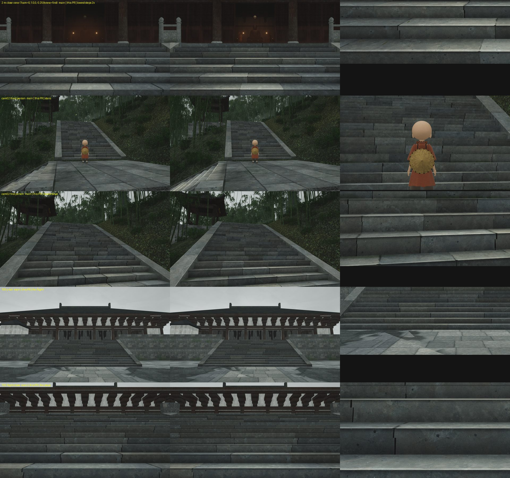

# #505 石阶的缝和棱（第 1、2 条）：改前改后

Refs #505（接 #544，那一个 PR 只过了第 3 条石块深浅）。审图二的评语：[第一轮](https://github.com/bolechen/temple-walk/pull/560#issuecomment-7070874392)（#544 的是 [7068051281](https://github.com/bolechen/temple-walk/pull/544#issuecomment-7068051281)）；美术总监对 T05 的两轮：[7071282529](https://github.com/bolechen/temple-walk/pull/560#issuecomment-7071282529)、[7071541535](https://github.com/bolechen/temple-walk/pull/560#issuecomment-7071541535)、[7071740823](https://github.com/bolechen/temple-walk/pull/560#issuecomment-7071740823)（`ccc5df0` 美术通过）。

每行三格：改前（main `3842470`）｜改后｜改后的局部。T4 原图在下面的地址里。

## 怎么拍的

- **机器**：Hugging Face Job，Tesla T4（ANGLE，Vulkan），高档，`?shot=1`，夏昼。拍图一轮 `20261122-002626`，帧耗一轮 `20261122-004358`；站点是同一份提交 `ccc5df0`（着色器和 geo.js 都在里面）。改前是 main `3842470` 的构建，用 `BASE_SITE` 放在同一个 Job 里，改前改后交替。
- 两米近景是审图二的地址：`?cam=0,1.0,0,-0.25&view=first`（1280×720）。cam02 第三人称另拍了一张 1280×720（`cam02third720_*`），是审图二那个远看量法的尺寸。
- 雪天和秋暮的改前改后（`software/`，软件渲染，不是 T4）是 `ba9b326` 时拍的，之后着色器又改了，现有的只当示意；十六种时辰（`r3/moods/`）是最终提交的，T4。

## 这个 PR 改了什么

- `app/src/materials.js` 的 `steps` 材质：缝一段开一段填平（背阴台阶、高处填得多；踏面缝浅、踢面缝深）；踏面前沿 3–6.6 厘米宽的磨圆带（中间三分之一最宽最亮，往两头收；每块石头自己的宽度和亮度）；石唇立面只在最上面 2–3 厘米压暗、边软；缝棱相交处 2.8–5.6 厘米的暗崩口；踢面稍暗、踏面前亮后暗。**近处才有**：这些边缘细节都乘一个随相机距离的系数，5 米以内全有，9 米回到改前（`length(vWP − cameraPosition)`）。踏面那一路的整体提亮是 1.0（美术总监的评论 7071541535），踢面和 cheek 顶面是 1.25，把整体平均亮度补回。
- **`STAIR_STYLE` 加两项**：`crest`（圆带强度）、`crestVary`（圆带宽度亮度的块间起伏），默认都是 1（T05 主创的条件）。
- **`app/src/geo.js`（所有台阶共用的几何，单独列出）**：`stairGeo` 里踏板石唇的立面顶点，写进 `stair` 属性第二个分量的值从一个常数 0.97 改成随高度 0.97（顶）到 0.93（脚）；只改顶点属性，**不加三角面，不动位置**。`cheek-feet`、`stairs`、`stair-stones` 单测过，`pnpm run edges` 全绿（每座建筑 0 over、deepest 0.0 cm）。
- `tests/unit/stair-stones.test.mjs`：`STAIR_STYLE` 的默认值和关卡能改。

## 验收（审图二给的数；量法 `measure.py`，审图二已确认）

量的是 T4 两米近景（`ccc5df0`），画面最低三级踏步（行 480–716），改前对改后；对照（改前对改前）填平 0、圆带 0。

| 项 | 要求（审图二） | 结果 |
|---|---|---|
| 缝填平 | 近处三级缝总长 ≥ 1/3 填平 | **33.1%**（踏面缝 31.7%，踢面缝 33.4%）——**贴线，三分之一是 33.3%，差一点点** |
| 开着的缝宽 | 两米处 1–4 px 都有；踏面浅、踢面深 | 有（1 px 108 行、2 px 152 行、3 px 52 行、4 px 58 行）；踏面缝开口比 0.58，踢面 0.49：踏面浅 |
| 棱：比紧邻踏面亮 ≥ 一成 | | 中位数 **1.37 倍** |
| 棱：两米处 ≥ 3 px 高 | | 中位数 **7 px**（最低几级 7.5 px） |
| 棱：下沿暗线只占踢面最上 2–3 cm、边软 | | 带下两行亮度是带顶的 0.39 倍；暗线只在石唇最上面 2–3 cm（geo.js 的 tf 给的高度） |
| 棱：中间三分之一最宽最亮，两头收，起伏 ≥ ±15% | | 中间三分之一 7.5 px、两头 6.6 px，**中间比两头宽 14%**，每块石头各自 ×0.75–1.3（宽）、×0.7–1.3（亮）；**差一点到 ±15%**，要靠审图二的眼睛判 |
| 崩口：最低三级至少一半的相交处有屏上 ≥ 3 px 的缺口 | | 着色器里 88% 的相交处有崩口，2.8–5.6 cm；画面上的个数没有自动量，看拼图第三列 |
| 逐像素平均差 | 两米近景台阶那一块不低于 8/255（审图二：上次 3.1） | **5.5**（行 322–716）。**没到 8**：美术总监要踏面不比 main 亮（踏面那一路由 1.25 改成 1.0），去掉了这一大块差；剩下的是缝、圆带、崩口、石唇和踢面。审图二说这只是够不够重的门槛，以并排图为准 |
| 远看不许多出横线 | cam02 第三人称 1280×720，230–440 行 × 470–600 列，去 9 行缓变后的行均值标准差，≤ 3.1 | main **2.95**，本 PR **2.84**（审图二量的是 2.67 和 4.26，我的裁法略有出入，同法同图比较：不多于 main） |

## 亮度（主创要的三样）和 T05 的石块深浅差

`tone.py` 读 CIE L*：L50、L95、近白像素占比（任一通道 ≥ 240）、同一行里相邻石块平均亮度的标准差的中位数（我的量法，和美术总监的不同）。

| 画面 | 平均 L* | L50 | L95 | 近白占比 | 石块间标准差 |
|---|---|---|---|---|---|
| 两米近景 台阶 | 28.07 → 28.12 | 24.59 → 24.32 | 51.38 → 54.47 | 0 → 0 | 2.96 → 2.95 |
| cam02 一人称 台阶 | 24.62 → 24.66 | 23.25 → 23.02 | 44.95 → 44.99 | 0 → 0 | 4.18 → 4.57 |
| cam02 第三人称 台阶 | 20.20 → 20.24 | 18.57 → 18.62 | 35.53 → 35.57 | 0 → 0 | 5.25 → 5.33 |
| T05 a-tall 踏道 | 27.26 → 27.30 | 26.05 → 26.05 | 39.80 → 39.81 | 0 → 0 | 4.04 → 4.07 |
| T05 b 踏道 | 24.09 → 24.07 | 23.05 → 23.05 | 40.82 → 40.31 | 0 → 0 | 3.45 → 3.43 |
| T05 flight-close | 25.71 → 25.49 | 23.95 → 23.51 | 47.78 → 48.23 | 0 → 0 | 2.08 → 2.01 |

平均亮度都在原位（±0.25 L*），**没有一个近白像素**。美术总监用它自己的量法量 T05 a-tall 的石块深浅差：1.62 → 1.61（上限 2.0，不用加开关）。俯看五段（T05，`cam=0,16,3.1416,0`）比 main 高 +3.5/+4.7/+2.6/+4.4/+3.2，平均 +3.7（线 4）、最高 +4.7（线 5），是美术总监在 `ccc5df0` 上量的；T4 上我也拍了这个机位（`r3/t05/t05_topdown_main.png`、`t05_topdown_arris.png`，1920×1080，`cam=0,16,3.1416,0` 加 `__look([0,4.7,15.8],[0,0.3,22.5])`，运行号 `20261122-005934`，同一份 `ccc5df0`）：我把踏道所在的行（666–1070 行、列 300–1620）平均分五段，比 main 的 L* 差 +3.4/+4.4/+3.3/+3.4/+3.4，平均 +3.6、最高 +4.4（段的切法和美术总监的不同，数不可逐段对；趋势一致）。

## 帧耗（T4，`__cost`，交替：改前、改后、改后、改前，…）

| 机位 | 对数 | 改前 | 改后 | 差 |
|---|---|---|---|---|
| art5 | 12 对 | 10.90 ms | 11.08 ms | **+0.18 ms** |
| cam02 | 8 对 | 11.91 ms | 11.79 ms | **−0.12 ms** |

三角面、绘制数逐行相同（art5 689,107 / 120，cam02 524,761 / 90）。噪声大（标准差 0.3–0.6 ms）。前几轮照实留着：第一版（圆带每个像素都算）art5 +0.31、cam02 +0.47；圆带只在鼻前一手宽内算之后 +0.21 / +0.11；中间几版 +0.08 / −0.12。（`cost-alternating*.txt` 是原始数；`-final` 是 `ccc5df0` 的。）

## 没验的

夜景近景、拍照模式成片、其余七座殿的台阶近看、手机（`q=low`）上的缝和棱（只在 T4 拍了一张 `phone-low_cam02`）；缝填平只有 33.1%、圆带中间/两头起伏 14%、逐像素差 5.5，这三项贴线或没到，写在上面；崩口个数画面上没有自动量。

## 审图二留的两件，补在 #560 合了之后（运行号 `20261122-014028`，`ccc5df0`）

- **T00 古道最后一段石阶的 T4 俯看一对**（审图二给的 A、B 两个眼位，1280×720，`r3/t00-topdown/t00_topdown{A,B}_{main,arris}.png`）：踏道中间一条（列 440–840）按有变化的行等分五段，比 main 的 L*：A +3.5/+5.2/+4.1/+4.7/+3.9（平均 +4.3，最高 +5.2），B +5.3/+4.8/+3.9/+3.8/+2.6（平均 +4.1，最高 +5.3）。审图二的线是平均超 +5 或单段超 +6 才收踏面前后那一路，没超，着色器没动。
- **冬天 cam02 最近几级前沿的白线是积雪**：`r3/sheets/winter-cam02-nearest-steps-zoom.jpg`（上 main，下改后，T4 1920×1080 放大）：那条白带在两张里形状亮度一样，不是亮带透出来。

## 原图

地址钉在数据集提交，清单见 `MANIFEST.json`；`node tools/evidence.mjs pull docs/t00/evidence/stair-seams-arris-505b` 取到 `tools/out/evidence/`。`r3/`（最终提交 `ccc5df0` 的 T4 图：`t4/` 两米近景、cam02 一人称和第三人称（含 1280×720）、cam01、art5、首院踏道、殿后台阶、手机；`moods/` cam02 十六种；`t05/` 改前 `_main`、改后 `_arris`；`sheets/` 十六种拼图）；根目录下 `t4/`、`moods/`、`t05/`、`software/`、`sheets/` 是前面几版（`ba9b326`、`5bdabfe` 之前）的图，原样留着。数字文件：`measure_near2m_summer-day*.json`、`tone_*_final.json`、`cost-alternating*.txt`。
