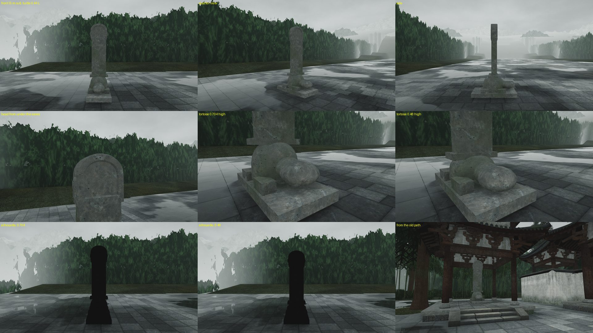

# #520 御碑亭的碑：第二次交（白模，只有形）

Refs #520。审图二的判法：[#520 评论 7072547624](https://github.com/bolechen/temple-walk/issues/520#issuecomment-7072547624) 和 [7072601153](https://github.com/bolechen/temple-walk/issues/520#issuecomment-7072601153)；结构评审对原文的核：[7072575185](https://github.com/bolechen/temple-walk/issues/520#issuecomment-7072575185)。

## 做了什么

`app/levels/t00/stele.js`（新）造碑，`site.js` 里把原来的三个方块换成它。只有形：碑还是 `M.monolith` 的素石材，没有字，没有岁月的材质（第三次交）。

L = 1.60 m（结构评审：L=1.65 会超 3.2 m）：

| 件 | 按书 | 白模 |
|---|---|---|
| 总高（含土衬） | 1.98 L | 3.17 m（包围盒 3.19，含碑首圆弧的倒角） |
| 碑身 | 宽 0.40 L、厚 0.15 L、长 L | 0.64 × 0.24 × 1.60 |
| 碑首 | 方 0.44 L、厚 0.18 L；云盘高 0.06 L | 0.70 宽、0.29 厚；云盘 0.10；比碑身每边宽 0.03（碑身宽的 5%） |
| 鳌坐 | 长倍碑身之广（0.8 L）、高 0.44 L | 长 1.28、高 0.70（对照 0.48）；宽 0.80（0.5 L，结构评审凭记忆，未核） |
| 土衬 | 两段，各 0.6 L × 0.3 L × 0.1 L | **自拟**：接起来 1.92 × 0.96 × 0.16（原文的宽托不住龟）；龟的足、腹、头尾都在它里面（单测管着） |

碑首：一块薄的圆首板，沿边一圈厚一点的带（盘龙的身体），中间凹下的是将来刻篆额的地方；两侧下角各垂一个龙头（出边 5 cm）。龟：压向平顶的壳（不是球）、碑下的一块驼峰、四块足、粗脖子接比高宽的钝头、短尾。

面数（`tests/unit/stele.test.mjs`）：龟 ≤ 900、首 ≤ 400、身和土衬 ≤ 200，合计 ≤ 2000（审图二的分配）；单测还管着比例、首比身宽 4%–8%、龟头伸出碑阳 ≥ 0.3 m、总高 ≤ 3.2 m。

## 图（1280×720，T00，夏昼，软件渲染；T4 留给第三次）

`tools/stele-views.cjs`：`pnpm dev` 之后 `node tools/stele-views.cjs --heights=0.704,0.48`。形的图把碑从亭子里拿出来（`__steleAlone`，亭子和竹子关掉，沙弥移走）；2 m 眼高那张和古道机位带着亭子。

- 彩色：正面、背面、侧面、四个斜向（q1–q4）、从正上方、龟头特写、碑首特写、2 m 眼高、古道机位（`stele`）；龟高 0.704 和 0.48 各一份（并排见拼图第二行）。
- 纯黑剪影：同样的机位，龟高两份。
- 原图地址在数据集，清单见 `MANIFEST.json`。

## 我自己对这一版的看法（请审图二按眼睛判，不好就走退路）

**还不好**，我自己看是：
1. **整体剪影像一根杆子立在一个小土包上**：碑身细高，龟的壳和座只占下面一小截，读成「御碑」的把握不大。真碑（岱庙那张）龟比碑身宽很多（1.3–1.5 倍）、壳压得很扁很宽，我的龟宽 0.80 只有碑身的 1.25 倍。
2. **龟读得出是龟，但偏玩具**：壳是一个压扁的圆顶，头是一个粗的椭球，没有头颈的转折；龟高 0.48 的比 0.704 的好一点，但两个都不够「沉」。
3. **螭首的龙看不出**：现在是一圈带加两个小龙头，隔 5 m 看只是个有边框的圆首，不是盘龙。2 m 眼高的图里也只看得出带，龙头太小。
4. 土衬 1.92 × 0.96 从上往下看是一个十字形的石座，龟在里面，但土衬四周留得宽。

如果这一版不过：是改（龟加宽、壳更扁、龙头加大）还是走退路（笏头碣）？我倾向再磨一轮龟和龙头，但你说了「不磨第二轮」，听你的。
