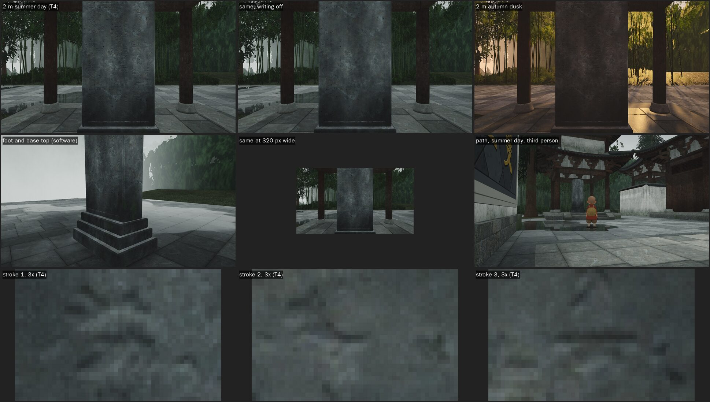

# #520 御碑亭的碑：第三次交（石质、风化、字；额待字形）

Refs #520。形（笏头碣白模第二版）已由审图二判过：[#594 评论 7075136640](https://github.com/bolechen/temple-walk/pull/594#issuecomment-7075136640)；结构评审的读法见 #520。第一、二版的图和数据在 `MANIFEST.json`（`r1/`、`r2/`、`collage-r1.jpg`、`collage-r2.jpg`），数据集 `bolechen/temple-walk-evidence`。

拼图（初审回来后这一轮）：第一行 2 米眼高夏昼有字痕、同一画面关掉字痕、秋暮；第二行 碑脚和座上面（软件渲染）、同一张缩到 320 像素宽、古道机位第三人称；第三行 三处笔画的 3 倍裁图（T4）。第一轮的拼图 `collage-r1/r2/r3.jpg` 和原图在数据集（`MANIFEST.json`）。T4，1280×720，改前是 main。

## 做了什么

- **石质**：新材质 `steleStone`（`app/src/materials.js`），青灰、比亭台基更冷更暗；靠 `stair` 属性（碑自己坐标、朝向、座/身、倒角）和两张小图读，不加一个三角形。碑不落雪。
- **返潮**：座和碑身最下 30–40 cm 发深（座三层朝上的面灰而略浅）。
- **摸亮**：碑身两条前棱离地 0.8–1.4 m 一段、座最上一层前棱，轻重不匀。
- **苔**：只在背阴面低处，面积很小。**风化**：碑首顶和上角发白、起坑；雨痕竖条。
- **破瓣**：碑身四条棱两个小面、中间一道线（原文「随身棱并破瓣」，结构评审要求）；`bevelSegments: 2`，线是材质刻的。
- **正文（初审后改）**：笔画改成两头尖、中间宽的 V 形刀沟（深度场，不再是等宽黑条），沟有朝向——上沿暗、下唇亮（按沟的断面斜着推）；撇、捺、点占四成以上；笔画宽 13 mm 上下；每列之间有浅的界格线。不是任何真文字（真碑文径山兴圣万寿禅寺一字不出现）。每格是自造的「像字的笔画」，再按斑块侵蚀掉约七成，残痕和更浅的磨痕留着；`app/levels/t00/stele-ink.js`，单测 `stele-ink.test.mjs` 管：丢失 60%–76%、完整的格子 ≤ 3、仍数得出 ≥ 10 行、种子一定则字一定。
- **额**：框已开在碑首（0.46 × 0.40 的浅下沉框），**字没有放**：「御書」两字的小篆字形要从《说文解字》的扫描本取（见下）；放字的管道（`makeTitle`、`stele-title-data.js` 的位图、材质里的字层）已经通了，单测证明两个字的位图会各落在框的左右半。
- 备用的龟趺版按主创的要求删了（git 历史里有），一个绘制调用（座和身合成一个网格）。

## 判法与数（审图第三次判法、初审的新判法；T4，1280×720）

「2 米眼高」是小沙弥自己的眼高（1.3 m）、离碑中心 2.0 m、平视；`measure3.py` 量 0.6–2.0 m 一段碑面：上五分之一和下五分之一的 L\*，48×48 块中位数去掉缓变后的标准差，平坦块（块内标准差 < 1.5 L\*）的比例。

| 图（T4） | 下五分之一比上五分之一暗 | 48×48 块起伏 | 平坦块 |
|---|---|---|---|
| 夏昼（基准 J01） | 11.2 L\* | 3.78 L\* | 4% |
| 冬昼（参照） | 10.0 | 3.44 | 8% |
| 秋暮（参照，按初审只要求碑不比台基亮、无雪） | 5.0 | 1.88 | **34%** |

夏昼、冬昼过线（≥ 6、≥ 3）。**秋暮平坦块 34%，超过初审说的三成**：整块碑在亭影里，碑面 L\* 只有 13–18，暗处同样的反照率差在 L\* 上只剩一小半。我回头看过：再加一层 2–3 cm 的细斑、再加大扫描纹理的起伏（软件渲染，秋暮），平坦块只从 34% 降到 32%，暗处改不动，而夏昼会开始读成花石头，所以没有改（这两个改动没有留在提交里）。请初审看秋暮的图确认。

**笔画**（初审的必改项）。读法：同一个 2 米眼高画面画两次，开着字痕和关掉字痕（`__steleInk(false)`），差就是字痕本身；取横笔（差在连续 8 像素上小于 −2 L\*），中心是笔画里最深的一行，上沿、下唇是中心上、下各 3 像素（沟壁外）。`stroke3.py`。

- 40 条横笔：笔画中心比旁边的碑面深 **7.9 L\***（10%–90%：6.7 到 10.7）；下唇比碑面亮 **2.2 L\***（线 2–4）；上沿 −0.1（沟壁里最深的一行就是上沿，往外回到碑面）。
- 三处代表（T4，各 12×12 以内）：笔画 1 中心 −11.0、下唇 0.0；笔画 2 中心 −10.9、下唇 +3.5；笔画 3 中心 −10.7、下唇 −0.9（单条的起伏大，中位数在上面）。3 倍裁图见拼图第三行。
- 撇、捺、点占 46%（单测）。
- 丢失 71%、完整的格子 3、仍有 11 列有字（单测）。
- **320 像素宽**：拼图第二行中间。**看不出成行的字**——字痕深度按线只有 5–8 L\*，细笔画缩到 320 像素就剩不到一个像素。要在这个尺寸读成「刻着成行的字」，只能加深或加粗，那会回到「黑条」。请初审看一下这条是看 1280 的图还是 320 的缩图，或者给我一个数。
- 摸亮、返潮、苔、座上层最浅等其余项照上一版（摸亮沿棱 ±20–30%、棱比旁边亮约 1.5×；苔可见约 1%）；座最上一层朝上的面现在是全碑最浅，见拼图第二行左（软件渲染）。
- 碑面的斑拉成竖的（竖向拉长约 3 倍）、加了雨痕竖条、亮斑收回到石色。

## 数

- 三角形：碑（座 + 身，破瓣后）约 320，原来三个方块 36，净增约 280（单测 ≤ 400）；T4 古道机位整幅 1345062 → 1345702（镜面再画一次，所以整幅多一倍），调用 178 → 180（座和身并成一个网格）；限额 ≤ 2000。
- T4 帧时间（`cost`，高档、1920×1080、古道机位，改前改后交替，T4，10 对）：改前均值 9.59、改后 9.56，**差 −0.03 ms**（中位数差 −0.16 ms），在 0.1 ms 以内；三角形 1326618 → 1327258（+640，镜面再画一次所以整幅翻倍），调用 180 → 182。原始数 `t4-cost-final-report.json`。**对照要用我合并进来的那个 main**：我有两轮拿了更旧的 main 当改前，多出的 0.3–0.5 ms 是别人的提交（茶碗、黄昏门洞等），不是碑；第一、二轮（座和身还是两个网格时）的原始数在同目录 `t4-cost-first-report.json`、`t4-cost-report.json`。
- 可走面积：`walk-diff` 命名地点一个不少，改后多 0.75 m²（座比原方块小），没有哪部分超过 1 m²；`nearplane:grid` 20/20；`edges` 御碑亭 12174 个落脚点 0 超出。
- 材质：`steleStone` 只有这座碑用，不改任何共用材质，所以不要 T05 对照。

## 额的字形来源（还没拿到）

- 主创定：「御」「書」两字都从同一部《说文解字》的扫描本取，不用 Sears 站点的重绘 SVG。
- 找到的：Wikimedia Commons，国家图书馆藏《说文解字》十五卷，清同治十二年（1873）番禺陈昌治刻本；第 2 册（`NLC892-312002098744-312890`）含弟二上、二下、三上、三下，御在弟二下彳部、書在弟三下聿部；文件页许可标签 PD-old-100-expired / PD-scan，出处 National Library of China，92 页，约 67 MB。
- 卡在：本机出口 IP 被 Wikimedia 限流，页面和 PDF 都 429，十几分钟轮询仍不开。没有绕开限流（试过另用一台机器下，被拒，也不该）。解封后：下载、核对许可页、栅格化、定位两字所在的页和裁切框，写进 SOURCES.md 和 `asset-register.csv`，裁切脚本和字图一起进仓库。
