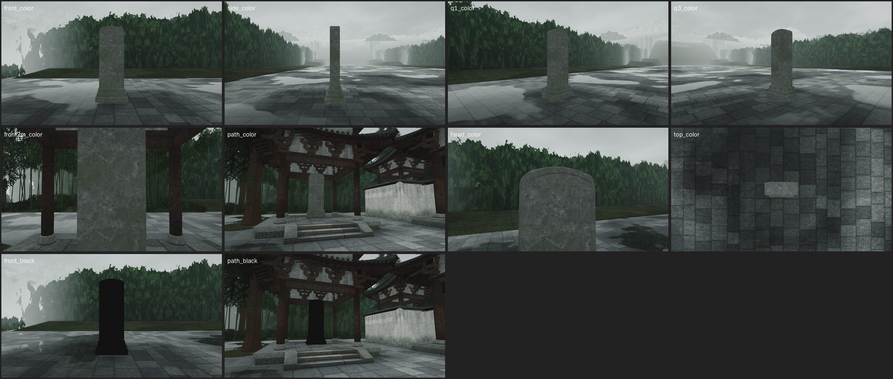

# #520 御碑亭的碑：白模第二版（笏头碣，只有形）

Refs #520。审图二的决定：[#594 评论 7074343386](https://github.com/bolechen/temple-walk/pull/594#issuecomment-7074343386)——第一版龟趺形没过，走退路做笏头碣。第一版的图（`collage-r1.jpg` 和 `r1/`）还在数据集里，见 `MANIFEST.json`。

## 做了什么

`app/levels/t00/stele.js` 重写成笏头碣；龟趺版整个移到 `stele-turtle.js`（备用，`?stele=turtle` 才画出来，单测 `stele-turtle.test.mjs` 照旧跑；将来有开放授权的龟趺扫描件，再另开一条换座）。只有形：材质还是 `M.monolith` 的素石材，没有字（第三次交）。

| 件 | 原文 / 结构评审 | 白模 |
|---|---|---|
| 总高 | 九尺六寸 | 2.98 m（包围盒顶 2.98） |
| 碑身连笏首 | 八尺 | 2.48 m；宽 0.99、厚 0.37 |
| 座高 | 碑身的 0.2 | 0.50 m，三层叠涩（0.20 / 0.15 / 0.15）——**自拟** |
| 座长 | 原文缺字，审图二取约 1.24 | 最下一层 1.24，往上 1.14、1.06 |
| 座进深 | 无 | **自拟** 0.77，往上 0.65、0.53 |
| 笏首 | 无 | **自拟**：平缓圆弧，拱高 0.11 m，两角抹圆半径 0.08 m |
| 边框、面 | 无 | **自拟**：碑面两侧和上沿留 7 cm 边框，面低于边框 1.5 cm |
| 额框 | 无 | **自拟**：面的上部一个 0.46 × 0.40 的浅下沉框（再深 1.5 cm） |
| 棱 | 无 | 碑身外缘、座每层的上下缘倒 1.5 cm |

面数：座 84 + 身 200 = 284（原来三个方块 36），净增约 250；限额 ≤ 400（`tests/unit/stele.test.mjs`）。

## 审图二的四条判法（软件渲染，T00 夏昼，1280×720；T4 留给第三次）

1. **古道机位纯黑剪影**（拼图末行右）：立在亭子里读得出是一块有圆首的碑，座的三层读得出但很细。
2. **2 米眼高碑面占画面宽**（`front2m`，眼在碑中心前 2.0 m、高 1.55 m，第一人称默认视角）：碑身（含倒角）占 31%（400/1280 像素），面的凹下部分占约 27%，**差一点到三分之一**。原因是碑宽按原文 0.99 m 不能放大；到离碑中心约 1.85 m 就是三分之一。请审图二判这条按哪个距离算。
3. **无悬空穿插**：座三层落在平台上、碑身下端往座里埋 3 cm；`edges`、`test:grid` 的结果见 PR。
4. **面数 ≤ 400**：284。

## 我自己看的

- 形上过得去：碑身比第一版粗壮得多，亭里读得出「碑」；笏首弧度浅，近看（`head`）两角的圆是倒角加圆，不尖。
- 座的三层叠涩只在近看能分，隔 5 m 以上是一个略宽的矮台；如果审图二要它更显，可以加大每层的收进或层高。
- 额框和边框现在只是浅凹，白模里近看才看出细线，到第三次由材质和刻字来读。
- 图的做法：`pnpm dev` 之后 `node tools/stele-views.cjs`（`--stele=turtle` 看备用版）；形的图把碑从亭子里拿出来（`__steleAlone`，亭子和竹子关掉，沙弥移走），2 m 眼高和古道机位带着亭子。
