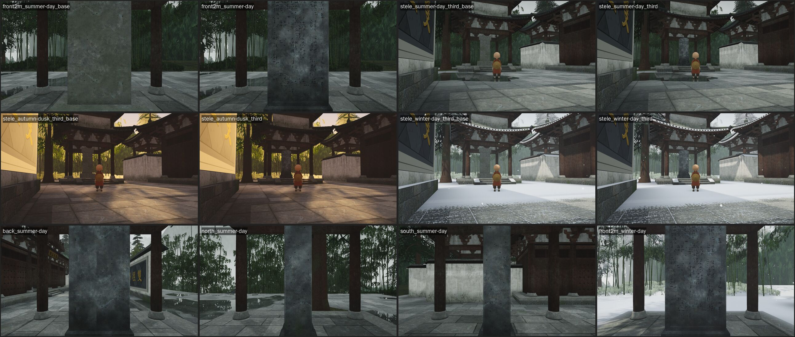

# #520 御碑亭的碑：第三次交（石质、风化、字；额待字形）

Refs #520。形（笏头碣白模第二版）已由审图二判过：[#594 评论 7075136640](https://github.com/bolechen/temple-walk/pull/594#issuecomment-7075136640)；结构评审的读法见 #520。第一、二版的图和数据在 `MANIFEST.json`（`r1/`、`r2/`、`collage-r1.jpg`、`collage-r2.jpg`），数据集 `bolechen/temple-walk-evidence`。

拼图：第一行 左两张是 2 米眼高（左改前的素方块、右改后）；第二、三张古道机位夏昼的改前和改后；之后依次秋暮、冬昼的古道机位改前改后；末行是碑阴、北侧、南侧、冬昼 2 米眼高。T4，1280×720，提交 `a8306dd` 的站点（改前是 main）。

## 做了什么

- **石质**：新材质 `steleStone`（`app/src/materials.js`），青灰、比亭台基更冷更暗；靠 `stair` 属性（碑自己坐标、朝向、座/身、倒角）和两张小图读，不加一个三角形。碑不落雪。
- **返潮**：座和碑身最下 30–40 cm 发深（座三层朝上的面灰而略浅）。
- **摸亮**：碑身两条前棱离地 0.8–1.4 m 一段、座最上一层前棱，轻重不匀。
- **苔**：只在背阴面低处，面积很小。**风化**：碑首顶和上角发白、起坑；雨痕竖条。
- **破瓣**：碑身四条棱两个小面、中间一道线（原文「随身棱并破瓣」，结构评审要求）；`bevelSegments: 2`，线是材质刻的。
- **正文**：不是任何真文字（真碑文径山兴圣万寿禅寺一字不出现）。每格是自造的「像字的笔画」，再按斑块侵蚀掉约七成，残痕和更浅的磨痕留着；`app/levels/t00/stele-ink.js`，单测 `stele-ink.test.mjs` 管：丢失 60%–76%、完整的格子 ≤ 3、仍数得出 ≥ 10 行、种子一定则字一定。
- **额**：框已开在碑首（0.46 × 0.40 的浅下沉框），**字没有放**：「御書」两字的小篆字形要从《说文解字》的扫描本取（见下）；放字的管道（`makeTitle`、`stele-title-data.js` 的位图、材质里的字层）已经通了，单测证明两个字的位图会各落在框的左右半。
- 备用的龟趺版按主创的要求删了（git 历史里有），一个绘制调用（座和身合成一个网格）。

## 判法与数（审图二的第三次判法；T4 软件之外的都在 T4 上，1280×720）

下面的「2 米眼高」是小沙弥自己的眼高（1.3 m）、离碑中心 2.0 m、平视；`measure3.py` 量。0.6–2.0 m 一段碑面：上五分之一和下五分之一的 L\*，48×48 像素块中位数去掉缓变后的标准差，平坦块（块内标准差 < 1.5 L\*）的比例。

| 图 | 下五分之一比上五分之一暗 | 48×48 块起伏 | 平坦块 |
|---|---|---|---|
| 夏昼 | 9.6 L\* | 4.06 L\* | 1% |
| 冬昼 | 8.8 | 3.72 | 1% |
| 秋暮 | 4.5 | 2.08 | 19% |

线是下五分之一暗 ≥ 6、起伏 ≥ 3：夏昼、冬昼过；**秋暮不过**（4.5、2.08、平坦块 19%），原因是秋暮整块碑落在亭影里，L\* 只有 13–18，暗处同样的反照率差在 L\* 上只剩一小半，改材质调不过来而不伤夏昼（试过加大斑块和细纹，没有变化）。请审图判这几条是否只按 J01 夏昼算。秋暮的碑在亭影里是一块安静的灰，没有比台基亮。冬昼碑上没有雪。

- **摸亮**（`arris` 视角，沿前棱 0.8–1.4 m）：沿棱每 20 像素一段的亮度，标准差/均值 0.20–0.30（线 ±15%），棱比旁边的面亮约 1.5 倍。
- **苔**：背阴面低处可见的偏绿像素约 1%（线：小于一成）。
- **石质**：冷、暗于亭台基。
- **正文**：2 米眼高图上，正文成行、认不出一个词；丢 72%、完整的格子 3 个、仍有 11 列有字。
- **额的字**：待字形，3.5–4 米平视看额的图和「两字各 ≥ 30 像素」这条等字放进去再量。

## 数

- 三角形：碑（座 + 身，破瓣后）约 320，原来三个方块 36，净增约 280（单测 ≤ 400）；T4 古道机位整幅 1345062 → 1345702（镜面再画一次，所以整幅多一倍），调用 178 → 180（座和身并成一个网格）；限额 ≤ 2000。
- T4 帧时间（`cost`，高档、1920×1080、古道机位，改前改后交替，T4）：第一轮（座和身还是两个网格）4 对，改前均值 11.02、改后 11.22，差 +0.21 ms；第二轮（并成一个网格）6 对，改前 9.645、改后 9.625，中位数差 −0.025 ms；两轮的原始数在 `t4-cost-first-report.json`（`r3/`，数据集）和 `t4-cost-report.json`。T4 同一类运行里两对之间的起伏有 ±0.5 ms，所以只能说差在 0.1 ms 以内（合计 10 对差 +0.07 ms）。
- 可走面积：`walk-diff` 命名地点一个不少，改后多 0.75 m²（座比原方块小），没有哪部分超过 1 m²；`nearplane:grid` 20/20；`edges` 御碑亭 12174 个落脚点 0 超出。
- 材质：`steleStone` 只有这座碑用，不改任何共用材质，所以不要 T05 对照。

## 额的字形来源（还没拿到）

- 主创定：「御」「書」两字都从同一部《说文解字》的扫描本取，不用 Sears 站点的重绘 SVG。
- 找到的：Wikimedia Commons，国家图书馆藏《说文解字》十五卷，清同治十二年（1873）番禺陈昌治刻本；第 2 册（`NLC892-312002098744-312890`）含弟二上、二下、三上、三下，御在弟二下彳部、書在弟三下聿部；文件页许可标签 PD-old-100-expired / PD-scan，出处 National Library of China，92 页，约 67 MB。
- 卡在：本机出口 IP 被 Wikimedia 限流，页面和 PDF 都 429，十几分钟轮询仍不开。没有绕开限流（试过另用一台机器下，被拒，也不该）。解封后：下载、核对许可页、栅格化、定位两字所在的页和裁切框，写进 SOURCES.md 和 `asset-register.csv`，裁切脚本和字图一起进仓库。
