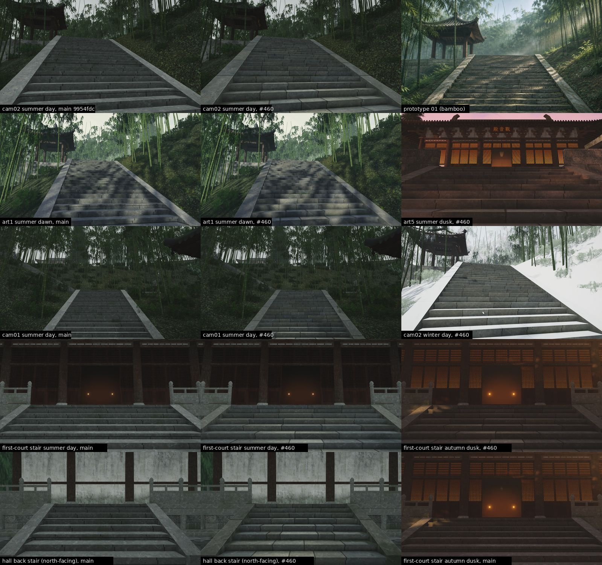

# #460 石阶读成砌的：改前改后

Refs #460（`docs/ART-REVIEW.md` A3）。PR #486。

拼图每行三格：改前（main `9954fdc`）｜改后（本分支）｜参照（第一行是美术原型 01，其余各行第三格是另一个机位或另一个时辰，格内有字）。每格都是 T4 的原图居中裁成 16:9，缩到 533 像素宽；原图在下面的地址里。

## 怎么拍的

- **机器**：Hugging Face Job，一块 Tesla T4（ANGLE，Vulkan 1.4），高档，1920×1080（`art*` 用 1920×804），一人称，`?shot=1`。运行号 `20261121-085034`（命名机位和帧耗）、`20261121-092256`（首院踏道和背阴后阶，用 `?cam=` 站到近处）；两次都是同一个站点构建。
- **改后的代码**：`2af05b1`（干净，没有 `+dirty`），站点指纹 SHA-256 `338ca54803a81628…`，366 个文件。
- **改前的代码**：`9954fdc`（本分支分出来时的 main），用 `BASE_SITE` 一并送上同一个 Job、同一个浏览器，放在 `base/` 下，文件名带 `_base`。
- 两个提交之间合进来的 main 改动是 T05 的白盒、证据流水线、新访客的第一枚印和文档，没有动 T00 台阶上画出来的东西。
- 重出：`BASE_SITE=<main 的 dist> tools/gpu-render.sh t4-small "$(cat t4-spec.json)"`（`t4-spec.json` 在本目录，是第一个 Job 的：交替量帧耗加出图；第二个 Job 只出图，规格在这个 README 的「机位」一条里）。
- 机位：`?show=cam02`、`cam01`、`art1`、`art5`、`terrace`（大殿后面上藏经楼台地的那一段）、`hall`（首院里远看大殿前阶）；首院踏道近景是 `?cam=0,2.2,0,0.12`（站在大殿台基前，夏昼、秋暮各一张），背阴的后阶是 `?cam=8.85,-31,3.14159,-0.25`（站在大殿后阶下面，向北下来的那一段，夏昼）。

## 三角面和绘制数：不增加

`bench` 每一行记的是页面里实际画出来的数，改前改后逐行相同：

| 机位 | 三角面 | 绘制数 |
|---|---|---|
| cam02 夏昼 | 527,283 → 527,283 | 86 → 86 |
| art5 夏昼 | 692,813 → 692,813 | 122 → 122 |
| cam01 夏昼 | 1,005,191 → 1,005,191 | 233 → 233 |

`__census()` 在 cam02 上改前改后逐项相同（`site` 628,722 面、140 个网格）：台阶的几何一个顶点都没有多，只是每个顶点多了一个 vec4 的属性（`stair`）。

## T4 帧耗：没有增加

同一个 Job、每次一个新开的页面，改前改后交替（改前先、改后先轮着来），`__cost(40)` 的毫秒数（只算画一帧，不含无头浏览器自己的呈现）：

| 机位 | 次数 | 改前 | 改后 | 差 |
|---|---|---|---|---|
| art5（台阶占画面下半，最不利） | 8 | 11.18 ± 0.46 | 10.96 ± 0.34 | −0.21 ms |
| cam02 | 6 | 12.06 ± 0.37 | 11.85 ± 0.21 | −0.21 ms |
| cam01 | 4 | 13.23 ± 0.15 | 13.23 ± 0.17 | 0.00 ms |

差都在每次的离散度之内：量不出变慢。（上一版没收窄噪声调用时是 +0.28、+0.67、−0.93 ms，同样在噪声里；提交 `2af05b1` 把噪声只放在可能有苔的踏步和垂带上。）

## 看哪里

- **cam02、art1**（`t4/cam02_summer-day*.png`、`t4/art1_summer-dawn*.png`）：垂带头上是一块压顶，其下是长短不一的条石，缝不齐；踏面由两到五块石拼成，缝一级一级错开；改前是整条光板和一整条横线。
- **首院踏道**（`t4/firstcourt-stair_*.png`）：大殿前阶，八级、宽 6.4 米，四五块石拼一级，垂带分三段；秋暮里垂带的亮面和暗面也分出了块。
- **背阴的苔**：朝北下去的台阶（大殿后阶）踏面角、踢面脚和垂带脚的缝里有苔，朝南下去的几乎没有。T4 的在 `t4/hall-back-stair_summer-day*.png`，近景在 `closeup-sw/main-hall-back-stair-shaded-from-*.png`（软件渲染，只证形和相对关系）。
- **磨亮的中线**：`closeup-sw/art5-treads-summer-day.png`、`cam01-treads-summer-day.png`，各块石磨得不一样；两头贴垂带处深而潮。
- **冬景**：`t4/cam02_winter-day*.png`、`closeup-sw/cam02-treads-winter-day.png`。积雪照旧（踏面前沿一条雪、垂带顶一层雪），没有新的破绽；#78 那件事（垂带积雪的样子）没动。
- **落叶**：踏面上零星几片竹叶，画在石面上，没有借 `litter.js`。

## 没验的

夜景、手机低档（`q=low`）、拍照模式成片、十六种季节时辰里别的十二种、其余七座殿的台阶近看（`hall`、`terrace` 只在夏昼拍了）。雪下的踏面在冬景里被雪盖住，苔看不到，这是对的。

## 原图

地址钉在数据集提交（第一批 `7f719cef3100`，第二批 `e130c85de127`），清单见 `MANIFEST.json`；`node tools/evidence.mjs pull docs/t00/evidence/stone-steps-460` 取到 `tools/out/evidence/`。清单里还有 `collage.jpg`，是第一版拼图（四行），已被 `collage-final.jpg` 取代，库里不删。

- T4 命名机位（改后 / 改前）：
  - [`cam02_summer-day.png`](https://huggingface.co/datasets/bolechen/temple-walk-evidence/resolve/7f719cef3100ca7650b3df54ab1c22830c6efc2b/t00/stone-steps-460/t4/cam02_summer-day.png) / [`cam02_summer-day_base.png`](https://huggingface.co/datasets/bolechen/temple-walk-evidence/resolve/7f719cef3100ca7650b3df54ab1c22830c6efc2b/t00/stone-steps-460/t4/cam02_summer-day_base.png)
  - [`cam01_summer-day.png`](https://huggingface.co/datasets/bolechen/temple-walk-evidence/resolve/7f719cef3100ca7650b3df54ab1c22830c6efc2b/t00/stone-steps-460/t4/cam01_summer-day.png) / [`cam01_summer-day_base.png`](https://huggingface.co/datasets/bolechen/temple-walk-evidence/resolve/7f719cef3100ca7650b3df54ab1c22830c6efc2b/t00/stone-steps-460/t4/cam01_summer-day_base.png)
  - [`art1_summer-dawn.png`](https://huggingface.co/datasets/bolechen/temple-walk-evidence/resolve/7f719cef3100ca7650b3df54ab1c22830c6efc2b/t00/stone-steps-460/t4/art1_summer-dawn.png) / [`art1_summer-dawn_base.png`](https://huggingface.co/datasets/bolechen/temple-walk-evidence/resolve/7f719cef3100ca7650b3df54ab1c22830c6efc2b/t00/stone-steps-460/t4/art1_summer-dawn_base.png)
  - [`art5_summer-dusk.png`](https://huggingface.co/datasets/bolechen/temple-walk-evidence/resolve/7f719cef3100ca7650b3df54ab1c22830c6efc2b/t00/stone-steps-460/t4/art5_summer-dusk.png) / [`art5_summer-dusk_base.png`](https://huggingface.co/datasets/bolechen/temple-walk-evidence/resolve/7f719cef3100ca7650b3df54ab1c22830c6efc2b/t00/stone-steps-460/t4/art5_summer-dusk_base.png)
  - [`art5_summer-day.png`](https://huggingface.co/datasets/bolechen/temple-walk-evidence/resolve/7f719cef3100ca7650b3df54ab1c22830c6efc2b/t00/stone-steps-460/t4/art5_summer-day.png) / [`art5_summer-day_base.png`](https://huggingface.co/datasets/bolechen/temple-walk-evidence/resolve/7f719cef3100ca7650b3df54ab1c22830c6efc2b/t00/stone-steps-460/t4/art5_summer-day_base.png)
  - [`terrace_summer-day.png`](https://huggingface.co/datasets/bolechen/temple-walk-evidence/resolve/7f719cef3100ca7650b3df54ab1c22830c6efc2b/t00/stone-steps-460/t4/terrace_summer-day.png) / [`terrace_summer-day_base.png`](https://huggingface.co/datasets/bolechen/temple-walk-evidence/resolve/7f719cef3100ca7650b3df54ab1c22830c6efc2b/t00/stone-steps-460/t4/terrace_summer-day_base.png)
  - [`hall_summer-day.png`](https://huggingface.co/datasets/bolechen/temple-walk-evidence/resolve/7f719cef3100ca7650b3df54ab1c22830c6efc2b/t00/stone-steps-460/t4/hall_summer-day.png) / [`hall_summer-day_base.png`](https://huggingface.co/datasets/bolechen/temple-walk-evidence/resolve/7f719cef3100ca7650b3df54ab1c22830c6efc2b/t00/stone-steps-460/t4/hall_summer-day_base.png)
  - [`cam02_winter-day.png`](https://huggingface.co/datasets/bolechen/temple-walk-evidence/resolve/7f719cef3100ca7650b3df54ab1c22830c6efc2b/t00/stone-steps-460/t4/cam02_winter-day.png) / [`cam02_winter-day_base.png`](https://huggingface.co/datasets/bolechen/temple-walk-evidence/resolve/7f719cef3100ca7650b3df54ab1c22830c6efc2b/t00/stone-steps-460/t4/cam02_winter-day_base.png)
- T4 `?cam=` 近景（改后 / 改前）：
  - [`firstcourt-stair_summer-day.png`](https://huggingface.co/datasets/bolechen/temple-walk-evidence/resolve/e130c85de127fab13f6a2f800733986a7b6e095b/t00/stone-steps-460/t4/firstcourt-stair_summer-day.png) / [`firstcourt-stair_summer-day_base.png`](https://huggingface.co/datasets/bolechen/temple-walk-evidence/resolve/e130c85de127fab13f6a2f800733986a7b6e095b/t00/stone-steps-460/t4/firstcourt-stair_summer-day_base.png)
  - [`firstcourt-stair_autumn-dusk.png`](https://huggingface.co/datasets/bolechen/temple-walk-evidence/resolve/e130c85de127fab13f6a2f800733986a7b6e095b/t00/stone-steps-460/t4/firstcourt-stair_autumn-dusk.png) / [`firstcourt-stair_autumn-dusk_base.png`](https://huggingface.co/datasets/bolechen/temple-walk-evidence/resolve/e130c85de127fab13f6a2f800733986a7b6e095b/t00/stone-steps-460/t4/firstcourt-stair_autumn-dusk_base.png)
  - [`hall-back-stair_summer-day.png`](https://huggingface.co/datasets/bolechen/temple-walk-evidence/resolve/e130c85de127fab13f6a2f800733986a7b6e095b/t00/stone-steps-460/t4/hall-back-stair_summer-day.png) / [`hall-back-stair_summer-day_base.png`](https://huggingface.co/datasets/bolechen/temple-walk-evidence/resolve/e130c85de127fab13f6a2f800733986a7b6e095b/t00/stone-steps-460/t4/hall-back-stair_summer-day_base.png)
- 软件渲染的近景（dev server，一页里换视角；只证形和相对关系）：
  - [`art5-treads-summer-day.png`](https://huggingface.co/datasets/bolechen/temple-walk-evidence/resolve/7f719cef3100ca7650b3df54ab1c22830c6efc2b/t00/stone-steps-460/closeup-sw/art5-treads-summer-day.png)
  - [`cam01-treads-summer-day.png`](https://huggingface.co/datasets/bolechen/temple-walk-evidence/resolve/7f719cef3100ca7650b3df54ab1c22830c6efc2b/t00/stone-steps-460/closeup-sw/cam01-treads-summer-day.png)
  - [`main-hall-back-stair-shaded-from-above.png`](https://huggingface.co/datasets/bolechen/temple-walk-evidence/resolve/7f719cef3100ca7650b3df54ab1c22830c6efc2b/t00/stone-steps-460/closeup-sw/main-hall-back-stair-shaded-from-above.png)
  - [`main-hall-back-stair-shaded-from-below.png`](https://huggingface.co/datasets/bolechen/temple-walk-evidence/resolve/7f719cef3100ca7650b3df54ab1c22830c6efc2b/t00/stone-steps-460/closeup-sw/main-hall-back-stair-shaded-from-below.png)
  - [`cam02-treads-winter-day.png`](https://huggingface.co/datasets/bolechen/temple-walk-evidence/resolve/7f719cef3100ca7650b3df54ab1c22830c6efc2b/t00/stone-steps-460/closeup-sw/cam02-treads-winter-day.png)
