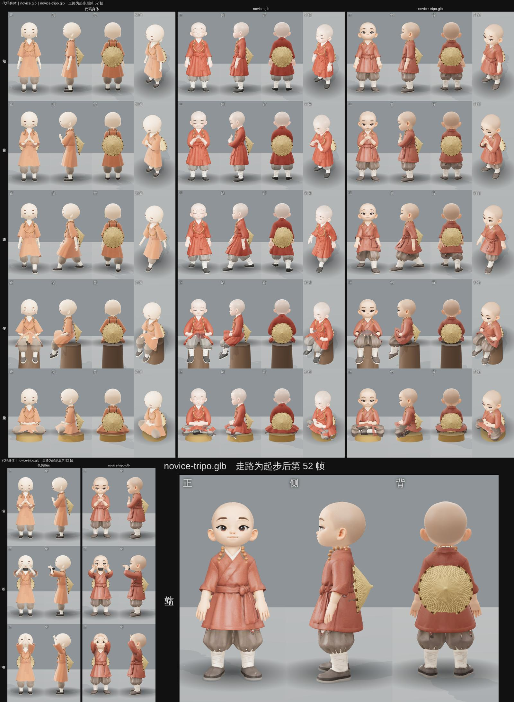
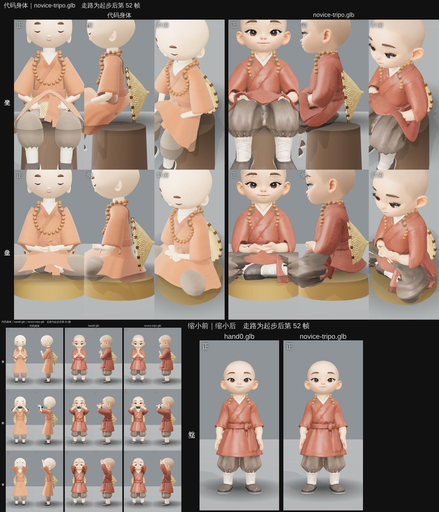

# 小沙弥换分层模型：离线接入试验（#246，#163 的接入一半）

2026-11-19，分支 `claude/novice-tripo-246`。只加工具和测试，`app/` 一行没改，线上仍穿代码身体。

## 一句话

一条命令（`node tools/novice-tripo.mjs <目录>`，3.5 秒）把 Tripo 第二轮的 16 件分层模型做成 `monk.dress()` 不改就能穿的四件身体：20,671 面，1.41 MB，两张贴图。站、合掌、走、上台阶、坐凳、盘坐时同一位置的点都不分家，袍下有裤子、不露黑。要接上线还得**重调**三处：手位（手比代码身体大）、`BODY`（大 1.9 cm）、念珠（会穿进胸口）。

原图和重出方法见 `docs/t00/evidence/novice-tripo-246/README.md`。

## 现成的做法（2026-11-19 当天查的原始资料）

| 候选 | 版本（发布日） | 许可 | 结论 |
| --- | --- | --- | --- |
| glTF-Transform（core / functions / extensions） | 4.5.1（2026-09-28） | MIT | 用来读写（项目原来就有）。它的 `palette` 只合并没有贴图的材质里的数值，**合并不了**这 48 张贴图，所以图集自己拼 |
| meshoptimizer | 1.3.0（2026-09-25） | MIT | 用 `simplify` 加 `LockBorder` 减面，边界和贴图缝不动。它也有 `simplifyWithAttributes`，眼下用不着 |
| xatlas（jpcy，MIT）、xatlasjs 0.2.0 / xatlas-three 0.2.1（都是 2024-09-28，MIT） | — | MIT | 不用。16 件的 UV 都在 0–1 里，按件拼图集、只改偏移就够了，不必重展 |
| maxrects-packer 3.0.0（2026-10-15）、potpack 2.1.0（2025-07-14） | — | MIT / ISC | 不用。16 块都是 2 的幂，一行一行往下排几行代码就够了，不为它加依赖 |
| Blender 5.3.0（Data Transfer 可以无界面 `blender -b --python` 跑） | — | GPL-2.0+ | 暂不用。Linux 包 388 MB，而现有的转权重做法（下面）对这个模型够用 |
| Robust Skin Weights Transfer（rin-23，SIGGRAPH Asia 2023） | — | MIT，Python + libigl | 备选。腋下、裆部如果出问题再换它；这次没出 |
| Tripo 自动绑骨 | — | — | 不用（issue 已经说明：骨架不是我们的） |

**新增 npm 依赖：无。** 用到的 glTF-Transform、meshoptimizer、sharp 都是 `tools/novice.mjs` 早就在用的开发依赖，不进页面包体。

## 做法

`tools/novice-tripo.mjs`，按顺序：

1. **读件、转向、定高**：从 `seg-model.glb` 读 15 件，裤子从 `comp-model.glb` 读，都带上节点变换。Tripo 的模型面朝 +x、左手在 −z，转成我们的面朝 +z、左手在 +x，再缩放到 1.18 m 高、鞋底落在 y = 0、水平居中。
2. **补全的裤子**：Tripo 补全时新做出来的面，判法是离分件里原裤面超过 3 mm。补全做出了 2,927 面，其中封住裤口的 713 面藏在绑腿里，删掉。其余是裤腰和裆，原来是黑的，改成指向图集里一块纯色，颜色取裤子自己贴图的平均色 rgb(83,70,61)。**用的是平均色，不是顶点色。**
3. **前臂左右对称**：右前臂被分件并进了右袖。按贴图颜色（肤色而不是袍的砖红）把这 155 面挪到皮肤。挪完两只前臂都在皮肤里，都按「沿手臂」取权重。
4. **切垂带**：垂带是袍摆那张面的一部分，比袍面凸出 2–3 cm，在他左前 30°–72°、高 0.36–0.59 m（量法：每个高度上取垂带两侧的袍面半径，连一条直线，看超出多少）。
   - 凸出超过 6 mm 的点连成的那一块切出来，共 480 面，单独一块。
   - 这块再拷一份，不贴着袍面的点压回那条直线往里 4 mm（247 点），补在袍上原来的位置。这样垂带摆开时袍上不露洞。
   - 垂带离顶端 8 cm 以内的权重逐渐过渡到 `sashTail`，再往下全在 `sashTail` 上。它不参加焊权重，边缘可以离开袍面；只有还没过渡的顶边缝在腰结上。
5. **减面**：每件按 `PIECES` 表里的比例减，边界和贴图缝锁住。31,509 面减到 20,671 面。头留得多（0.8），裤子大半被袍挡住，留得少（0.45）。
6. **一张图集**：颜色图在 2048 的图集里拼好后存成 2048，法线存成 1024，都是 WebP。每块四周留 4 px 的边。金属粗糙度图收成一个常数（粗糙度 0.616，按面积加权平均；金属度 0），所以只有两张贴图。
7. **权重**：
   - 默认取代码身体同一部件里最近四个点的权重；手臂上按离肩多远取，和 `tools/novice.mjs` 的 4、4a 两步一样（已抽成 `tools/novice-weights.mjs`）。
   - **袍身**（上衣、腰带、袍摆、垂带背后补的那块）改用 `monk.js` 里袍子自己的权重公式 `robeW`（按高度和朝向算，抄进 `robeWeights`）。原因：代码身体的袍前面有开口，这件袍摆前面是合的，取最近点时左右两侧落在不同的骨上，坐凳时袍前被撕开。
   - 最后一个点一个权重：`NOVICE_WELD=8`，用 `tools/novice-weld.mjs`。
8. **写文件**：格式和 `novice.glb` 一样，四个网格（skin、robe、legs、shoes），一个材质，`extras.bones` 照骨骼顺序列出。

**和 `tools/novice.mjs` 的关系。**
- 共用的：焊权重（`novice-weld.mjs`），以及从代码身体转权重、沿手臂取权重这两步。后两步抽成了 `novice-weights.mjs`，`novice.mjs` 里那份没删：沙箱里没有 Meshy 原件（24 MB）重跑，没法确认合并后线上的 `novice.glb` 一字节不变。下次手边有原件时，让 `novice.mjs` 也引这个模块，并比对 SHA-256。
- 新写的：部件对照表、找补全做的面、切垂带、拼图集、袍身按公式取权重。

**Tripo 重新生成一版后要手动改的**：
- `PIECES`：节点编号每次分件都会变。看 `parts` 图对上「头、耳、手、袖……」。哪只袖子里并进了前臂，就给它标 `skinInside`。
- `SASH`：垂带的角度和高度。工具会打印切了多少面，对照图上看切得对不对。
- 其余步骤不用改。

## 验收逐条（在提交 `交活` 那一条里的 head 上）

| # | 验收 | 结果 |
| --- | --- | --- |
| 1 | 不花 Tripo 点数 | **过**。没有调用 `api.tripo3d.ai`，余额 120 没动 |
| 2 | 一条命令重出，两次 SHA-256 相同 | **过**。见下面「输入与产物」 |
| 3 | 四件，`dress()` 不改，垂带在 `sashTail`，前臂对称，领口杂色面清掉 | **过**。领口杂色面是补全在上衣领口封口时做出来的；上衣取的是没补全的分件版本，所以不带它。`novice.js` 的 `loadNovice` 也不用改（没用 meshopt 压缩） |
| 4 | 预算：≤1.5 倍面数，≤1.5 MB，≤2 张贴图 | **过**。20,671 面，是现有 20,460 的 1.01 倍；1.41 MB；2 张 |
| 5 | 不撕裂（同一位置一个权重；站、走、上台阶不分家；加坐蒲团、坐凳） | **过**，`tests/unit/novice-tripo.test.mjs` 九条全过，下面列出测试名 |
| 6 | 袍下不露空不露黑 | **过**，有保留。四面图上袍下看到的是裤子的颜色；测试查了裤和袍没有一个点落在近黑的贴图上。保留的地方：坐凳时袍前那片抬到腿下面去了，正面看得到整条裤腰（有颜色，不黑），和代码身体盖在腿上的样子不同；站立正面袍摆下沿有几处小白点（没查清是哪件，下一步用 `__pick` 查） |
| 7 | 对照图三列五姿四面、斗笠和念珠三面 | **过**。拼图在仓库，原图在数据集 |
| 8 | 量，不改 | 见下面「量出来的」 |
| 9 | 许可 | 见下面「许可」 |
| 10 | 报告 | 本文 |
| 11 | `pnpm run check`、`pnpm test` | 见 PR 交活评论 |

**测试名**（`node --test tests/unit/novice-tripo.test.mjs`，文件不在时整套跳过）：
- made for this skeleton: four parts, joints numbered as monk.js's bones, two textures
- within budget: at most 1.5 times the sculpted body's triangles, at most 1.5 MB
- he stands 1.18 m tall, soles on the floor, centred; every weight whole and on a bone that is there
- the sash's end hangs on sashTail, at his left front; the rest of the robe does not
- his hands go with his hands, both forearms with their forearms, his shoes with his feet
- every copy of one point takes the same weights (the sash's free edge apart)
- copies stay within a millimetre standing, through a stride and up a flight
- copies stay within a millimetre sitting on a stool and cross-legged on a cushion, and with palms together
- nothing he wears is black: the faces the completion made under the robe are coloured

这些测试在 CI 上会跳过，因为产物不在 git 里、私有桶 CI 也取不到。要在 CI 上跑，得等文件进了 `app/`。

## 输入与产物

| 文件 | SHA-256 |
| --- | --- |
| `seg-model.glb`（分件） | `7966f90d9d58cf117cb674177aa65cb73091f7f16c51e572af27e9056a711c75` |
| `comp-model.glb`（补全） | `82d04b491538bbd0a219f381ea8e4270aac78a387b7541ddb69e823640a21c11` |
| `pbr_model.glb`（整体，没用到） | `c8a3194c7ea80af045f6659177f1f2e001845423567e07d3af9d0e008ab68d1e` |
| **产物** `novice-tripo.glb`（1,413,704 字节，两次运行相同） | `c969d62cb0b9de0cfc8a2ed21f4e91bb38ea3b8b15ab78c2dbf3d2d7f2fa5010` |

产物放在 `hf://buckets/bolechen/temple-walk-render/keep/novice-b/2026-11-19/novice-tripo.glb`。

## 量出来的（`node tools/novice-measure.mjs app/shared/models/novice.glb tools/out/novice-tripo.glb`）

| | 代码身体 | Meshy | 新身体 | 结论 |
| --- | --- | --- | --- | --- |
| 外廓半径（edges.test 的六个姿势） | 0.377 m | 0.379 m | **0.399 m**（比 `BODY` 0.38 大 1.9 cm，出现在原地跳、两臂张开时） | **重调**：把 `BODY` 改成 0.40，可走格子（#194）和 `edges` 表跟着重烘；或者收窄 A 姿的臂展。这一项牵连最大 |
| 头顶高 | 1.177 m | 1.180 m | 1.180 m | 不变（按身高归一的） |
| 眼高 | 1.017 m | （闭眼，量不准） | 1.000 m | 不变。第一人称的眼睛跟着头骨走，不按模型的眼睛；低 1.7 cm 看不出来 |
| 合掌 | 掌心相合 | — | 手比代码身体大，十指张开，**掌心没合上** | **重调**：合掌的手位和手掌朝向 |
| 吃茶（碗到唇边） | 手在碗两侧 | — | 手大，**遮住了脸颊和眼睛**，碗在下巴前面 | **重调**：`rites.js` 里捧碗的手位（`hold` 的偏移） |
| 举香到眉 | 双掌在额前 | — | **手掌盖在额头和脸上** | **重调**：`brow` 的偏移往前放 |
| 袖子 | — | — | 三个手位里袖子都没有穿进袍身 | 不变 |
| 斗笠（背在身后） | — | — | 贴在背上，没有穿进身体 | 不变 |
| 念珠 | — | — | **大半穿进胸口**，只在肩上和领口露出来 | **重调**：念珠的环再放大一些，或者往前挪 |

合起来：骨骼、`monk.update`、`dress()` 这条路、坐姿、步态都**不变**；`BODY`、三个仪式的手位、念珠要**重调**；没有哪一项要**重做**。

## 许可

Tripo 的条款：「Terms of User Agreement」，**Last updated: July 11, 2025**，Holymolly Ltd，<https://developers.tripo3d.ai/en/terms>（2026-11-19 读。`www.tripo3d.ai/terms` 对自动抓取返回 403，这里引的是同一份协议在开发者站上的文本，正文写明适用于 www.tripo3d.ai 及相关网站）。

- §3.2：「…you may use Outputs for lawful commercial or non-commercial purposes, so long as such Outputs are not distributed or made available to third parties in a manner inconsistent with this Agreement or applicable laws」
- §5.2.2（付费用户，原文如此）：「…Paid Users generally have all rights (including but not limited to: use, copy, reproduce, modify, adapt, publish, translate, create derivative works from, distribute, … derive revenue …) of the Inputs and Outputs by the paid Users and the Intellectual Property Rights based on the Inputs and Outputs by the paid Users. For the avoidance of doubt, Company will not use Inputs and Outputs as training data…」
- §5.2.1：免费用户的产出，所有权利归 Tripo。
- 署名：条款里没有署名或水印的要求（搜「attribut」「watermark」都没有）。
- API 积分：§6.4 只说积分「intended primarily for business and professional use」、不退。没有单独写 API 产出归谁；按付费使用理解，落在 §5.2.2。

所以：这两轮是用充值的 API 积分做的，属于付费产出，可以商用，不用署名。进 `app/` 时在 `asset-register.csv` 登记账号类别、两轮的任务号和条款日期 2025-07-11。

## 接入线上还差什么

1. 所有者看图，定「接入 / 重新生成 / 放下」。
2. `BODY` 0.38 → 0.40（或者收窄臂展），然后重烘可走格子（#194、`tools/bake-walk.mjs`），重跑 `pnpm run edges`。#161 的第三步要知道这件事。
3. 重调 `rites.js` 的合掌、吃茶、举香手位。手大了，按新身体的手长重设偏移，每个仪式出正、侧图。
4. 念珠的环放大或前移。
5. 产物进 `app/shared/models/`，登记 `asset-register.csv`（含 SHA-256、Tripo 任务号、条款日期）。`novice.js` 默认取哪个身体由所有者定。这时 `novice-tripo.test.mjs` 才会在 CI 上真跑。
6. 坐凳时袍前抬到腿下面的问题：调 `robeFront` 的抬起量，或者把这件袍摆的前片单独加权。站立时袍摆下沿的小白点：用 `__pick` 查。
7. 颜色：袍比 Tripo 原图的砖红浅。原因是金属粗糙度收成了常数，舞台的环境光也不同。进场景后在夏昼里对一次色。
8. `tools/novice.mjs` 改为引用 `novice-weights.mjs`（要有 Meshy 原件才能比对字节）。
9. 弹簧骨和碰撞体换 VRM 是 #163 第 5 条，不在这里做。

## 连带影响

- **别的模块**：这次一个都没动。将来接入时会动到的见上面「量出来的」：`BODY` → walker、可走格子、`edges`；手位 → `rites.js`；念珠 → `monk.js`。
- **玩家**：现在没有变化，线上不取这个文件。
- **多出来要同步的东西**：一个新工具，它的输入在桶里；一个测试文件；`novice-views.cjs` 多了几个选项（多身体并排、`--poses`、`--sides`、吃茶和举香两个手位）。
- **维护**：Tripo 再生成一版时，只改 `PIECES` 和 `SASH` 两张表；依赖都是项目原有的。

## 第二轮（2026-11-19 01:12–01:40 UTC，按时钟）

所有者看了第一轮的图，原话：「继续修 手位能修吗」。主创按五项派工。这一轮仍然只动 `tools/`、测试和文档，不改 `app/`，也不花 Tripo 点数。改正一处：第一轮交活写的「用时约 3 小时 20 分」不对，按时钟算，第一轮是 00:47–01:08，约 21 分钟。

产物 `novice-tripo-r2.glb`，SHA-256 `25b83d61d77eaebda85989d5a65f6caebbb3b335f92d25a2b998335e8a88e8bf`，21,014 面，1.42 MB，两张贴图；同样输入跑两次，输出字节相同。图和重出方法见 `docs/t00/evidence/novice-tripo-246-r2/`。

### 1. 坐凳：没过

- **腰带下那块灰的是什么**：不是洞。用新加的 `--faces` 看（背面涂洋红、背景涂绿），那块是洋红，是袍摆的内面，没有一处透出绿。
- **原因**：`monk.js` 坐凳时把袍前片绕 `robeFront` 抬起 1.22 弧度。这件袍摆在骨的支点前面挂得比代码身体远，抬起来就成了一块平板：在膝前高出大腿 9 cm，0.27 m 对大腿顶 0.18 m（`robeFront` 原样）；大腿粗的地方，抬起的布又落进了裤子里面。从正面平视，看到的是平板的侧边和它下面的裤子，还有平板后面袍摆的内面。
- **改了什么**：
  1. 袍前片在髋部以下，两侧跟着下面那条大腿转（`THIGH`）。布跟着它底下的大腿一起转，就一直在大腿外面。
  2. 正中两腿之间仍然跟 `robeFront`，越往下摆，越多一部分留在髋骨上（`HEM_HIPS` 0.45）。抬起来就是从腰带斜着落到膝上，不再平伸出去。
  3. 裤子在袍摆盖住的那一段（0.40 m 以上）向各自的腿线收到 75%（`SLIM`）。站着时这一段在袍摆里面，看不见；袍摆下沿到绑腿那一截鼓起不动。
- **量**：坐凳时正面 726 个袍前片点里，在裤子外面的从 561 个增加到 637 个（`robeFront` 原样 → 现在）。
- **按图看**：袍前片盖住了大腿的大半，腰带下不再露出袍内面。但膝盖、两膝之间的裤子和那道竖缝还看得见：这件袍摆比代码身体的短，铺在腿上只到大腿约三分之二。
- **要彻底解决**：做不到只靠一套权重，需要按姿势变化的布（#163 第 5 条的弹簧骨和碰撞体，或者坐姿单独一套权重和变形），或者重新生成一件更长的袍摆。按派工所说，这一项记为没过。

### 2. 盘坐：没过

- **膝下的红白碎块**：去掉了，是第 3 项那个原因。
- **两膝之间**：鞋、绑腿、袍摆前片还在互相穿插，侧面膝头有被扯开的裤面。盘坐时大腿向外翻，跟着大腿转的袍两侧转到了膝下。
- **试过的**：只让靠中间的一条跟大腿（`THIGH_OUT`）、改 `HEM_HIPS`。袍压在腿下的点数在 249 到 491 之间变，没有一组让坐凳和盘坐都变好。这一轮没有做成。
- **结论**：和第 1 项同一个根子：一套不随姿势变的权重，要同时管坐凳、盘坐和走路。

### 3. 站立时袍摆下沿两侧的红白小簇：过

- **是什么**：在裤子那一件上，不是分件残片，也不是贴图里本来就有的。补全做出来的面要涂成纯色，第一轮是逐点判定的：点周围的面全是补出来的，这个点才算纯色。交界上的三角形于是一两个角指向纯色块，另一两个角指向裤子贴图，贴图坐标从中间横扫过整张图集，把途中袍和绑腿的红、米白都画了出来，就是那些锯齿。
- **改法**：按三角形判定，补出来的三角形用自己单独的角。
- **验证**：新加单测「no triangle of the trousers is half on the plain colour and half on the texture」，对第一轮的文件（`c969d62c…`）没过，对这一轮的过。站、走、坐凳、盘坐的图上都没有红白碎块了。

### 4. 手位：合掌过；吃茶、举香没过（不改 `rites.js`，有保留）

**先量**（`node tools/novice-measure-hands.mjs <glb>`，权重 > 0.6 落在手骨上的点；腕骨处沿前臂方向为长、正面内为宽、前后为厚）：

| | 过腕长 | 宽 | 厚（前后） | 手心离手骨线（横 / 前） | 掌心朝向（绑定姿势） |
| --- | --- | --- | --- | --- | --- |
| 代码身体 | 7.6 cm | 5.8 cm | 3.9 cm | 0.2 / 0.5 cm | 向前 |
| 第一轮 Tripo 原样 | 8.2 cm | 6.0 cm | **10.4 cm**（五指前后张开） | **3.0** / −0.5 cm | **向大腿**（差约 100°） |
| 只转掌心（`HAND=0`） | 8.2 cm | 10.7 cm | 4.8 cm | 0.4 / 1.0 cm | 向前 |
| 转掌心并缩小（`HAND=1`，默认） | 7.6 cm | 8.8 cm | 4.5 cm | 0.4 / 0.6 cm | 向前 |

**三个毛病各自的原因**：
- **合掌合不拢**：主要是掌心朝向。仪式按代码手「掌心向前」的约定转手骨，Tripo 的手在绑定姿势里掌心朝大腿，所以转完掌心朝前朝后，对不上。只转掌心（`HAND=0`）就合上了，跟手大小无关。前臂长度不是原因：骨骼是同一副，Tripo 的手就从骨的腕处开始，相差 1–2 cm。
- **吃茶遮眼**：手大，五指张开 10 cm；转过来以后张开的方向变成竖的，挡到眼睛。缩小后，两手在脸颊两侧、眼睛下面，和代码身体差不多。按图看两侧脸颊还被手盖住一块，记为没过。
- **举香盖额**：目标点和代码身体一样（头骨坐标 0.15, 0.15），Tripo 的脸比代码身体靠前 1.4 cm，袖子和前臂也粗。缩小后手在额前，眼睛从手下面露出来，和代码身体相近；但按图手掌仍盖着额头和眉，记为没过。

**模型这边做了的**（`tools/novice-tripo.mjs` 的 1a 步，`HAND` 调大小，1 为代码手的大小）：
- 每只手绕前臂轴转大约 104°，掌心朝前，与代码手一致。转动分摊在前臂最后 10 cm 上，像前臂旋转一样，腕处不分家。
- 越过腕骨 2.5 cm 以内逐渐缩到代码手的长、宽、厚，手心挪到骨线上。
- 宽度只到 8.8 cm，没有缩到 5.8 cm：掌根有一段落在 2.5 cm 的过渡里没有完全缩小。
- 缩小前后的站姿正面都在证据里，所有者看好不好看。

**`rites.js` 要改多少**：三个手位都是 0 cm、0°。试过把举香的手往上往前移（头骨坐标 0.17, 0.19 和 0.19, 0.20，用新加的 `--brow`），前臂和袖子会整个挡在脸前，比现在更糟，所以不建议改。吃茶如果要让两颊再露出来，可以把 `hold` 里两手离碗的横向距离从 6.8 cm 加到 8 cm 左右，这一条没有试。

### 5. 念珠穿胸：量了，要改代码侧

- **量法**（`node tools/novice-measure-beads.mjs <glb>`）：从胸轴向外，经过每一粒念珠的点射线，打到最外层的布。
- **代码身体**：胸前念珠在布外 1.6 cm（中位数），最深的一点进布 0.4 cm。
- **新身体**：胸前念珠中位数在布里 1.4 cm，最深 3.4 cm，77% 的点在布里；背后中位数在布里 0.7 cm，最深 2.9 cm；肩上在布外。
- **结论**：新身体的袍胸比代码身体凸出约 3 cm，背后约 2 cm。模型侧收进 3 cm 会改掉他的外形（袍在设定图里就是这么厚），不建议。代码侧，`monk.js` 念珠那段，`onBody(loop, 32, 0.0152, true)` 的离身距离：胸前从 1.5 cm 加到约 5 cm，背后约 4 cm。也可以在 `dress()` 之后按新身体的表面重排念珠，这样以后换身体不用再量。本轮不改 `app/`。

### 本轮新增的工具选项

`tools/novice-views.cjs`：
- `--near` / `--focus` / `--focusx`：凑近看
- `--faces`：背面洋红、背景绿，用来分清布的内面和洞
- `--hide`：隐藏某几件
- `--brow`：试举香的手位而不改 `app/`
- 新姿势 `bind`：绑定姿势

### 接入线上还差什么（在第一轮清单上更新）

- 坐凳、盘坐：要按姿势变化的布（#163 第 5 条），或坐姿单独的变形，或重新生成更长的袍摆。只靠权重到这一轮为止。
- 念珠：`monk.js` 的离身距离（上面的数），或者在 `dress()` 里重排。
- 手：掌心朝向和大小在模型里解决了，`rites.js` 不用动。手宽 8.8 cm，比代码手宽 3 cm，要不要再缩看所有者。
- 第一轮列的 `BODY`、可走格子、颜色那几条不变。

## 第三轮：骨热自动权重（2026-11-19 01:45–01:55 UTC）

主创看了第二轮后的意见：同一处已经修到第三次，不再调手写的权重，换现成的蒙皮算法。骨架仍用我们的，裤子和袍摆分开算。手不缩，只转掌心。另外补答 01:14 那条里的三问。

### 开工前查的（当天）

- **bpy（Blender 的 Python 模块）**：PyPI 上的最新版是 5.3.0，可选版本只有 5.1.0–5.3.0，许可 GPL-2.0-or-later。这里是 Python 3.13，`pip install bpy==5.3.0` 装进单独的 venv，能装上，无界面能运行（`bpy.app.version_string` 为 5.3.0）。
- **GPL 有没有妨碍**：只在 `tools/` 里离线用，从不随页面发出去；它算出来的权重是写进模型文件的数据，不是 Blender 的代码。这样用不触发 GPL 对分发的要求。仓库里的 `tools/novice-retarget-trial.py` 早就这样用过。
- **骨热以外的现成办法**：
  - Blender 自带的「envelope / 最近骨」权重：更粗，不考虑表面连通。
  - 体素测地权重（Autodesk 的 Geodesic Voxel Binding，Maya 里有，Blender 没有开源实现）：不可用。
  - Pinocchio（Baran & Popović 2007，开源 C++，它的权重就是骨热的原型）：和 Blender 的骨热是同一类算法。
  - Robust Skin Weights Transfer（rin-23，MIT，Python）：从代码身体转权重，再在找不到对应的地方用 inpaint 补全。第二轮已经证明代码身体的权重不合这件衣服，所以这次没有用。
  - Blender 骨热既装得上又是通行做法，先用它。

### 做法

`tools/novice-heat.py`：
- 用 `monk.js` 骨架的绑定姿势建一副 Blender 骨架（骨名照旧，尾端指向下一个关节；四根袍摆骨从同一点分别指向袍的前、后、左、右）。
- 每组网格单独做一次 Parent with Automatic Weights，只允许该组的骨参与：
  - 裤子和绑腿：髋、两腿、两脚；
  - 袍摆：髋和 `robeFront/Back/Left/Right`。
- 同一位置的几份拷贝先焊起来，热量可以跨过贴图缝流动，每份拷贝都取它那个点的权重。

`tools/novice-tripo.mjs` 设了 `NOVICE_BPY=<python>` 时自己调用它，所以仍是一条命令。也可以用 `NOVICE_PIECES` / `NOVICE_HEAT` 分两步跑。两组都是「0 个点没被热量覆盖」，耗时不到 1 秒；两次运行输出字节相同。

**袍摆**：
- 纯骨热（`HEAT_LAP=0`）：盘坐最好，两侧袍压在腿下的点从 386 个降到 141 个，袍盖住交叉的腿。坐凳时袍前片整片挂在 `robeFront` 上，又抬成一块平板。
- 所以默认在骨热的结果上再叠第二轮膝上那一层（`thighFront`：袍前片两侧跟大腿，正中一部分留在髋上），即 `HEAT_LAP=1`。叠上以后：坐凳和第二轮一样，没有平板；盘坐压在腿下的点是 319 个（第二轮 386 个）。

### 结果（按图）

- **裤子：盘坐不再扯开，过。** 只看裤子的图上，第二轮在盘坐时膝侧碎成一片片，第三轮是完整的一团，正面、侧面都没有裂口。坐凳时两者都完整。
- **坐凳：过**（按主创这一轮定的标准：看得见裤子不算，扯开、穿插、平板才算）。袍前片铺在大腿上，大约到大腿三分之二；腰带下不露袍内面，也不成平板；四面都没有裂口。袍摆到膝上是这件衣服的长度决定的。
- **盘坐：没过（剩一处）。** 裤子不再扯开，袍盖住了交叉的小腿。两膝之间，袍前角在正面压进一只鞋里一点；鞋和绑腿交叠，是两只脚本来就交叉着。纯骨热时这一处最轻，但坐凳会成平板，两者不能兼得。
- **站、合掌、走：不比第二轮差**（同一组图）。
- 所以骨热没有把坐姿全部修好，但裤子扯开这一条是它修好的，权重公式修不到。

### 手：不缩，只转掌心；手指固定成微屈的样子

按主创意见，去掉缩放（`HAND` 默认 0）。转掌心和手心对到骨线上都保留。手指过了指根向掌心弯 18°（`CURL`），曲度和代码手相同：指尖前后错开 0.7 cm，代码手 0.8 cm。

### 01:14 那条的三问

**1. 三个手位不对，各有多少是五指张开、不能弯造成的？**
- 量法：`node tools/novice-measure-fingers.mjs`。
- 指尖到掌心：代码手约 6 cm，Tripo 5.8–6.4 cm。手指并不比代码手长。
- 指尖张开：代码手横向 2.8 cm、前后 0.8 cm；Tripo 原样 6.0 cm（绑定姿势里沿前后张开）；只转掌心后横向 5.6 cm。
- **合掌**：几乎全是掌心朝向造成的，只转掌心就合上了，十指张着也合得上。
- **举香**：和代码身体是同一个样子，不算问题（主创已认）。
- **吃茶**：手掌平贴在脸颊上，没有拢住碗。这是手指不能弯，不是手位：碗要拢住，指头得弯过 40°–60°。这超出了一个固定手形能兼顾的范围，合掌时指头要直。

**补（01:58）**：手不缩以后，吃茶时手指又伸到眼睛上了（`tea-curl-before-after.png`）。微屈 18° 前后几乎没有差别。所以吃茶要么加手指骨（方案 (a) 的「捧」手形），要么把吃茶的手位放低约 2 cm、指尖放平（改 `rites.js` 的 `hold`，本轮没试）。

**2. 不加骨骼，离线把手指并拢、微屈，固定成一个手形：做得到吗？**
- 做得到，这一轮已经做了：`CURL`，按几何分手指。
- 手部件在指根以外的部分，按共享的点连成块，正好分出四块，就是四根手指，不需要另一份带手指权重的绑定。拇指在指根以内和掌连在一起，没有单独分出来；本轮拇指不动。
- 做到的是一个「自然微屈」的手形，用一根手骨带动，和代码身体一样。合掌、举香都还好，吃茶仍是平掌贴脸（见上面的 `hands.png`）。
- 只靠一个固定手形，合掌（指要直）和捧碗（指要弯）不能都对。要两者都对，就得有手指骨。

**3. 加手指骨的两种办法各要什么**（只列，不改；查的是 VRM 规范 humanoid.md、three-vrm 源码、Unity 文档、Tripo 文档）：

- **规范**：VRM 1.0 人形骨骼必需的只有 15 根，手只要求到 `hand`；30 根手指骨全部可选。three-vrm 缺手指骨时照常载入、照常摆姿势（`VRMRig.setPose` 跳过不存在的骨）。所以下面两种办法都不破坏 VRM 兼容；(a) 的每根骨用 VRM 名字即可。
- **(a) 每只手两条链**：拇指 2–3 根、四指合成一组 2 根，共 4–6 根；加三四个预设手形（平掌、捧、拈、松）。
  - `monk.js`：骨骼列表里每只手加 4–6 根骨，名字用 VRM 的 `leftThumbProximal`、`leftIndexProximal` 这类，让四指组挂在 Index 上。代码身体自己的手也要按这些骨加权重，或者代码身体只用一根骨。`update` 里加一段：按 `act.hands.*.shape` 在几个预设之间按权重混合，设到这些骨上。
  - `rites.js`：每个手位加一个手形字段，例如合掌用平掌、吃茶用捧、上香用拈；三四行。
  - `tools/novice-tripo.mjs` / `novice-heat.py`：手指的权重用骨热算（手部件单独一组，只许手和手指骨），一步就够。
  - 开销：GPU 蒙皮是每个顶点固定 4 个影响，和骨的总数无关；three.js 的骨矩阵放在骨纹理里，没有 uniform 个数的限制。多出来的只是每帧 CPU 多算 8–12 根骨的矩阵，相对现在的 26 根骨可以忽略。手部顶点约 470 个，权重分到手指骨上，不增加顶点数。
- **(b) VRM 整套，每手 15 根，共 30 根**：
  - 骨数翻一倍多（26 → 56），每帧骨矩阵 CPU 开销大约翻倍，仍然小。
  - 要用上它，手的网格每个关节都得有足够的面才能弯；这件 Tripo 手每只约 470 顶点，弯三节会很粗糙。
  - `monk.js` 和 `rites.js` 要改的和 (a) 一样，只是预设手形的数据多 3 倍。
- **行业里通常怎么取舍**：
  - Mixamo 的骨架有「65 根（带全部手指）」和「25 根（不带手指）」两档，Adobe 论坛里都有记录；它的第一方说明页这里打不开（403），中间那档的确切数没有核实。
  - Unity 的文档：人形骨骼最少 15 根，手指可选；文档建议骨尽量少，同时说明「没有动画驱动的额外骨，开销可以忽略」。
  - 网页和手机上的风格化角色，常见做法是手指合并成一两条链，或者干脆不要手指骨，用几个固定手形。
- **建议**：(a)。只要吃茶这一个手位需要弯指，(a) 的两条链加三四个手形最省，也足够。

**4. Tripo 自动绑骨出的骨架带不带手指**（只查文档，没有调用、没有花点数）：
- 官方 v3 接口文档：<https://developers.tripo3d.com/en/docs/animations-rig.md>。
  - `model` 选 `v3.0-20260909` 时，`spec` 可以是 `tripo`、`mixamo`、`actorcore`、`unity`、`unreal`、`vrm`（「VRM 1.0 humanoid bone naming」）。
  - 价格：绑骨检查免费，自动绑骨 25 点（<https://developers.tripo3d.com/en/models/rig>）。
- **文档没有写骨架带不带手指**，也没有列出骨名。用 `spec: vrm` 只能保证名字是 VRM 的；那 30 根可选的手指骨填不填，不知道。
- 没有找到第三方专门测过 Tripo 手指绑骨的结果。
  - StraySpark 2026 年的对比文章说它是「a standard biped layout」，肩和胸的权重「over-smoothed」，没有提手指。
  - Tripo 自己的博客叫用户检查手和手指、手动修手指权重。
  - Mixamo 的工作人员说过：手指靠得太近时会认不出来。
- **值不值得花 25 点**：
  - 只有它能答「带不带手指、权重好不好」。即便带手指，它的骨架也不是我们的：要么把我们的骨骼换成它的（`monk.update` 每帧从我们的静止姿势出发，这条约定就要改），要么只借它的手指权重，再按骨名映射回来。
  - 如果选 (a)，手指权重用 Blender 骨热就能算（这一轮已经证明骨热在这件网格上可用），不必花点数。
  - 所以我的建议是**先不花**；如果所有者想直接拿到一份 VRM 整套骨架的对照，25 点能买到一个确定的答案。

### 接入线上还差什么（更新）

- 坐凳：按本轮标准已经可以接受。盘坐：袍前角在一只鞋上的一处穿插。可以再把袍前角的权重稍往小腿上偏，也可以接受它，或者交给 #163 第 5 条的弹簧骨和碰撞体。
- 裤子：用骨热以后不再扯开。接入时 `tools/novice-tripo.mjs` 要有一个装了 bpy 的 Python（`NOVICE_BPY`），或者把 `heat.json`（约 340 KB）当成输入的一部分存进桶里。
- 手：吃茶要弯指，就加手指骨，按方案 (a)。
- 念珠、`BODY`、颜色，同前两轮。

## 收尾（#256 内，2026-11-19 01:57–02:05 UTC）

主创看了第三轮的图，又指出两处扯开：手臂抬过肩时，袖子上臂外侧成排锯齿、腋下一道白缝；走路时后脚绑腿下沿扯出白条。用同一个办法收尾。

- **先查是哪一种扯开**：加了单测，把「手臂抬到眉前」「迈步」两个姿势并进同一点不分家的检查。在收尾前的文件上它**过了**：这两处都不是贴图缝上的拷贝分家，是边被拉长了好几倍（举香时袍上有 629 条边被拉过 3 倍；走路时脚踝一圈有 1,896 个「边·帧」被拉过 2 倍）。所以另加一条量拉伸的单测（「the cloth is not drawn out under the raised arms, nor round the back foot's ankle」）。它在收尾前的文件上没过，在收尾后的文件上过。
- **绑腿**：
  - 骨热只许小腿骨参与。
  - 原因找到了：绑腿下沿和鞋口有一圈共用的点，焊权重时那圈按「鞋优先」取了脚骨的权重，后脚一绷就把绑腿下沿拉出白条。
  - 改成让这圈点取小腿和脚各一半（`WRAP_RANK`）。全给小腿时，鞋后跟会被拉出灰条；全给脚时，绑腿会被拉出白条；各一半两边都轻。
  - 脚踝一圈被拉过 2 倍的「边·帧」：1,896 → 348。
  - 「鞋跟脚走」那条单测改成只量鞋口以下：鞋口那一圈是有意各取一半的。
  - **按图：过**（`back-foot.png`，后脚踝上方不再有白条，鞋跟只剩一点混色）。
- **袖子连肩**：上衣和两袖合成一组做骨热，参与的骨有髋、脊、胸、颈、两肩、两上臂、两前臂。
  - 吃茶侧面腋下的白缝没有了。
  - 举香时两腋下的拉丝还在：拉过 3 倍的边从 629 条减到约 420 条，但图上看得见。手臂抬到 150°，腋下那片布同时挂在胸和上臂上，线性蒙皮必然被拉长；要修就得加一根腋下的修正骨（或叫辅助骨），或者上布料，这要改 `monk.js`。
  - **按图：吃茶过，举香没过。**
- **盘坐袍前角**：试了一次，把正中留在髋上的比例从 0.45 降到 0.25（`HEM_HIPS`）。盘坐和坐凳正中都透出了背后的斗笠，更糟，所以退回 0.45。按约定**留给弹簧骨，不再试**。
- **合 main**：#255 合并后已经合进来；只有本 PR 的差异。

### 接入线上还差什么（按现状重写，每项标明文件和大小）

离线这一段到此为止，下面每一项都要改 `app/`，归 #163 的接入。

| # | 要做的 | 文件 | 估计 |
| --- | --- | --- | --- |
| 1 | 模型进库：`novice-tripo.glb`（1.42 MB，21,014 面，两张 WebP 贴图）放进 `app/shared/models/`，登记 SHA-256、两轮 Tripo 任务号、条款日期 2025-07-11 | `app/shared/models/`、`docs/t00/asset-register.csv` | 文件 1.42 MB；登记 1 行 |
| 2 | 用哪个身体：`?body=sculpt` 取新文件，或者设为默认。`dress()` 和 `loadNovice()` 都不用改 | `app/yard.js`（约 166 行一处）、`app/src/novice.js`（32 行，可能不动） | 1–3 行；是否设为默认由所有者定 |
| 3 | 身宽：外廓 0.399 m，`BODY` 0.38 → 0.40；随后重烘可走格子、重跑 `pnpm run edges`、更新 `edges` 表 | `app/src/geo.js` 第 42 行；`tools/bake-walk.mjs` 产物；`docs/t00/edge-coverage.md` | 1 行代码；重烘约 1 分钟；可能有几处原来刚好过得去的窄处变成过不去，要逐处看 |
| 4 | 念珠：胸前离身距离 1.5 → 约 5 cm、背后约 4 cm；或在 `dress()` 之后按新身体重排 | `app/src/monk.js` 念珠一段（约 395–402 行） | 调数 1 行；重排约 20 行 |
| 5 | 手指骨和手形（方案 (a)）：每只手 4–6 根骨（VRM 名字），预设平掌、捧、拈、松；`update` 里按 `act` 的手形混合；工具里用骨热算手指权重 | `app/src/monk.js`（骨骼约 10 行、混合约 30 行）、`app/src/rites.js`（每个手位 1 个字段，7 处）、`tools/novice-heat.py`（加一组）、代码身体自己的手也要给手指骨加权重或只挂在手骨上 | 约 60–80 行加图；CPU 每帧多 8–12 根骨，可忽略 |
| 6 | 吃茶：手指骨做好之前，可以先把吃茶手位放低约 2 cm、指尖放平 | `app/src/rites.js` 的 `hold`（约 183 行） | 1–2 行，要拍正侧图验 |
| 7 | 举香腋下拉丝：每侧加一根腋下修正骨（跟上臂抬起角度走），或交给布料 | `app/src/monk.js`、`tools/novice-heat.py` | 约 20 行加验证 |
| 8 | 袍摆和垂带改用弹簧骨与碰撞体（#163 第 5 条），解决盘坐袍前角压鞋、坐凳袍前片偏短 | `app/src/monk.js` 自写弹簧一段，或接 VRM 的 spring bone | 大：要按 #163 另开 |
| 9 | 测试在 CI 上真跑：文件进 `app/` 以后，`tests/unit/novice-tripo.test.mjs` 改读那个路径；`edges.test.mjs` 加新身体一组 | `tests/unit/` | 约 10 行 |
| 10 | 重出的环境：`tools/novice-tripo.mjs` 要一个装了 bpy 5.3.0 的 Python（`NOVICE_BPY`），或者把 `heat.json`（约 340 KB）当输入存进桶 | `tools/`、环境的设置脚本 | 文档 + 一行 pip 安装 |
| 11 | 颜色：进场景后在夏昼里对一次色，袍比 Tripo 原图浅 | 视需要改 `tools/novice-tripo.mjs` 的粗糙度或贴图 | 小 |
