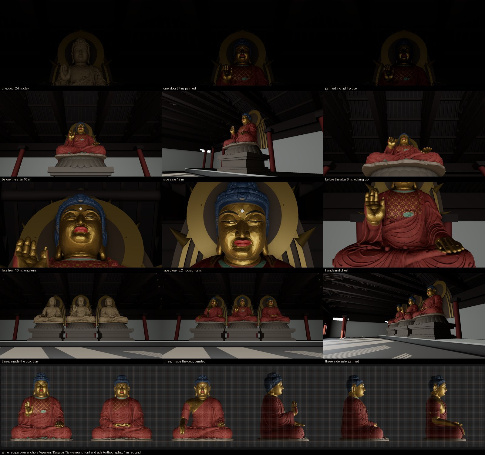

# T05 一尊佛像的彩塑上色试验（#287）

2026-11-19，分支 `spike/t05-statue-paint`。只改了 `tools/t05-hall*`、`tools/gpu/t05-hall-gpu.cjs`、`tools/t05-gpu.sh` 和 `docs/t05/`；`app/` 一行没动，没花 Tripo 点数。

## 结论

1. **可行。** 「锚点 + 像自己坐标系里的体积 + 头部贴花」能把无贴图的 Tripo 几何上成彩塑：面与手贴金、螺发、袈裟、胸衣（团花）、内衣、裙、座，七区各有颜色、粗糙度和金属度。眉、眼、唇、白毫用贴花画，不受三角形多少的限制。
2. **暗殿里贴金读得出，但要一个光照探针。** 不给贴金东西反射，它在暗殿里就是黑的（金属没有漫反射）。殿内拍一次环境图（three 的 `PMREMGenerator.fromScene`，就是常说的光照探针）以后：佛前 10 m、侧廊 12 m 面金、手金都读得出；殿门 24 m 只读得出下半张脸和手的高光，上半张脸偏暗。见下文「暗殿可读」。
3. **七尊能用同一份参数统一。** 三尊共用一份 `recipe.json`，各尊只带自己的锚点文件（24–30 个数）。三尊并排是一家：同一种金、同一种红、同一种发色和胸衣纹样。
4. **每尊人工：约 15–30 分钟对锚点**（估计，见「人工」），袒右这种衣式多几处，约多一倍。
5. **性能：三尊上色前后在 T4 上差 0.2–0.4 ms 一帧**，绘制次数不变（三尊共用一个着色器程序）。
6. **最大的问题：** ① 6 万面在近处的折面，贴金一反光就显出来；② 胳膊这种「从正面看是一个截面」的部位，从正投影图读锚点容易读错（释迦的前臂读错了三次）；③ 殿门那一眼，上了色的像比素泥更暗，轮廓靠背光撑着。

原图怎么取，见 `evidence/color-spike/README.md`。

## 现成的做法（开工先查的）

| 做法 | 是什么 | 用不用 |
| --- | --- | --- |
| 按局部坐标定区，在着色器里选材质 | 把物体坐标传进片元着色器，用解析体积（椭球、胶囊、盒、半空间）判断属于哪一区；three 的写法是 `onBeforeCompile` 改 `MeshStandardMaterial`，同一个思路在本项目 `app/src/materials.js` 的 `procMat`（按世界坐标出图样）。three 论坛有用顶点位置代替 UV 的做法（[three.js #18992](https://www.github.com/mrdoob/three.js/issues/18992)、[论坛：按位置给模型上色](https://discourse.threejs.org/t/how-to-make-the-face-of-the-model-facing-down-to-use-another-color/38866?page=2)） | **用**。没有现成的「雕像分区」库；按这个思路写了 `tools/t05-hall/paint.js`（约 170 行） |
| `three-custom-shader-material`（[npm](https://www.npmjs.com/package/three-custom-shader-material)，MIT） | 扩展 three 内置材质的库，能直接写粗糙度、金属度 | **不用**：本项目一直用 `onBeforeCompile`（`procMat`），多一个依赖换不来新东西；写法上照它的提醒，设了 `customProgramCacheKey` |
| `DecalGeometry`（three addons，MIT） | 把贴花投影成一块新网格贴在模型上 | **不用于眉眼唇**：每块贴花是一份新几何，要防 z 冲突，换 LOD 要重投；改成在着色器里按头部前方平面画（「投影贴花」的同一个意思，不另出几何） |
| UV 展开后烘贴图（[xatlas-three](https://github.com/repalash/xatlas-three)，MIT；`@gltf-transform/functions` 的 `unwrap`） | 业界通行：展 UV，在 Substance / Blender 里画，烘成贴图 | **这次不用**：要手画、要展 UV，重出一次像就要重画，三档 LOD 各要一份；正式做时若要逐尊画细节（描金纹样、旧痕），这条再拿出来 |
| Tripo 分割（Segmentation） | 生成方给的分件 | **不用**：七尊 280 点，未必按语义分（3D 评审 PR #285） |
| `PMREMGenerator.fromScene`（three 自带） | 把场景拍成预过滤的环境图，给金属反射用 | **用**：暗殿里贴金要有东西可反射 |

## 怎么做的

### 分区

`tools/t05-hall/paint/recipe.json` 七尊共用；每尊一份锚点 `paint/vipasyin.json`、`kasyapa.json`、`sakyamuni.json`。座标是像自己的：米，x 朝观者右，y 从座顶向上，z 朝观者（`stage.js` 的 pivot）。

| 区 | 用什么定 | 颜色 | 粗糙度 | 金属度 |
| --- | --- | --- | --- | --- |
| 袈裟（底） | 其余全部 | `#7B3527` 赭红，加一点斑驳 | 0.78 ±0.06 | 0 |
| 裙 | 盒：座前最外一层垂下的衣摆 | `#4F6B58` 矿物绿 | 0.86 | 0 |
| 胸衣 | 盒 ∩ 斜半空间（下沿跟着袈裟斜搭的线） | 底 `#6E2E22`，团花 `#B08A45` | 0.7 | 底 0，花 0.75 |
| 内衣 | 领口一道弯带（y = y₀ + c·x²）+ 束带结一个椭球 | `#6E8B72` 浅矿物绿 | 0.66 | 0 |
| 座（像自带的薄座板） | 半空间 y < 座板顶 | `#6B5D4C`（同须弥座） | 0.7 | 0 |
| 面与手（贴金） | 颈线以上的盒 ∩ 斜半空间（颈前到颈后）；手：胶囊或椭球；袒右的胸和肩：盒或椭球 ∩ 斜半空间 | `#B08A45` 暗金，加斑驳 | 0.5 ±0.06 | 0.85 |
| 螺发 | 头部 ∩ 发际的斜半空间（额前到耳后两点），减去两耳 | `#2E3C4C` 石青 | 0.62 | 0 |
| 面部贴花（只在贴金区里） | 由两眼、嘴、白毫四个锚点量：眉（眼上 0.72 个半眼距的弧）、上眼睑线、睑下半圆的眼、唇（椭圆）、白毫 | 墨 `#1C1814`、唇 `#9A3A2C`、白毫 `#D6D0C2` | 0.6 / 0.45 | 0 |

- 颜色取自 `docs/t05/ART.md` 第 3 节色板；石青、各区用哪个颜色是试验自拟，**全部待顾问核**（`ADVISOR-BRIEF.md` 第 5 问）。
- 袈裟起初用 `#8A3B2A`，在殿内曝光下成了一整片橘红（ART.md「不要整片大红」），压到 `#7B3527` 加斑驳。
- 一尊缺哪个锚点，那一块就不画：迦叶、毗婆尸没有「袒右」锚点；释迦没有胸衣和内衣锚点（它袒右，胸前没有内衣）。
- 「裙」在这三个模型上没有单独的形体，袈裟一直盖到脚。这次把座前最外一层垂下的衣摆定为裙，只是给它一个位置；真要裙，得在提示词或修形里给出一层。
- 区的边缘是 2 cm 的软过渡（`edge`）。贴花的线宽按屏幕像素抗锯齿（`fwidth`）。

### 着色器

`tools/t05-hall/paint.js`：把 recipe 编成一段 GLSL（每个形体两个 `vec4` 的 uniform），接到 `MeshStandardMaterial` 的 `onBeforeCompile` 上，改 `diffuseColor`、`roughnessFactor`、`metalnessFactor`。数都在 uniform 里，七尊共用一个程序（`customProgramCacheKey`）；换尊只换 uniform。像的坐标系每帧从 pivot 的矩阵来，所以转向（释迦西偏 7°）、缩放、三档 LOD 都不用重算掩码。没有改 `app/` 的 `procMat`，也没有引用它。

### 光照探针

`stage.js` 的 `paint()` 第一次上色时，把殿（像藏起来）从佛前 7 m、离座顶 4.5 m 处拍一张 256² 的预过滤环境图，只给上色的像用，强度 1.6；换季节（换光）时重拍。素泥照旧不用它。

### 对锚点

`node tools/t05-hall.cjs <spec>` 里写 `ortho` 的一张，出像自己坐标系里的正投影正面或侧面，叠 1 m / 0.5 m / 0.1 m 的格子（放大到脸时 2 cm）；从图上读点，写进锚点文件，再出一张上色的正投影看边界落在哪。

## 验收逐条

### 1. 至少五区，每区有颜色、粗糙度、金属度；参数是一份数据，换一尊只改数据 —— 过

七区加面部贴花，见上表。共用的是 `recipe.json`，每尊只改自己的锚点文件，代码不动。图：`ortho/*`、拼图最下一行。

### 2. 眉眼唇读得出（佛前 10 m、6 m 仰视、面部特写） —— 10 m 过；6 m 只有唇和白毫

- **佛前 10 m**（`one/front10-winter-paint.png`，1600×900，脸约 110 像素宽）：唇、白毫清楚；眉是两道细暗弧，上眼睑一条线，读得出。`face-from10-*` 是同一位置用长焦看，等于放大：眉眼唇都在。
- **佛前 6 m 仰视**（`one/front-winter-paint.png`）：唇和白毫读得出；眉和眼睑被仰角压扁在脸上，只剩几个像素，读不出。这不是贴花的毛病，是 6 m 仰视的透视；和 #280 的结论一致（礼佛位置宜 8–10 m）。
- **面部特写**（`one/face-close-winter-paint.png`，离脸 3.2 m，不是玩家站得到的地方，诊断用）：眉、睑、眼、唇、白毫都和雕出来的五官对上。看得出的毛病是贴金把 6 万面的折面照出来了（见「最大的问题」）。
- 眉线开始画在雕出的眉棱上方，偏细；加粗到半眼距的 0.085 倍、眼睑 0.035 倍以后 10 m 处才读得出。

### 3. 暗殿可读：初冬晴冷，殿门 24 m、佛前 10 m、侧廊 12 m，素泥与上色并排 —— 过，光比问题照实记

并排图：`one/{door,front10,side}-winter-{clay,paint}.png`，三尊另有 `three/` 同样四处。曝光是 #280 定的（殿门 1.15，殿内 4.5）。

| 位置 | 贴金读得出的 | 死黑或过亮的 |
| --- | --- | --- |
| 殿门 24 m（`door`） | 下巴、嘴、鼻头、两手的高光；白毫 | **上半张脸和螺发几乎是黑的**；袈裟成一块暗红，像的轮廓主要靠背光的暗金托出来。素泥在这里反而比上色亮、轮廓更清楚 |
| 殿门 24 m，不给探针（`door-winter-noprobe`） | 只剩手上一点 | 整张脸是黑的 |
| 佛前 10 m（`front10`） | 整张脸、两手、胸衣的团花、领口的绿 | 没有死黑。袈裟偏亮偏饱和（曝光是为素泥定的） |
| 侧廊 12 m（`side`） | 脸的侧面、举起的手、胸衣 | 没有死黑；螺发的石青在侧光下偏亮 |
| 夏昼（`door-summer`、`front10-summer`） | 同冬天；殿内主要靠门光，差别在地上的太阳 | 同上 |

- **为什么殿门一眼更暗：** 上色以后像的平均亮度（线性反照率）从素泥 `#A88A62` 的约 0.27 降到赭红 `#7B3527` 的约 0.07；贴金是金属，没有漫反射，只有反射到的东西。从殿门往里看，眼睛还按殿外曝光，殿内整体就暗，素泥靠浅色撑着，彩塑撑不住。
- **这正是 `ART.md` 要的「七尊的脸从暗里一尊一尊出来」，但现在是靠手放的曝光。** 正式做要有：殿内烘焙的光照（或几个探针）给贴金反射；走进殿门时曝光跟着变（#280 已列为风险，three 没有现成的）。没有这两样，殿门那一眼只能看见背光和手。
- 「贴金在暗殿里读不读得出」的答案：**有探针、站在殿内，读得出；殿门外那一眼，只读得出下半张脸的高光。**

### 4. 统一：同一份分区数据套到迦叶、释迦，三尊并排一张；写明调锚点花了多久 —— 过

三尊并排：`three/door3-winter-paint.png`、`front10`、`side3`，拼图第四行。三尊一家：同一种金、红、石青和团花；释迦袒右的胸和肩是金，另两尊是胸衣。

**调锚点花了多久**（会话的实耗，不是人的）：

| 尊 | 锚点数 | 读图写锚点 | 改了几轮 | 改的是什么 |
| --- | --- | --- | --- | --- |
| 毗婆尸 | 29 个数 | 和工具一起做，没单独计 | 4 | 头部椭球够不到下巴 → 改成「颈线以上全是皮肤」；胸衣下沿改成斜线；举起的手漫到袖口 |
| 迦叶 | 24 | 约 2 分钟 | 1 | 禅定印的手的椭球漫到两边袖口 |
| 释迦 | 30 | 约 3 分钟 | 4 | 袒右的肩：盒子留下一道直边 → 改椭球；**前臂读错三次**（见下） |

- **人工估计：每尊 15–30 分钟**（估计，按人从格子图读 25–30 个数、每轮出一张正投影图 1–2 秒再看，改 1–4 轮）。通肩的像接近 15 分钟，袒右、手离身体远的像接近 30 分钟。
- **释迦的前臂：** 手按在膝上，前臂从肘向前伸，正面图上只看到它的一个截面。我先按正面图把胶囊放在 x = −1.6，从侧面图看前臂整条没上金；放大半径到 0.6 m 才盖上，最后在 x = −1.8 找到。正面图读「伸向镜头的东西」会读错，要两张图对着读，最好有一个在图上点一下就给出模型表面座标的工具（像站点的 `__pick`），这次没做。

### 5. 性能：上色前后在 T4 上各量一次三尊的 `__cost`，同一 Job 交替，干净的提交 —— 过

Job `6afefb304fdc5ab3c559b374`（`tools/t05-gpu.sh`，`SETS=paint`），`ANGLE (NVIDIA, Vulkan 1.4.357 (NVIDIA Tesla T4))`，1080p，开 GTAO，120 帧平均。顺序：素泥、上色、素泥、上色。**`report.json` 的 `site.commit` = `9e5c09306f7bfc633322828356a57d2c2a211dbb`**，没有 `+dirty`，就是本分支第一个提交（之后的提交只加文档和锚点文件里删掉一个没用的字段，不影响画面和帧耗）。

| 视角 | 素泥 第 1 / 2 轮 | 上色 第 1 / 2 轮 | 差（第 2 轮） |
| --- | --- | --- | --- |
| 殿门内 `door3` | 6.19 / 3.47 ms | 5.46 / 3.71 ms | +0.24 ms |
| 侧廊 `side3` | 3.88 / 3.82 ms | 4.02 / 4.06 ms | +0.24 ms |
| 佛前 10 m `front10` | 3.72 / 3.75 ms | 4.11 / 4.12 ms | +0.37 ms |

- 第 1 轮殿门内的 6.19 ms 是 Job 的第一次测量（预热），不算。
- 三角形和绘制次数上色前后一样（22.2 万、168 次等）：上色只改了像素着色，三尊共用一个程序。
- 差的 0.2–0.4 ms 是像素上的：每个像素多算十几个形体、一次环境图采样。像在画面里越大越贵（佛前 10 m 差得最多）。七尊估计差 0.5–1 ms（未量）。
- 手机没量。

### 6. 报告、拼图 ≤ 1 MB 进仓库，其余推证据库 —— 过

本文件；`evidence/color-spike/collage.jpg` 约 306 KB；其余 38 个文件在证据库，`MANIFEST.json` 钉在 `57b80551`。`node tools/evidence.mjs check` 通过。

### 7. 不花 Tripo 点数 —— 过

一点没花。只用了 #280 已有的三个 6 万面文件。

## 最大的问题

1. **折面。** 6 万面的脸，一贴金一反光，三角形就一块一块显出来（`face-close`、`face-from10`）。素泥看不出，是因为漫反射对法线不敏感。办法（按 3D 评审的建议，没试）：从 148 万面的原件烘法线贴图到近档上；或近档留更多面。不解决这一条，正式做时佛前 10 m 用长焦看脸也会露。另外贴金粗糙度从 0.34 调到 0.5 是为了压折面，代价是金不够亮。
2. **从图上读锚点会读错。** 见释迦的前臂。正式做七尊之前，值得花半天做一个「在正投影图上点一下，给出表面座标」的小工具；或者干脆用射线在模型上取点。
3. **殿门那一眼。** 上了色的像比素泥暗，24 m 处只读得出下半张脸和手的高光。这要靠殿内烘焙的光照和走进殿门时的曝光渐变来解决，不是上色能解决的。
4. **模型没有某些衣层。** 「裙」和「内衣」在 Tripo 的模型上没有独立的形体，这次是给了一个位置；袒右像的上臂到底盖不盖布，模型本身也含糊。要分得像，提示词里就要写清衣层，或者修形。

## 和 issue 的出入

- **「面部特写一张」**：拍了离脸 3.2 m 的一张，那是诊断用的，玩家站不到。玩家能看到的最近是佛前 6–10 m。
- **6 m 仰视读不出眉眼**：是透视，不是做法的问题；和 #280 建议的礼佛位置 8–10 m 一致。
- **贴金需要光照探针**：issue 没写，但没有它贴金在暗殿里就是黑的，这是这次最实在的发现之一。探针是从白盒殿拍的，正式殿改了以后要重拍。

## 连带影响（二阶、三阶）

- **别的模块：** 本 PR 不碰 `app/`。正式接入时，`paint.js` 要搬进 `app/src/`（或做成 `procMat` 的一种），读三档 LOD 时共用同一套锚点；光照探针要进殿内的光照方案（和「走进殿门的曝光」同一件事）。
- **玩家：** 现在无。将来七尊上色，殿门那一眼会比素泥暗，要靠光照设计补，否则第一眼的「七佛同堂」会被削弱。
- **多出来要同步的东西：** 每尊一份锚点文件，跟着那一尊的模型文件走：**重出一次像（比如释迦的手印），锚点要重对**（约 15–30 分钟）；减面、转向、缩放不用。`recipe.json` 是七尊共用的，改一处七尊一起变，这是想要的。
- **一年后：** 着色器是 `onBeforeCompile` 改 three 的内置着色器，three 升级改了块名（`color_fragment` 等）要跟着改，这和 `procMat` 是同一份风险。若 T05 改用 three 的节点材质（TSL），这段要重写，规则（recipe、锚点）可以照搬。

## 没做 / 没验

- 三档 LOD 上实测：`tools/t05-statue.mjs` 把 6 万面再往下减时减不动（同一误差上限下停在 6 万），没继续追；「LOD 共用一套掩码」是按座标系推出来的，**没验**。
- 法线贴图、更多面的近档。
- 点选取点的工具。
- 龙纹（调研包说三尊胸衣是龙纹，未核）；这次三尊都用团花。
- 手机帧耗；七尊上色的帧耗。
- 除 `gpu/` 外全部是软件渲染。

## 花费

- Tripo：0 点。
- T4：一次，job `6afefb304fdc5ab3c55997d0` 之后的 `6afefb304fdc5ab3c559b374`，几分钟（约 0.05 美元）。
