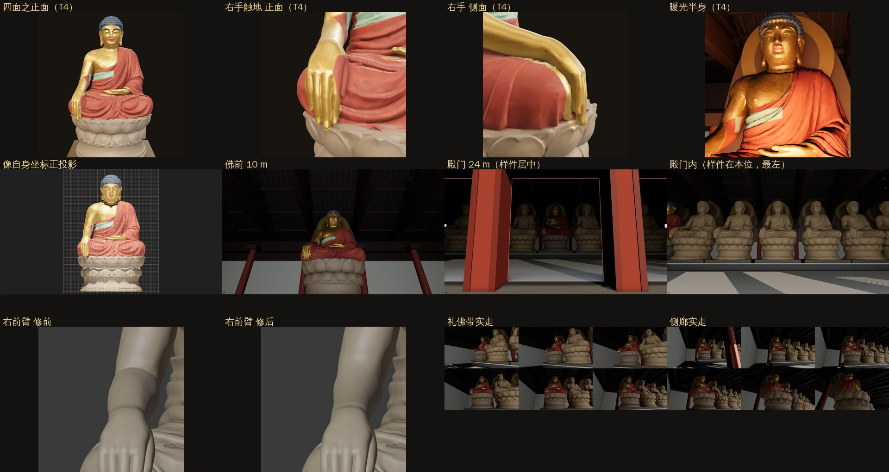

# T05 释迦样件（#370）

2026-11-20，分支 `claude/t05-shakyamuni-370`。只改了 `tools/` 和 `docs/t05/`，`app/` 一行没动；样件在 `tools/t05-hall/` 的白盒殿里验。

## 结论

1. **图生模型一次就出对了手印。** 用原型图 01 的正面加背面做 Tripo 多视图生成（`multiview_to_model`，v3.1-20260211，不要贴图），一次出成：右手触地（垂过右膝，指尖落在莲座上缘，掌心朝内）、左手掌心向上置腹前、袒右，衣褶和面相与原型图对得上。#280 的文字生成给的是按膝的手；这次没有重出。
2. **手修只有一处：右前臂的一道箍。** 模型在裸露的右腕上方多了一道像袖口的环（原型图里没有，袒右的臂上不该有）。用 Blender 的 Smooth 修改器在前臂局部磨平，数据写在 `tools/t05-statue/sakyamuni/repair.json`，命令可重跑。手指、掌向、指尖都没动。
3. **三档 LOD 这回减得动了，还查出一个旧 bug。** 先焊点再减面，6 万、2 万、6 千三档一条命令出（#287 停在 6 万，是因为 Tripo 每个 UV 岛各存一份顶点）。另外 `tools/t05-statue.mjs` 原先调用 gltf-transform 的 `normals()`，它写的是**平面法线**、把每个三角形拆开：#280、#287 的像在近处一块一块地发亮，部分是这个原因，不全是面数不够。改成按面积加权的平滑法线以后，近档文件从 4.3 MB 降到 1.08 MB，佛前近照里的折面基本看不出了。
4. **上色五区加面部贴花，同一份 `recipe.json`。** 面与手贴金、螺发、袈裟、内衣（袒右边下的内层衣缘）、座；胸衣按顾问意见改成素面（本来就被袒右露出的胸代替了，这尊没有胸衣区）。
5. **点数：花 60 点，余 1020 点**（上限 80）。主线一次 20 点；另两次（各 20 点）是主创要的对比：用所有者后来出的新四视图再生成，第一次槽位放错长出两张脸，第二次放对。多视图生成一次 20 点，是文字生成的两倍。
6. **七尊估计：每尊约 2–3 人时（人做），点数约 200 点**，比已批的 110 点多，原因和要定的事见末节「七尊要多少」。

原图、录像和模型怎么取，见 `evidence/shakyamuni-370/README.md`。

## 和新四视图的对比（主创要的，2026-11-21）

所有者后来出了透明背景、侧面改正的四视图（`refs/t05-concept-2026-11-20/04–07`）。主创要求用它再生成一次作对比；左侧那张莲座矮、像大，没用，用的是前、右、后三张。

| 次 | 输入 | 点数 | 结果 |
| --- | --- | --- | --- |
| mv-1（主线） | 原型图 01 的正面、背面 | 20 | 对；只有右前臂一道箍，已修 |
| mv-2 | 新图 前、右、后；右侧那张放进 Tripo 的 `right` 槽（v2 `files` 的第 4 个） | 20 | **后脑长出第二张脸**（背面那张是一张正脸），不能用 |
| mv-3 | 同三张；右侧那张放进 `left` 槽（第 2 个） | 20 | 对；右腕上仍有一道箍，莲座更薄，膝更宽 |

- **Tripo 的视图槽是「从哪边看」，不是「像的哪一侧」**：画面里像朝左、露出像的右侧的那张，要放进 `left` 槽。v2 文档只写了顺序 front、left、back、right，没说是哪一种；这次花 20 点试出来了。正式做七尊照此填，写进 `tools/t05-tripo.mjs` 的注释。
- **mv-3 不比 mv-1 好到要换**：手印、袒右两次都对；mv-3 一样有腕上的箍，换它要重修、重对锚点。主线仍用 mv-1，所有者已看过说「不错」。
- 四视图的用处在侧面：mv-1 只给了前后两张，侧面全靠模型猜，这次侧面是对的，是运气；其余六尊建议给前、右（放 `left` 槽）、后三张。

## 现成的做法（开工先查的）

| 做法 | 是什么 | 用不用 |
| --- | --- | --- |
| Tripo `multiview_to_model`（[开发者文档](https://developers.tripo3d.ai/en/docs/generation-multiview-to-model/standard)，2026-11-20 读） | 前、左、后、右四视图出几何，正面必须有，至少两张；无贴图 20 点 | **用**。正面加背面两张；侧面那张有错，不用（#370「输入与排期」）。代理只接了 v2 的 `api.tripo3d.ai`，所以走 v2 的 `/upload` 和 `/task`；v3 的 `openapi.tripo3d.ai` 字段名不同（`inputs`、`model`），以后搬家要改 `tools/t05-tripo.mjs` |
| Blender 无头（`pip install bpy`，Blender 5.3 的 Python 模块） | 业界通行的修形工具；修改器（Smooth、Laplacian Smooth）、BVH 射线 | **用**：修形（`repair.py`）、四面出图（`views.py`）、在模型上取点（`pick.py`）。不另写网格库 |
| 自己写 Taubin 平滑、按管状截面拟合 | — | **试了，不用**：Taubin 在 140 万面上走 250 步只动了 2 mm，环还在；管状拟合把前臂撕开。换成 Blender 的修改器（同一处第三次就换做法） |
| meshoptimizer 简化（`@gltf-transform/functions` 的 `simplify`） | 已在项目里 | **用**，先 `weld` 再减 |
| Tripo 智能重拓扑（`/mesh/decimate`，30–40 点） | 生成方的减面 | **不用**：本地减面免费，三档已够 |
| 法线贴图烘焙（从 140 万面的原件烘到近档） | 治 6 万面的折面（#287 最大的问题 1） | **没做**，见「没做 / 没验」 |

## 做了什么、各花多久

时间是本会话的实耗（UTC），不是人的工时；人的工时在最后一列另估，按「工具已经有了、照命令做」算。

| 步 | 做什么 | 会话实耗 | 一次性还是每尊 | 人做一尊（估计） |
| --- | --- | --- | --- | --- |
| 0 | 读 issue、顾问评审、管线、两份试验报告 | 13:47–13:53，6 分钟 | 一次性 | — |
| 1 | 原型图 01 裁出正面、背面，抹掉标注，放大 2 倍 | 13:53–13:55，2 分钟 | 每尊 | 10 分钟（另要所有者先出每尊的正背面原型图，见末节） |
| 2 | 上传两张图，Tripo 多视图生成，前后各读一次余额 | 13:55:16–13:57:10，2 分钟（任务本身 1 分 40 秒） | 每尊 | 5 分钟 |
| 2b | 对比：新四视图两次生成、出对比图 | 11-21 00:20–00:35，约 15 分钟（两个任务各约 3 分钟） | 一次性（试出槽位规矩） | — |
| 3 | 写 `views.py`，出四面和手、肩、胸的近照，判手印 | 13:57–14:00，3 分钟 | 工具一次性；出图每尊 15 秒 | 15 分钟（看图判手印、衣缘） |
| 4 | 修右前臂的箍：试了四种做法，查出导入的旧法线遮住了改动，最后 Smooth ×3000 | 14:00–14:11，11 分钟（最后一次计算 4 分钟） | 工具一次性；每尊跑 4 分钟 | 30–60 分钟（在雕刻软件里修一处；若手指要重做，1–2 小时） |
| 5 | 三档 LOD | 14:11–14:12，1 分钟 | 每尊，自动 | 5 分钟 |
| 6 | 读锚点（`grid.py` 格子图、`pick.py` 和页面里的 `hall.pick` 取点），上色、看图、改 7 轮 | 14:12–14:24，12 分钟 | 工具一次性；每尊约 8 分钟 | 30–45 分钟 |
| 7 | 白盒出图：正投影、佛前、殿门群像（样件在本位和中位各一套） | 14:24–14:40，软件渲染 | 每尊，命令 | 15 分钟（看图） |
| 8 | T4 帧耗（同一 Job 里三档 × 七位 × 素泥 / 上色，各两轮） | Job 14:27:03–14:28:51，2 分钟 | 每关一次 | — |
| 9 | 礼佛带和侧廊实走的录像与遮挡记录 | 14:30 起，软件渲染约 30 分钟 | 每尊，命令 | 15 分钟（看录像） |
| 10 | 资产登记、来源、报告、证据 | 约 20 分钟 | 每尊少量 | 15 分钟 |

## 规格

| 项 | 数 | 怎么来的 |
| --- | --- | --- |
| 像身净高（莲座顶到肉髻顶） | **6.0 m** | 游戏设计值（顾问评审第 4 条）；模型里座顶在通高的 0.302 处，按此缩放 |
| 连座通高（佛坛顶到肉髻顶） | **9.0 m** | 模型自带仰莲座 2.6 m + 座基 0.4 m + 像身 6.0 m |
| 佛坛高 | **0.87 m** | 白盒（`stage.js` 的 `ALTAR`），S11【摘要】 |
| 宽 | 5.05 m | 开间 5.80 m，相邻留 0.75 m |
| 三角形 | 原件 143.8 万；近 6 万、中 2 万、远 6 千 | `tools/t05-statue.mjs --error=0.02 / 0.05 / 0.1` |
| 文件 | 近 1.08 MB、中 0.36 MB、远 0.11 MB（未压缩） | 进游戏时用 meshopt 压缩，未量压缩后 |

## 验收逐条（#370）

### 1. 手、前臂、衣缘、材质分区 —— 过（分区边界粗，见下）

- **手**：右手触地，掌心朝内贴膝，五指垂下，中指尖落在莲座上缘（`evidence/shakyamuni-370/compare/mv1-rhand-*.png`，上色后 `review/hand-front.png`、`hand-side.png`）；左手掌心向上，四指朝观者左（`compare/mv1-lhand-front.png`、`review/hand-left.png`）。
- **前臂和袖口**：右前臂的箍磨平，肘到腕一条连贯的形（`views/forearm-before.png`、`forearm-after.png`）。左前臂在袖里，袖口和手腕的接缝是生成时就有的，没动。
- **袒右的衣缘**：袈裟从左肩斜下，右胸、右肩、右臂裸露；背面右肩胛也裸露，袈裟斜搭到右胯（`review/turn-back.png`）。原型图的侧面画错了（右肩被盖住），模型没有照错的那张出，所以侧面是对的。
- **分区**：`tools/t05-hall/paint/recipe.json`（七尊共用）+ `tools/t05-hall/paint/sakyamuni-370.json`（这尊的锚点，34 项）。五区各有颜色、粗糙度、金属度：

  | 区 | 颜色 | 粗糙度 | 金属度 |
  | --- | --- | --- | --- |
  | 袈裟 | `#7B3527` | 0.78 ±0.06 | 0 |
  | 内衣（内层衣缘） | `#6E8B72` | 0.66 | 0 |
  | 座（模型自带的仰莲座） | `#6B5D4C` | 0.7 | 0 |
  | 面与手、袒露的胸臂（贴金） | `#B08A45` | 0.5 ±0.06 | 0.85 |
  | 螺发 | `#2E3C4C` | 0.62 | 0 |
  | 面部贴花（眉、睑、唇、白毫） | 墨、唇红、白毫 | 0.6 / 0.45 | 0 |

- **改了共用的 `recipe.json` 两处**：胸衣去掉团花（顾问评审第 5 条「胸衣先用素面」，迦叶、毗婆尸的胸衣因此也变素面，这是想要的）；内衣加一条斜带的写法（`innerMin/innerMax`、`innerLowP/N`、`innerTopP/N`），没有这几个锚点的尊不受影响。
- **不足**：内衣斜带是盒子和两个半空间围的，两端是直边，正面近照看得出（`one/hands-close-winter-paint.png`）；颈下有一道阴影，是下巴下的凹，不是分区。要像原型图那样一道顺着衣褶的灰绿，得逐顶点画掩码，或在提示词里给出这层衣。
- **锚点读错过一次**：左手按正面图读的深度落在手背后 0.3 m，金色涂到了腹前的袈裟上；在页面里用 `hall.pick` 从上往下取点，才知道这只手前后长 0.5 m（掌根在 0.5 m、指尖在 1.05 m）。所以取点要用射线，不要从图上读深度，#287 那次读错前臂是同一件事。

### 2. 正面近照 —— 交图，待 3D 评审

- 像自身坐标系的正投影正面：`one/ortho-front-paint.png`（上色）、`ortho-front-clay.png`（法线着色），格子 0.1 / 0.5 / 1 m；侧面 `ortho-side-paint.png`；手部放大 `ortho-hands-paint.png`。
- 佛前近照：`one/hands-close-winter-paint.png`（佛前 5.5 m、像腰高，诊断用）、`front10-winter-paint.png`（佛前 10 m，眼高 1.6 m，玩家站得到）。
- 我看到的：10 m 处右手的触地读得出，是像左下角一道竖的金；掌心朝内，看不见掌心；指尖压在莲瓣上缘。左手的掌心朝上在 10 m 处只是一道横的金，读不出掌心。

### 3. 约 24 m 的入口照 —— 交图；有一条发现

- 样件放在本位（最西，x = −16.45），另外六位放同一个文件的素泥：`group/door-winter.png`（殿门中轴月台上，离中尊 24 m）、`group/cam03-winter.png`、`group/door3-winter.png`、`group/door-summer.png`、`group/door-winter-clay.png`（全素泥）。
- **发现：从殿门中轴看，最西的释迦在中门框外**，只从最西一扇窗透出一角（`door-winter.png` 左缘）。中门 4.6 m 宽，24 m 外只框得住中间三尊。殿门那一眼看不到释迦，要走进殿门（`door3`）才见七尊。这是白盒的门宽和视点定的，正式殿要不要让这一眼看到两端，是镜头的事（CAM-03），记给主创。
- 为了看「在群里读不读得出」，另把样件放在中位出一套：`group-centre/door-winter.png`、`cam03-winter.png`。24 m 处贴金的脸、触地的手、袈裟的红都读得出，在素泥中间明显；上了色的像比素泥暗，#287 说过。

### 4. 8–10 m 站位和侧廊实走 —— 见下（数字由 `occlusion` 逐帧量）

样件在本位（x = −16.45），另外六位素泥。第一人称，眼高 1.6 m，1.2 m/s，眼睛一直看样件的胸口：

- **礼佛带**：佛前 9 m（z = 佛坛前沿 + 9），从 x = −5.5 走到 −21.5，16 m（`walk/band-strip.jpg`；录像 `films/band-winter.mp4` 在私有桶）。
- **侧廊**：西侧廊 x = −21.4，从殿门内 z = −2 走到像前 1.5 m（`walk/aisle-strip.jpg`；录像 `films/aisle-winter.mp4` 在私有桶）。

每帧从眼睛向像的四个点各打一条线（`window.hall.occlusion`）：脸（嘴上方）、右手指尖、左手、莲座正面；第一个碰到的东西离那一点 0.4 m 以内算看见，否则记下挡住它的是什么。

| 走法 | 帧数 | 脸 | 右手指尖 | 左手 | 莲座正面 |
| --- | --- | --- | --- | --- | --- |
| 礼佛带，佛前 9 m，16 m 长 | 160 | 100% 看得见 | 100% | 100% | 100% |
| 西侧廊，殿门内到像前 1.5 m | 141 | 100% | 100% | 79%：最后 2.8 m 被挡 | 81%：最后 2.6 m 被挡 |

- **礼佛带一路都没被挡。** 礼佛带在佛坛前 9 m，佛坛前没有柱（白盒的前排内柱只在两端，x = ±18.94、±23.92 以外），左手在 9 m 处略低于眼睛的视线、在膝和莲座之上，看得见。
- **侧廊只在最后一段挡，挡它的是像自己。** 走到离像中线 4.4 m 以内（z = −13.2 到 −16，侧向 4.95 m），左手和莲座正面被像自己的右膝和垂下的右臂挡住（`by: self`）；脸和右手一路看得见。从侧面近处看不到远侧的手，本来如此；柱子、邻像、佛坛都没挡。逐帧的记录在私有桶 `films/aisle-winter-occlusion.json`，统计在证据目录 `walk/aisle-report.json`。
- 录像里的像是平面法线的旧近档文件（录像在修法线之前就开始拍了）；遮挡只看几何，和法线无关。录像在私有桶（不交录像进证据库，AGENTS.md），证据库里是从中取的六帧拼条。

### 5. T4 帧耗 —— 过

Job `6b00defe4fdc5ab3c55c269d`（运行号 `t05-20261120-235953`，`tools/t05-gpu.sh` 加 `SETS=lod370`），`ANGLE (NVIDIA, Vulkan 1.4.357 (NVIDIA Tesla T4))`，1080p，开 GTAO，120 帧平均。站点指纹：`site.commit` = `393dd59c7c02e9c18a4347283b05e0d662a97db6`（没有 `+dirty`），`site.sha256` = `1beb0a54766489d3729e0783fd1ad9bf97a163589f7239711e2fd18d876b08a8`。同一档的文件重复摆满七个座位，素泥和上色在同一个 Job 里交替，整套跑两轮。审阅图（`evidence/shakyamuni-370/review/`）在同一个 Job 里先出。

| 套 | 一帧三角形（殿门 24 m / 殿门内 / 佛前 10 m） | 绘制次数 | 殿门 24 m 第 1 / 2 轮 | 殿门内 第 1 / 2 轮 | 佛前 10 m 第 1 / 2 轮 |
|---|---|---|---|---|---|
| 空殿 | 1.3 万 / 1.3 万 / 1.2 万 | 160 / 129 / 91 | 5.03 / 2.52 ms | 2.69 / 2.52 ms | 2.60 / 3.22 ms |
| 近档 6 万 · 素泥 | 43.8 万 / 43.7 万 / 43.5 万 | 195 / 164 / 120 | 3.56 / 3.60 ms | 4.42 / 4.43 ms | 4.03 / 4.05 ms |
| 近档 6 万 · 上色 | 同上 | 同上 | 4.99 / 4.01 ms | 4.95 / 5.14 ms | 4.93 / 4.98 ms |
| 中档 2 万 · 素泥 | 15.8 万 / 15.7 万 / 15.5 万 | 同上 | 3.46 / 3.48 ms | 4.16 / 4.17 ms | 3.81 / 3.83 ms |
| 中档 2 万 · 上色 | 同上 | 同上 | 3.77 / 3.76 ms | 4.71 / 4.73 ms | 4.54 / 4.55 ms |
| 远档 6 千 · 素泥 | 6.0 万 / 5.9 万 / 5.7 万 | 同上 | 3.37 / 3.37 ms | 3.98 / 3.99 ms | 3.66 / 3.67 ms |
| 远档 6 千 · 上色 | 同上 | 同上 | 3.63 / 3.63 ms | 4.44 / 4.46 ms | 4.31 / 4.33 ms |

- **每个新页面量的第一个视角含预热**（空殿殿门 24 m 5.03 对 2.52 ms），那一格不作数；其余两轮差在 0.2 ms 以内。
- **七尊近档上色，一帧 5.0–5.1 ms**（第 2 轮殿门内、佛前 10 m），空殿 2.5 ms 上下，七尊多约 2.5 ms。上色比素泥多：近档约 0.7–0.9 ms，中、远档约 0.5–0.7 ms。
- **6 万换 2 万省约 0.3–0.4 ms，2 万换 6 千再省约 0.2 ms。** 三角形占得不多，像素着色（上色每个像素算二十几个形体、一次环境图）占得多。
- 前一次 Job（`6b0058ac4fdc5ab3c55b826a`，`d0d7926`）用的是平面法线的旧文件（每个三角形三个独立顶点，近档 18 万顶点，新文件 3 万）；新旧差在 0.1–0.4 ms，近档上色差得最多。
- 正式殿里七尊同时近档的视角只有殿门内；按距离换档（10 m 内近档、30 m 内中档）以后，七尊估计在 4–5 ms（按上表推，未量）。
- 不是三档按距离切换的实测，是三档各自摆满七位，issue 允许这样量。手机没量（第 8 条）。

### 6. 工时 —— 见上「做了什么、各花多久」和末节

### 7. 素材登记 —— 过

- `docs/t05/asset-register.csv` 加 `STATUE-t05-sakyamuni-sample-370` 一行：原件和修过、减过的四个文件的 SHA-256，「本项目用 Tripo 生成」，任务号，Tripo 开发者平台条款 2025-07-11 §3.2、§5.2.2（按 `docs/t00/LICENSING-AUDIT.md` 的口径：所有者充值的付费 API 点数，产物不自动公开，文件里的 AI 标记保留），输入图是所有者的 GPT Image 原型图；备注列出原创设计的部位。
- `docs/t05/SOURCES.md` 加 6.2 节：触地式为原创设计及其依据（顾问评审第 2 条；S13 的与愿印只是摘要、有四说），袒右、内层衣缘、比例、彩塑、光背、头向各一行。

### 8. 目标设备 —— 不在本条测，延后

初载、峰值内存、手机帧耗等正式资产齐了再测。

## 定稿：主创看图提的五条（2026-11-21）

改后的审阅图在 T4 上重出：Job `6b00e5614fdc5ab3c55c3034`（运行号 `t05-20261121-002709`），站点 `site.commit` = `7d2d4b3ebcad2fee6b476096a3254afd06c72616`（干净），`site.sha256` = `9607dbb5…923a3f`；图在证据目录 `review-v2/`，[拼图](https://huggingface.co/datasets/bolechen/temple-walk-evidence/resolve/fcad44cdfb8e9f2765d840f534391f010e8e9d37/t05/shakyamuni-370/review-v2-collage.jpg)。改前的一组在 `review/`，留着对照。

| # | 主创提的 | 怎么改的 | 结果 |
| --- | --- | --- | --- |
| 1 | 青绿衣缘斜带两端是直切方头，像胶带 | 内衣斜带的外框从盒子换成一个扁椭球（`innerC`、`innerR`），上下两条边仍由两个半空间沿布折定，两端随椭球收尖 | 改了：两端收成尖头，没有直边（`review-v2/turn-front`、`half-warm`）。还不是真正「顺着布折」，要那样得逐顶点画掩码 |
| 2 | 右手手背和腕部压着红；暖光半身左下臂一块红 | 右手的胶囊往外移、加粗（半径 0.36 → 0.42）；前臂加粗（0.36 → 0.40）；`recipe.json` 加一条上臂胶囊 `armR`（肩到肘）；斜带往左延到腋下 | 改了：手背、腕、上臂全是金（`review-v2/hand-front`、`hand-side`、`half-warm`）。腋下躯干侧面那一道现在是内衣的灰绿，不是金：那里在模型上是袈裟内层，不是手臂 |
| 3 | 背面右肩的分界是一条直斜线，太硬 | 背面另起一条边界：从背面格子图上沿袈裟真实的边读七个点，连成六段折线（`bk1`–`bk6`，每段一个盒子加一个半空间，相邻两段重叠 3.4 cm，免得接缝处出现半透的细线）；正面的斜半空间只管前半身（z > −0.55 m），和背面重叠 0.3 m | 改了：分界沿衣褶弯下去，从左肩颈侧绕过右肩胛下到右胯（`review-v2/turn-back`） |
| 4 | 嘴唇太艳 | 唇色 `#9A3A2C` → `#A8675A`（淡朱） | 改了 |
| 5 | 侧廊最后约 2.7 m 左手和莲座被右膝挡 | 不改模型，记为已知问题 | 见下 |

**已知问题（留给站位或机位）**：西侧廊走到离像中线 4.4 m 以内（侧向 4.95 m），像自己的右膝和垂下的右臂挡住左手和莲座正面，约最后 2.7 m。脸和右手一直看得见。可改的地方：侧廊的站位或机位（如 CAM-04 的位置）、侧廊离佛坛的距离，或者在那一段让玩家的视线自然转向下一尊。这是 T05 第一阶段定站位时的事，不在模型上改。

**T4 帧耗，改后**（同一个 Job，第 2 轮）：七尊近档上色时，殿门内 5.23 ms、佛前 10 m 5.09 ms；改前是 5.14 / 4.98 ms。分区多了 13 个形体，每像素多算这些，帧耗多约 0.1 ms。全表在 `gpu-report-v2.json`。

## 点数台账

| 日期 | 事项 | 点数 | 余额 | 依据 |
| --- | --- | --- | --- | --- |
| 2026-11-20 | 起点 | — | 1080 | `tripo-balance.json` |
| 2026-11-20 | 主线 mv-1（原型图 01 正背面） | 20 | 1060 | 任务 `cd076293…` |
| 2026-11-21 | 对比 mv-2（新四视图，槽位放错） | 20 | 1040 | 任务 `bb474101…` |
| 2026-11-21 | 对比 mv-3（同上，槽位放对） | 20 | 1020 | 任务 `572a5ee0…` |

- **批的额度**：#370 样件上限 80 点；所有者 2026-11-21 又批了七尊共 **200 点**（主创转达，原话「批 200」，含样件已花的）。**已花 60，余 140**。另六尊每尊一次 20 点，共 120 点，余下的 20 点只够一次重出。主创转述时说「含已花的 40」，实际已花 60（两次对比各 20），请主创核一下。
- 其余六尊的原型图提示词：`docs/t05/STATUE-PROMPTS.md`。

## 没做 / 没验

- **法线贴图**：没烘。改成平滑法线以后，近档 6 万面在手部近照（离手 4.4 m）里只在指缝和衣褶边上看得出折角；烘不烘等 3D 评审看了 `review/` 再定（Blender 的 bake 或 Node 射线，管线 §二第 5 步）。
- **三档 LOD 共用一套锚点**：按坐标系推是成立的（三档同一坐标，锚点不随面数变），**没有逐档出图验**；远档 6 千的手指成了块，贴金的边界会跟着粗。
- **meshopt 压缩后的大小**。
- **修形逐字节重跑：过**。同一命令再跑一次，输出的 SHA-256 一样（`02817edd…0d44`）。
- **3D 评审**：第 2–4 条的图要 3D 评审看过。
- **背光**：用的是白盒的素面身光和头光（圈数 0、火焰 0），没另建模型。
- **头向**：没转。

## 七尊要多少

按这一尊的实耗外推。前提：工具都已在（`tools/t05-statue/`、`tools/t05-hall/`），另外六尊各有一张正面加背面的原型图。

| 项 | 每尊 | 七尊（另六尊加样件） | 依据 |
| --- | --- | --- | --- |
| 原型图（所有者用 GPT Image 出正背面） | 所有者的时间 | 六张，未计 | 样件的输入就是这样来的；**要所有者定** |
| Tripo 多视图 | 20 点；按一半要重出一次，平均 30 点 | 6 × 30 + 已花 60 = **约 240 点**（不算样件的对比则约 200） | 本次实读余额 1080 → 1060；槽位已试出，不必再为它花点 |
| 判手印、修形 | 0.5–1 小时 | 3–6 小时 | 本次只修了一处；手印不对的要多修或重出 |
| LOD、锚点、上色 | 0.5–1 小时 | 3–6 小时 | 本次 12 分钟会话；人读 25–35 个点、改 5–7 轮 |
| 进殿出图、实走、看图 | 0.5 小时 | 3 小时 | 命令都在 spec 里 |
| 合计（人） | **约 2–3 小时** | **约 2–2.5 人日** | 不含原型图；不含法线贴图（一次性的工具约半天，之后每尊几分钟） |
| T4 | — | 一次 Job，几分钟 | 本次 2 分钟 |

**要主创定的：**

1. **点数比已批的多。** 已批 110 点是按文字生成 10 点一尊估的；图生模型 20 点一尊，七尊约 200 点。建议照图生走：这次一次出对手印，#280 的文字生成手印不对。另一条路是其余六尊走文字生成（10 点，约 110 点内），代价是手印要靠重出和手修，而且和样件不是同一种输入出来的，一家人的统一要另看。
2. **其余六尊的原型图**要所有者出，正面加背面各一张（侧面可不要）。迦叶的双肩覆盖、另外四尊的原创手印要先在图上定。
3. **殿门中轴看不见最西、最东两尊**（第 3 条）。要不要改 CAM-03 的位置或门的宽度，是 T05 镜头的事。

## 连带影响（二阶、三阶）

- **别的模块**：`app/` 没动。共用的 `recipe.json` 改了胸衣（去团花），#287 的三尊图再出会变素面；`stage.js` 加了 `plinth`、`pick`、`walkPath`、`occlusion`，旧 spec 不受影响；`tools/t05-statue.mjs` 加了 `--error`，默认值不变；`tools/t05-tripo.mjs` 加了 `upload` 和带记账的 `balance`。
- **玩家**：现在无。
- **多出来要同步的**：每尊一份 `repair.json`（修形）和一份锚点文件，跟着那一尊的原件走：重出一次就要重修、重对锚点（约 1 小时）。
- **一年后**：v2 接口下线后，`t05-tripo.mjs` 要改成 v3（`openapi.tripo3d.ai`，字段 `inputs`、`model`），代理也要加 v3 的域名。原件存在私有桶，不指望同种子重出。Blender 模块（`bpy`）升级可能改修改器的参数名，`repair.py` 要跟。

## 花费

- Tripo：**60 点**（上限 80）：主线 20、对比 2 × 20。余额 1080 → 1060 → 1040 → 1020，每次前后都读了（`evidence/shakyamuni-370/tripo-balance.json`）；任务号、文件 SHA-256 在 `tripo-ledger.json`，请求在 `tripo/`。#315 的点数没碰。
- T4：两次，Job `6b0058ac4fdc5ab3c55b826a`（平面法线的旧文件）和 `6b00defe4fdc5ab3c55c269d`（新文件，加审阅图），各运行约 2 分钟（合计约 0.05 美元）。
