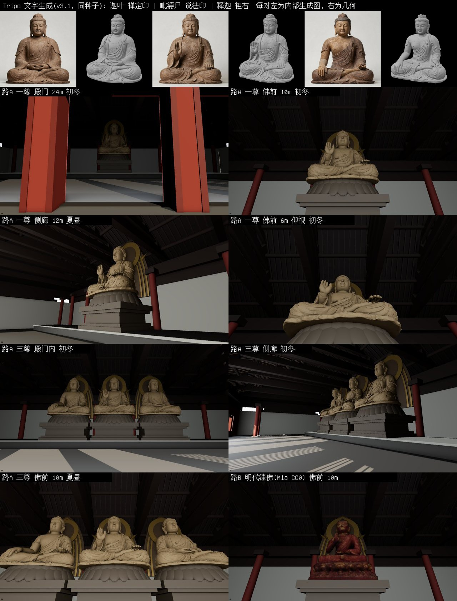

# T05 七佛造像试验（#280）

2026-11-19，分支 `claude/t05-statue-spike-280`，PR #285。只加了 `tools/` 下的试验页和脚本、`docs/t05/` 下的报告；`app/` 一行没改。

## 结论

1. **推荐路 A：Tripo 文字生成几何，颜色用我们自己的材质统一上。** 一尊放进按实测开间搭的白盒殿里，从殿门、佛前、侧廊看，尺度、面相、衣纹读得出庄严；三尊用同一套提示词和同一对种子、只换手印和衣式那一两句，远看是一家、近看各是一尊。
2. **路 B（公有领域扫描）走不通。** 没有辽、金、北宋的 CC0 坐佛扫描；能用的几件不是辽式，手不能改（改手印就是雕刻）。
3. **七尊的花费**：几何每尊 10 点，按一半要重出一次估约 **110 点（约 1.1 美元）**，加离线处理和逐尊验手印约 **2–3 人日**；另有一项新代码：给像分区上色的掩码（约 1–2 人日，见「最大的未解问题」）。
4. **要顾问**：七尊里有四尊的手印只有一个来源不明的网页，释迦的手印有四种说法；经典本身不规定七佛手印。见 `statue-spike-research.md` 第三节。

原图、录像、模型怎么取，见 `evidence/statue-spike/README.md`。

## 白盒殿

`tools/t05-hall/`，单独一页，用的是项目里同一个 three（r186）。`node tools/t05-hall.cjs <spec.json>` 出图、出录像、记三角形数；三份 spec 在 `tools/t05-hall/specs/`。

- **按实测**：开间 4.98 / 4.98 / 5.26 / 5.80 ×3 / 5.26 / 4.98 / 4.98 m（`ARCHITECTURE.md` §2.1），进深 25.13 m 按五间均分；殿内地面 +3、院子 0。
- **按调研包「可由主创定」**：佛坛 37.5 × 4.8 × 0.87 m；七个座位在 x = 0、±5.80、±11.33、±16.45。
- **白盒自拟**（都标在代码注释里）：
  - 佛坛前沿在 z = −15.5（殿门内约 15 m）。从月台上殿门中轴 z = +6 处看中尊约 24 m，对上 issue 的「约 25 米」。
  - 内柱：后排一整排立在佛坛后沿，前排只在两端各两根（减柱的意思，柱位未测）。
  - 门 4.6 × 5.3 m，窗 3.0 m 宽、直棂。
  - 屋架：四级梁、六道槫、椽，体块。屋面按庑殿的举折做。
- **座和像的比例**（第一次做错了，改过）：
  - 先按通高 9 m 缩放，座只有 1.4 m，像身宽到约 7 m，三尊膝盖挤在一起。
  - 王南等 2021 读奉国寺七佛「高宽比近 3∶2」，指的是连座。温玉清记七佛「结跏趺坐于约 90 厘米高的砖坛及仰莲佛座之上」。
  - 所以改成：须弥座 2.0 m + 仰莲座 1.0 m + 像身约 6 m。像宽约 5.5 m，正好填满 5.8 m 的开间，相邻两尊之间留约 0.3 m。
  - 座高 3 m 是白盒的取舍，奉国寺实测未核。
- **背光**：每尊一面尖拱形身光加头光，暗金。圈数、火焰尖的有无、头光大小是逐尊不同的地方。
- **光**：太阳是唯一投影的光。门窗各有一块朝内的面光，颜色取天色。佛坛前地面有一块朝上的暖灰面光，代替地面反光（这里不算间接光）。殿外材质加一点天光补色。
  - 夏昼：太阳高 68°，进不了殿。
  - 初冬晴冷：约 12 月初 09:45，北纬 41.5°，太阳高 17°、方位 152°。阳光从门窗斜着铺进殿里，直棂窗的影子落在地上。
  - 曝光按「眼睛适应了殿内」给（殿内约是殿门的 4 倍），不是物理亮度。
  - 软件渲染，加 GTAO。

## 路线比较

| | 路 A：Tripo 文字生成 | 路 B：公有领域扫描 | 路 C：程序生成 |
| --- | --- | --- | --- |
| 试的是 | 毗婆尸、迦叶、释迦三尊（v3.1，无贴图）；毗婆尸另加一次 Tripo 贴图 | Mia 明代漆佛 `buddha-lacquer.glb`（项目已有）；另放进殿看过 Freer 唐坐佛、雷峰塔像 | 没做（理由见下） |
| 花了多少 | 40 点（4 个任务，各 10 点）；每个任务 3–4 分钟 | 0 点；查库约 6 分钟（并行），下载两件 19 MB | — |
| 面数 | 原件每尊约 148 万面，减到 6 万面（`tools/t05-statue.mjs`，meshoptimizer） | 漆佛 4 万面（`tools/statues.py` 早先减的）；唐坐佛原件 30 万、雷峰塔 19 万 | — |
| 贴图 | 无贴图：0，颜色用我们的材质。带贴图：Tripo 给 2048² 的颜色、法线、金属粗糙度三张，减到 6 万面的 GLB 是 10.1 MB | 漆佛：顶点色，无贴图 | — |
| 离线步骤 | 焊点 → 减面 → 重算法线（一条命令）；转 90°（Tripo 面朝 +x）；按开间限宽 | 归一、减面、烘顶点色（`statues.py`）；唐坐佛要补两条前臂和手，雷峰塔像要切掉连体的背光和莲座 | — |
| 许可 | Tripo 条款 2025-07-11 版 §5.2.2：付费产出可商用，无署名要求（同 `novice-spike.md`） | 漆佛：CC0，馆方。唐坐佛：CC0，但是扫描者自己声明的，馆方另标「usage conditions apply」（未核）。雷峰塔：CC BY 4.0，要署名，馆方权利未核 | — |
| 改得了手印吗 | 能：换提示词里那一句，10 点重出 | 不能：要在雕刻软件里重做手和前臂 | 能，但要先能做出手 |

**为什么没做路 C。** issue 写明路 C「只作对照，预期最难出庄严感」。路 A 用 40 点就做出了三尊可比的像，路 C 至少要从头写一副能结手印的人体，花在它上面的工夫这次换不来新结论。按 issue 的「可只做 A 加 C」反过来，这次做的是 A 加 B。

## 一尊的判断（选路 A 的毗婆尸）

图：殿门（月台上中轴，约 24 m）、佛前 6 m 仰视、侧廊约 12 m 斜看，各有夏昼和初冬晴冷两张。另加一张佛前 10 m，因为 6 m 看出了问题，见下。录像是第一人称，眼高 1.6 m：从月台走进殿门，到佛前 6 m 停下，再慢慢抬头看脸。

- **尺度**：从殿门看，像在门框里，座比人高，脸在暗处。走近以后，像身大约三分之二在头顶以上。这一点成立。
- **比例和衣纹**：面相圆满，螺发，肉髻平缓；袈裟的衣褶是平行的深沟，和调研里说的辽像特征（面形圆鼓、两肩宽厚、衣褶多）对得上。上身比辽像（应县木塔大佛头身比 1∶3–1∶3.25）略短略宽，盘腿铺得开。
- **面相**：素泥材质加 GTAO，在侧廊和 10 m 处读得出眉眼和嘴角。佛前 6 m 往上看，脸被下巴和胸压短了。这是近处仰视本来的样子，不是模型的毛病。
- **手印**：说法印的右手在三处都读得出。放在膝上的左手，6 m 处被膝盖和仰莲座的边挡住。
- **发现：6 m 太近。** 座顶在人眼以上约 2.3 m，站 6 m 只看得见像的上半身。到 10 m，座、像身、手、脸一张里全有。T05 的礼佛位置宜在佛前 8–10 m（调研包写的佛坛前礼佛带也是 8–10 m）。
- **两季**：殿内主要差在地上那几道太阳。冬天低角度的阳光铺到佛坛前；夏天进不来，殿内更平。像本身两季看起来差不多，因为照亮它的主要是门光和地面反光。

**路 B 的漆佛**：形体完整、手也完整，但样式是藏传的五方佛（宝冠式的坐姿和衣边），红漆在暗殿里比素泥难读。它能作「先有一尊像占位」的东西，不能作七佛的底子。

## 三尊的判断（同一条路 A）

三尊并排在 x = 0、±5.80：中尊毗婆尸，东（观者右）迦叶，西（观者左）释迦。为什么选这三尊而不是奉国寺实际在 ±5.80 的尸弃和毗舍浮：这三尊的手印和衣式出处最可靠（迦叶禅定印、毗婆尸说法印、释迦袒右与愿印）。尸弃、毗舍浮的手印只有一个来源不明的网页。所以这次只看三种手印、两种衣式并排时成不成立，不是排位提案。

**统一的是什么**：
- 同一段提示词（时代、材质、坐姿、面相、螺发、肉髻、衣褶的写法都一样）。
- 同一个 `image_seed` 和 `model_seed`（2801）。
- 同一个减面预算（6 万面）、同一种素泥材质、同一种须弥座和仰莲座、同一种背光的形制。
- 结果：三张脸是同一家的，肩宽、腿的铺法、衣褶的深浅一致。

**区别的是什么**：
- 手印：说法印、禅定印、按膝。
- 衣式：释迦袒右，另两尊通肩。
- 释迦整尊向西偏 7°（奉国寺释迦「脸稍向西偏」，二手）。
- 背光：中尊三圈加九个火焰尖，迦叶两圈，释迦四圈、头光小一号。
- 高度：中尊通高 9.0 m，两侧 8.8 m。
- 结果：殿门那张三尊是一组；侧廊那张一尊一尊看得出不同；10 m 那张手印都读得出。

**没做到的**：
- **释迦的手印不对。** 提示词要的是与愿印（掌心朝外、指尖向下），出来的是右手掌心向下按在膝上，更像触地印。Tripo 照提示词出手印不可靠，正式做七尊时每尊要看图验收，不对就重出（再 10 点）。这次留了 20 点没用，就是为它；但手印该是哪一种本身就有四说，先等顾问再重出更省。
- 胸衣纹样（调研包写「花纹 / 龙纹」）没有做：出处未核，见研究记录。
- 头向只能整尊转。真要只转头，要分件或手修。

## 性能

T4 上实测（`tools/t05-gpu.sh`，Hugging Face Job，`ANGLE (NVIDIA, Vulkan 1.4.357 (NVIDIA Tesla T4))`，1080p）。帧耗是让显卡画完每一帧的平均毫秒数，120 帧，同站点 `__cost` 的量法。七尊是把三尊的文件重复摆满七个座位，是七尊这个面数的开销，不是七尊的设计。三角形数是一帧里的数（软件渲染量，与显卡无关）：只算场景那一遍，不算 GTAO 为法线另画的那一遍，也不算只在换光时画一次的阴影贴图。

| | 一帧三角形（殿门内 / 侧廊） | 绘制次数 | T4 一帧（开 GTAO，殿门内 / 侧廊） | T4 一帧（关 GTAO） |
| --- | --- | --- | --- | --- |
| 空殿（白盒） | 1.3 万 / 1.4 万 | 129 / 184 | 3.61 / 2.85 ms | — |
| 一尊 | 8.3 万 / 8.4 万 | 142 / 197 | 2.75 / 3.17 ms | — |
| 三尊 | 22.2 万 / 22.3 万 | 168 / 223 | 4.29 / 3.79 ms | — |
| 七尊 | 50.1 万 / 49.3 万 | 220 / 265 | 4.75 / 5.57 ms | 1.36 / 2.11 ms |

- **每尊约 7 万三角形**：像 6 万，须弥座、仰莲座和背光约 1 万。七尊约 50 万，比 T00 第一进院高档的 110–190 万少一半以上。T05 的院落和殿身（辽式斗拱、梁架、彩画）还没算进去。
- **七尊在 T4 上只多 1–2 ms。** 空殿开 GTAO 已经 3 ms（大半是 GTAO 本身），关 GTAO 时七尊 1.4–2.1 ms。T00 首院高档 9.3 ms（`CLAUDE.md`）。
- 空殿和一尊两行的耗时有高有低，差在 0.5 ms 以内，是量的误差范围。
- 没有量手机。
- `report.json` 里的三角形和绘制次数，量的时候把阴影贴图那一遍也算进去了（第一帧要画）。上表的三角形数是改正后在软件渲染里重量的；毫秒数不受影响，因为 `cost()` 先画一帧再计时。

**LOD 建议**：近 6 万、中 2 万、远 6 千，三档都用同一条减面命令出。殿门那张里七尊同时在画面上，要靠中、远档。

## 七尊要多少

| 项 | 估计 | 依据 |
| --- | --- | --- |
| Tripo 几何 | 7 × 10 = 70 点；按一半要重出一次，约 110 点 | 本次 3 尊 3 次出成 2 尊半（释迦手印要重出） |
| 贴图 | 0 点 | 不用 Tripo 贴图（见下） |
| 离线：减面、三档 LOD、转向、限宽 | 每尊几分钟，一条命令 | `tools/t05-statue.mjs` |
| 逐尊验手印、出图 | 每尊约 0.5 小时 | 本次 |
| 分区上色的掩码（面、手、袈裟、胸衣、裙） | 新代码约 1–2 人日；每尊画掩码约 1 小时 | 未做，估计 |
| 合计 | 约 110 点（1.1 美元）、2–3 人日加掩码代码 | |

**为什么不用 Tripo 的贴图**：
- 它把像画成了褐色的风化泥木，进了暗殿比素泥更难读（`evidence/statue-spike/tex-vs-clay.png`）。
- 七尊各画各的，颜色和旧痕不会一致，正好破坏「统一」。
- 奉国寺是彩塑：面贴金、袈裟赭红、胸衣有纹样。这些要由我们的材质统一画，才和殿里的彩画、壁画是一套颜色（`ART.md` 的赭红、暗金、矿物绿）。

## 最大的未解问题

1. **手印：该是什么、做没做对。** 该是什么要顾问；做没做对要逐尊看图。Tripo 不保证照提示词出手印。
2. **上色。** 没有贴图的几何只能整尊一个颜色。彩塑要分区：面、手、袈裟、内衣、胸衣、裙。办法有两个，都还没试：
   - 在模型上画顶点色掩码（手工，每尊约 1 小时）；
   - 按 Tripo 的分件或分割接口切开（Segmentation 40 点一次，七尊要 280 点，超出本次预算，也未必切得准）。
3. **辽像的比例。** Tripo 的像上身偏短、膝间偏宽。奉国寺两端几尊高宽比趋于 8∶5，比中尊更瘦。提示词里还没写进这一条，下一轮可以试「上身修长、两膝收窄」，每尊 10 点。
4. **近处仰视。** 6 万面在 6 m 处，手指和衣褶边缘能看出减面的折角，要么近档留到 10 万面，要么像正式那样加法线贴图。

## 七尊这条路成立以后，殿内光比和大空间还剩多大风险（只写判断，没有做）

主创在 #280 的更正评论里要的。判断依据是这次白盒里看到的，没有为它另做试验。

- **殿内光比：中等风险，主要在「走进去」那几秒。**
  - 白盒里殿内要比殿门外多给约 2 EV 的曝光（殿门那张 1.15，殿内 4.5–5），才读得出像。读得出还靠两样手放的东西：佛坛前一块假的地面反光，和 GTAO。
  - 这一殿是静止的，可以离线烘一张光照图或几个光照探针来代替手放的补光。这是现成的做法，难度不大。
  - 真正没有的是**曝光随人走动渐变**（人眼适应）。T00 进殿隔着一道纱幕换房间，从来不需要它；T05 是从亮院子一步一步走进暗殿，中间不切。three 没有现成的自动曝光，要自己写（按画面平均亮度慢慢追）。录像里的曝光是按位置手写的渐变，不是这个。
- **大空间：低到中等风险。**
  - 相机、近裁面：48×25×16 m 比 T00 的房间宽敞得多，第三人称的眼睛在殿里更不容易撞到东西。风险低。
  - 碰撞：佛坛当一个实体就够，不必碰像。风险低。
  - 真正的风险在**殿和院子要在同一个场景里画**：从月台上就看得见殿内（录像第一帧），不能像 T00 那样把房间放到地下、隔纱幕换。所以七佛、十六尊胁侍和天王、八缝梁架要和院落、殿身同一帧画。
  - 本次七尊连座和背光，在没合批的白盒里是 220 次绘制（殿门内视角）。加上胁侍和梁架，要靠合批和 LOD 压住。
  - 建议：T05 立项时先做「院子 + 殿身 + 殿内体块 + 七尊三档 LOD」一帧的 T4 实测，再定胁侍的面数。

## 要所有者定的

1. **路线**：建议路 A（Tripo 几何 + 自己的材质）。理由：花得少、改得动、三尊已经统一；路 B 没有合适的底子；委托雕塑师留给路 A 也不过的时候。
2. **预算**：七尊约 110 点。当前余额 80 点，要买点数，所有者定。
3. **顾问**：建议请。只核手印、衣式、尊格三项，对照正面照片逐尊过一遍。或者所有者定「手印按原创演绎」，在 `SOURCES.md` 写「自拟」，但释迦袒右、迦叶禅定印、毗婆尸说法印这三条有出处的照做。

## 和 issue / 调研包有出入的地方

- **「中央佛高 9.0 米」** 我按连座的通高算（须弥座 + 仰莲座 + 像身）。按像身 9 m 算，像宽约 8.3 m，放不进 5.8 m 的开间。
- **「佛坛前（约 6 米、仰视）」** 照做了，但结论是 6 m 太近，建议礼佛位置定在 8–10 m。
- **三尊的身份**：issue 写「中央与左右各一」，没指定是谁。这次选的是出处最可靠的三尊，不是奉国寺在 ±5.80 的那两尊，理由见上。
- **调研包 `CULTURE.md` §2.3**：「胸衣花纹 / 龙纹」没找到出处，应改成未核；「拘留孙、尸弃待核」应扩为四尊（加毗舍浮、拘那含牟尼）只有一个来源不明的网页；「迦叶通肩」与另一说「袒右」冲突。
- **资产表**：调研包的 `ASSETS.md` 还在 PR #176 里没合并，所以本 PR 的许可登记放在 `docs/t05/statue-spike-assets.csv`，#176 合并后并进它的 `asset-register.csv`。

## 连带影响（二阶、三阶）

- **别的模块**：
  - 本 PR 一个都没动。
  - 将来接入时，`buildSevenBuddhas` 要读三档 LOD 和掩码。
  - 碰撞：像在佛坛上，只要佛坛是实体就够，不碰像。
  - 镜头：礼佛位置定在 8–10 m，牵连 `camera-manifest.json` 的 CAM-03、CAM-06 和观察页的触发距离。
- **玩家**：现在无。将来七尊各有手印，观察页「七点」那一页就有东西可看。
- **多出来要同步的东西**：
  - 每尊一份提示词、一对种子、一个任务号（`tools/out/t05/tripo/ledger.json` 的格式），要进 T05 的资产登记表。
  - 种子换了，整组的「一家人」就散了。所以种子和提示词骨架要当作资产的一部分保存，不是一次性的。
- **一年后**：
  - Tripo 的 `v3.1-20260211` 下线或换版以后，同一种子未必出同一个像。所以第一次出成的原始 GLB（每尊约 42 MB）要存在私有桶里，不能指望重出。
  - 本次的四个原件已存，见证据 README。
  - v2 接口已有迁移指南（v3 在 `openapi.tripo3d.ai`）。代理目前只接了 `api.tripo3d.ai`，v2 下线前要请主创把 v3 域名加进环境。

## 花费

- Tripo：40 点（上限 60）。四个任务号和每个文件的 SHA-256 在 `evidence/statue-spike/tripo-ledger.json`。
- T4：一次，job `6afeec214fdc5ab3c55997d0`，排队约 3 分钟、运行几分钟（约 0.05 美元）。
- 时间：2026-11-19 12:05 起。查资料两路并行约 10 分钟，Tripo 每个任务 3–4 分钟，软件渲染出图每张 4–7 秒，录像约 30 分钟。
