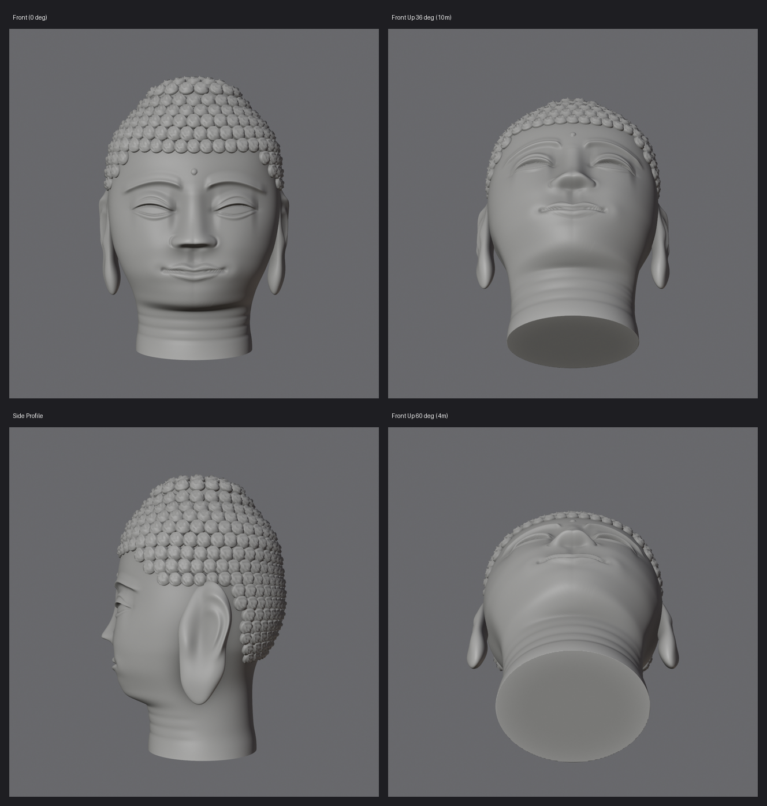

# T05 七尊共用佛头 — Gemini Neon（#720）

本目录为 [issue #720](https://github.com/bolechen/temple-walk/issues/720) 外部模型试验（Gemini Neon）的确定性无界面生成脚本与自检工具，未改动 `tools/t05-statue/` 中既有文件，GLB 不入库。

## 灰模四视图（正面平视 / 仰角 36° / 侧面 / 仰角 60°）



## 复现命令（`bpy==5.3.0`，不联网）

```sh
# 1. 生成高模 GLB（纯几何，无材质/UV/顶点色/骨骼）
python3 tools/t05-head-gemini/make_head.py /tmp/gemini_head.glb

# 2. 双次运行校验 SHA-256 逐字节一致
python3 tools/t05-head-gemini/make_head.py /tmp/gemini_head_b.glb
shasum -a 256 /tmp/gemini_head.glb /tmp/gemini_head_b.glb
# 500d162860fd7b46778e287dec90e6e5a32199e09bdbf54f5fc880812f13a085

# 3. 拓扑与定量自检
python3 tools/t05-statue/closed/topology.py /tmp/gemini_head.glb
python3 tools/t05-head-gemini/check_head.py /tmp/gemini_head.glb

# 4. 渲染灰模视图
python3 tools/t05-head-gemini/render_views.py /tmp/gemini_head.glb /tmp/gemini_views --px=1024

# 5. 两档减面与 2048 法线烘焙
node tools/t05-statue.mjs /tmp/gemini_head.glb /tmp/gemini_head_20k.glb --tris=20000 --error=0.05
node tools/t05-statue.mjs /tmp/gemini_head.glb /tmp/gemini_head_6k.glb --tris=6000 --error=0.1
python3 tools/t05-statue/closed/topology.py /tmp/gemini_head_20k.glb /tmp/gemini_head_6k.glb
python3 tools/t05-statue/bake.py /tmp/gemini_head.glb /tmp/gemini_head_20k.glb /tmp/gemini_head_20k_baked.glb --size=2048 --cage=0.03 --ray=0.08
```

## 自检汇总（精修版）

- **SHA-256（两次独立进程一致）**：`500d162860fd7b46778e287dec90e6e5a32199e09bdbf54f5fc880812f13a085`
- **面数 / 顶点**：`852,480` 三角形 / `427,076` 顶点（主头颈 634,800 面 + 双耳 + 415 颗独立闭合深纹螺发）
- **坐标系与包围盒**：Y 向上、脸朝 `+Z`、对称轴 `X = 0`、原点位于封平颈底中心；`W = 1.5949 m`、`H = 2.2000 m`、`D = 1.4896 m`（宽高比 `0.725`，净头高比 `~0.77`）；脸部对称最大误差 `0.0000 mm`
- **水密拓扑（高模）**：`boundary_edges = 0`、`nonmanifold_edges = 0`、`pieces_of_10_faces_or_fewer = 0`、`winding_consistent = true`、全部 418 块水密
- **减面 2 万（`--error=0.05`）**：`20,000` 面（381 KB），`boundary_edges = 0`、`nonmanifold_edges = 0`、`pieces_le_10 = 0`、全水密一致
- **减面 6 千（`--error=0.1`）**：`6,000` 面（129 KB），`boundary_edges = 0`、`winding_consistent = true`、主体水密（极低面数下小螺发块产生 2 条非流形边）
- **法线烘焙（`bake.py` 2048）**：脸部 UV 岛平滑干净，眼睑与唇缝未见黑斑或大片错色
- **神情定量**：
  - 平眉无褶：眉头高 `1.312 m`、眉梢高 `1.294 m`（`+3.22° ≥ 0°`）；眉心褶深 `-0.00049` 脸宽（平滑微凸，`≤ 0.01`）
  - 半开垂目：单眼宽 `0.33 m`，睑裂开口 `~0.078 m`（`0.236` 眼宽，在 `0.2–0.3` 区间）；厚实上睑与头颅为连续单一水密网格，眼区外薄片 `0`、睑下无缝
  - 闭合花瓣唇与圆颏：嘴宽 `0.50 m`，唇凸 `lip/w = 0.001`（`≤ 0.03`）；颏唇沟深 `16.63 mm`（`3.33% w ≤ 8% w`），颏前点相对下唇 `-0.24 mm`（圆润自然对齐、无圆垫）；几何嘴缝中点 `y = 0.680 m`、嘴角 `y = 0.697 m`（`+0.034 w`）
