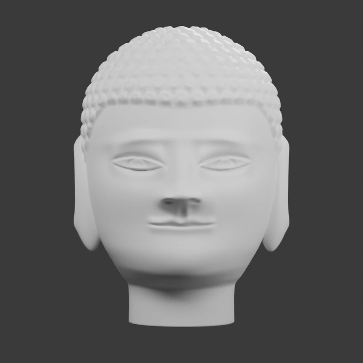
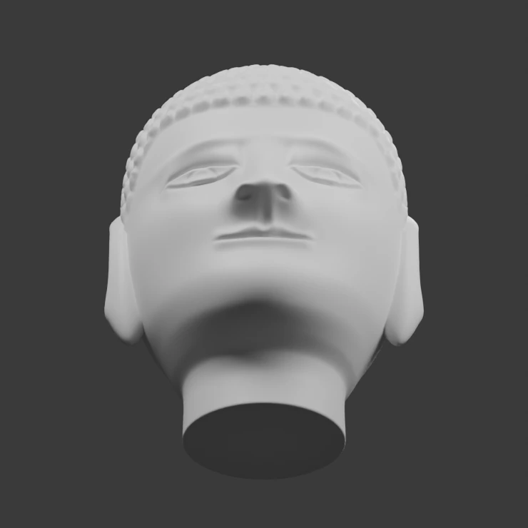
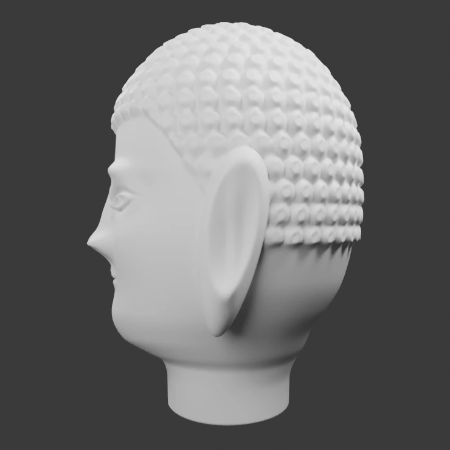
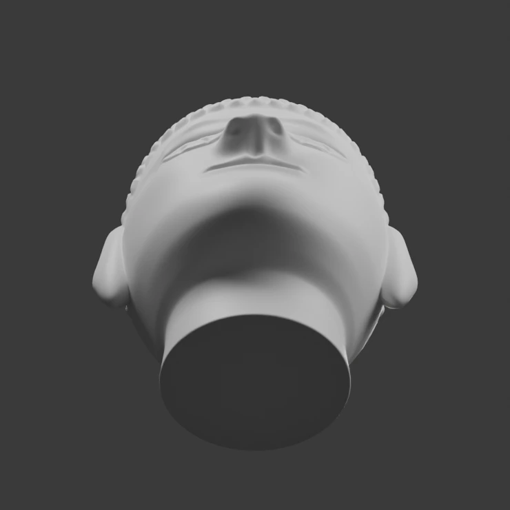

# T05 七尊共用佛头 · 第一轮

以拘留孙正、背面和毗婆尸正面定宽额、长耳与圆顶轮廓。额头前方的发际较平，螺发越过耳后逐排降到后脑。耳轮、耳甲和实心耳垂按侧影塑出，两耳在导出前并入头部。颈底封平，向上约 0.35 m 为插入身子的颈根。

神情主要靠上睑重量、唇缝和颏的侧面轮廓。上、下睑与眼球在同一张连续曲面上，垂低的虹膜只刻一道浅弧。眉头略高，眉心留平。上下唇沿同一条闭合线收向嘴角，下唇到颏只用宽缓的转面。从佛前看，鼻底与下巴的遮挡较强，垂目在这个角度比平视难辨，留给上色后的殿内审图复核。

## 生成

在装有 Python 3.13 的环境中，从本目录运行。依赖安装一次，生成过程完全离线。输出单位为米，glTF 的 Y 轴向上，脸朝 +Z，原点在颈底中心。

```sh
python3 -m pip install bpy==5.3.0
python3 make_head.py /tmp/t05-head.glb
```

GLB 只有一个网格，顶点属性为位置和法线。几何由脚本生成，参考照片只用于观察眼睑。PR 评论里的 ZIP 含原始 GLB。

## 灰模

从交付 GLB 重新导入 Blender，以同一组面光源和中性灰背景渲染。相机瞄准头部中心，距离为相机到目标的直线距离。

| 正面平视 · 10 m | 仰看 36° · 10 m |
| --- | --- |
|  |  |
| **侧面 · 3 m** | **仰看 60° · 4 m** |
|  |  |

## 第五节自查

| 项目 | 交付 GLB 实测 |
| --- | --- |
| 高模 | 490,344 三角面，245,174 顶点，一个连通壳；开口边、非流形边、≤10 面碎屑各 0。绕序一致，体积 +2.673559 m³。Blender BVH 查无公共顶点三角形的交叉为 0。 |
| 包围盒 X × Y × Z | 1.6250 × 2.2124 × 1.6379 m。颈底 Y=0，宽高比 0.7345。 |
| 对称 | 以 X=0 镜像。两颊同宽；在 X=±0.150、±0.315、±0.470 m 三对眼区竖线上，从正面采样得到的左右深度差均小于 0.001 mm。布尔接耳处的三角划分可左右不同。 |
| 嘴与眉 | 嘴角取点 X=±0.244 m，嘴宽 0.488 m。眉头、眉梢到中央嘴缝的高度差分别为 0.623、0.590 m。按标称嘴宽 0.50 m 归一化，唇凸为 0.010，左右嘴角升高均为 0.030。双侧眉头比眉梢高 0.033 m，眉心褶深约 0。 |
| 睑裂 | 眼宽设计值 0.418 m；右眼中央射线剖面取上下睑缘 Y=1.237、1.139 m，开口 0.098 m，比例 0.234。 |
| 颏 | 仓库正中剖面量具测得颏唇沟深 9.9 mm，颏前点比下唇前点突出 9.9 mm。与释迦原型的相对门槛留待同口径复核。 |
| 复现 | macOS arm64，Python 3.13.15，bpy 5.3.0，两个独立进程的 GLB 逐字节相同。SHA-256 为 `652a5c4f0cd8f653a4274ae961f7fc25f7fe1bd2237977ec23c38442664bfcf1`。 |

在仓库根目录运行以下命令复查。近档直接从高模减到 20,000 面会产生一条非流形边，经 60,000 面中间档再减可避开；远档从高模直接减到 6,000 面。两条列出的路径均得到一个水密壳，开口、非流形边和碎屑均为零。

```sh
node tools/t05-statue.mjs /tmp/t05-head.glb /tmp/t05-mid.glb --tris=60000 --error=0.05
node tools/t05-statue.mjs /tmp/t05-mid.glb /tmp/t05-near.glb --tris=20000 --error=0.05
node tools/t05-statue.mjs /tmp/t05-head.glb /tmp/t05-far.glb --tris=6000 --error=0.1
python3 tools/t05-statue/closed/topology.py /tmp/t05-{head,near,far}.glb
python3 tools/t05-statue/bake.py /tmp/t05-head.glb /tmp/t05-near.glb /tmp/t05-baked.glb --size=2048 --cage=0.012 --ray=0.035
```

2048 切线空间法线已烘到近档，在重新导入的近档模型上检查过正面与仰视，睑下、唇缝未见大片错色或黑斑。烘焙测试产生的中间文件在仓库外。独立审形、装身后六机位的颈口、七尊同场的神情、实际压缩包体和 T4 帧耗留给接入评审。
